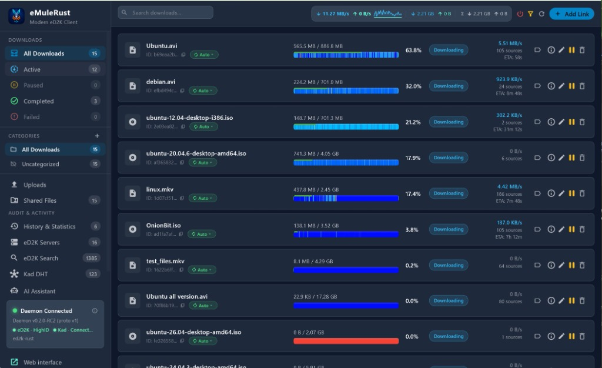

<div align="center">


# Pulse Core

**Reinvención moderna y asíncrona en Rust de las redes eMule (eD2K + Kad DHT) y Torrent, con protocolo PC26, automatización multimedia nativa, centro de notificaciones e interfaz web integrada.**

[](LICENSE)
[](docs/CHANGELOG.md)
[](README.md)
[](Cargo.toml)
[](wiki/Home.md)
[-red)](README.md)

<br/>

[📖 Wiki Oficial](wiki/Home.md) • [Características](#-qué-hace-diferente-a-pulse-core) • [Interfaz Web](#-interfaz-web-integrada) • [Puertos y Red](#-configuración-de-red-y-puertos) • [Arquitectura](#-arquitectura-del-workspace) • [Inicio Rápido](#-inicio-rápido) • [Reportar un error](#-antes-de-reportar-un-error)

</div>

---

> [](README.md)
>
> **Desarrollo técnico riguroso:** Pulse Core es una reimplementación limpia creada en simbiosis entre ingeniería humana experta y agentes de IA avanzados. La totalidad del código, los comentarios y la documentación están redactados en **español de España**, siguiendo estándares inflexibles de seguridad de memoria en Rust: sin pánicos en producción, sin advertencias del compilador (`-D warnings`), con fidelidad milimétrica a las fuentes de eMule 0.72a —complementada con la capa criptográfica moderna `PC26`— y suites de prueba consolidadas que se ejecutan 100 % sin conexión a Internet.

El cliente original de eMule nació en 2002 sobre C++ y MFC para Windows de 32 bits, sufriendo los bloqueos de interfaz y las fugas de memoria típicas de la época. **Pulse Core** traslada toda esa herencia a la era moderna: un único binario ligero y asíncrono (`mule-daemon`) basado en **Tokio** y **Axum** que unifica los protocolos **eD2K**, la red DHT **Kademlia de 128 bits** y enjambres **Torrent** en un mismo bucle de eventos sin bloqueo.

Está especialmente diseñado para **servidores domésticos, microservidores, NAS (Synology, QNAP, TrueNAS, Unraid) y Raspberry Pi**: opera de manera 100 % *headless* (sin necesidad de monitor ni interfaz gráfica instalada en el sistema) con un consumo mínimo de apenas ~45 MB de RAM en reposo, administrable de forma remota y segura a través de su panel web embebido. En equipos de sobremesa con Windows 10/11, se integra de forma transparente en la bandeja del sistema.

> [](README.md)
>
> **Estado actual del proyecto (`v0.4.0-beta.5`):** El núcleo operativo y la infraestructura de servidor están completos y probados: identificación eD2K (MD4 + AICH + SUI V2/V3), perfil de transporte moderno `PC26` (`X25519 + ML-KEM-768`, `ChaCha20-Poly1305` y `QUIC`), endurecimiento de Kad DHT para WAN (defensa anti-Sybil y cliente *LowID Buddy*), política fija «Solo Vídeo», centro de notificaciones multicanal, actualizador híbrido con *rollback* `O(1)`, guardián de montajes NFS/NAS, interfaz web con telemetría de ancho de banda en tiempo real y organización mediante enlaces duros. Actualmente seguimos afinando la contención de ancho de banda en descargas concurrentes masivas y la convergencia de fuentes en enjambres híbridos.
>
> **Entornos validados:** Probado con éxito en estaciones de trabajo AMD Ryzen / Intel Core bajo Windows 10/11 x64, Linux x86_64 (Arch, Debian, Ubuntu) y procesadores ARM64 (Raspberry Pi 4 y 5 bajo Raspberry Pi OS, con consumos inferiores a ~45 MB de RAM en reposo).

> [](README.md)
>
> **Panel Web instantáneo sin dependencias:** No necesitas Node.js, Docker ni servidores HTTP externos para controlar Pulse Core. Inicia el daemon y abre de inmediato en tu navegador **`http://127.0.0.1:4660`** para supervisar transferencias y gráficas de tráfico mediante WebSockets, añadir enlaces `ed2k://` o `magnet:?` al vuelo, recibir alertas y gestionar el catálogo multimedia sin latencia.
>
> Para colaborar o inspeccionar las decisiones de diseño, consulta [`docs/INDEX.md`](docs/INDEX.md) y [`AGENTS.md`](AGENTS.md). Recuerda que cualquier aportación debe superar la validación inteligente (`python3 scripts/smart_test.py --mode smart`), la suite completa (`cargo test --workspace --all-features --lib --tests`) y `clippy` sin advertencias.

> [](README.md)
>
> **Neutralidad tecnológica absoluta:** Pulse Core **no incluye, no aloja, no indexa ni proporciona acceso a ningún archivo, película, serie o material con derechos de autor**. No suministra listas de servidores de terceros ni rastreadores preconfigurados. Es un motor de transporte de datos agnóstico y descentralizado; el uso y la legalidad del material descargado son responsabilidad exclusiva del usuario final.

---

## 🖥️ Interfaz Web integrada

El servicio incorpora un panel de control web reactivo y moderno servido directamente en el puerto `4660`, sin dependencias externas:

<div align="center">
  
  <p><em>Panel de control reactivo en tiempo real servido nativamente por <code>mule-daemon</code> (Axum + WebSockets).</em></p>
</div>

Además de la gestión de descargas, búsquedas, servidores eD2K, red Kad y biblioteca Cine & Series, la WebUI integra:
- **Monitor interactivo de ancho de banda y tráfico P2P**: gráfica SVG de hasta 10 minutos con ventanas configurables, picos, medias y desglose por protocolo (`eD2K/Kad` y `Torrent`).
- **Centro de notificaciones en tiempo real**: campana animada con contador de no leídos, *toasts* no intrusivos, filtros por severidad y configuración directa de canales externos.
- **Estado de montajes NFS/NAS y actualización en caliente**: diagnóstico del almacenamiento de red y modal *Drag & Drop* para instalar nuevas compilaciones locales o revertir al binario anterior con un clic.

---

## ⚡ Qué hace diferente a Pulse Core

### 1. Dos redes en un solo motor asíncrono y estándar Pulse Core 2026 (`PC26`)
Descarga y comparte piezas simultáneamente entre clientes clásicos de eMule (`0.72a` / `aMule`, con compatibilidad total y almacenamiento disperso validado mediante sumas MD4 y árboles AICH) y enjambres modernos de **Torrent** (`uTP` BEP 29, Dual-Stack IPv6 y `fastresume`). Sobre la pila clásica retrocompatible incorpora además el perfil moderno **[Pulse Core 2026 (`PC26`)](docs/ed2k/decisions/0005-negociacion-pares-2026.md)**:
- **Transporte cifrado `PC26-AEAD` y post-cuántico**: intercambio efímero `X25519` e híbrido `X25519 + ML-KEM-768` (FIPS 203) con `ChaCha20-Poly1305`, identidad `Ed25519` (SUI v3), compresión `Zstd` acotada, verificación Merkle `BLAKE3/SHA-256`, transporte **QUIC** (RFC 9000), *pipelining* adaptativo por BDP y estimador `LEDBAT++` pasivo.
- **Conectividad NAT y Dual-Stack**: cascada automática de apertura de puertos (`UPnP IGD → PCP → NAT-PMP`), *pinholes* IPv6, conexión saliente con Happy Eyeballs v2 (RFC 8305) y perforación simultánea UDP (`PCHP`).
- **Kad DHT endurecido para WAN**: cliente completo **LowID Buddy** (`0x51`, enlace TCP con ofuscación RC4 opcional, latidos y callbacks), límites globales anti-Sybil por IP y subred `/24`, revalidación periódica LRU y publicación de palabras clave por lotes.

### 2. Organización multimedia propia y protección de montajes NAS / NFS
Pulse Core incorpora su propio motor de gestión de medios sin depender de programas de terceros ni servicios externos:
- **Actualización y mejora progresiva de calidades**: supervisa activamente el catálogo de medios local. Cuando detecta una versión con mayor resolución, mejor códec o calidad superior para una película o serie ya descargada, la captura automáticamente, la descarga y actualiza la biblioteca sustituyendo el enlace de forma transparente.
- **Enlaces duros sin duplicar espacio (`hard_link`)**: organiza y clasifica automáticamente las descargas finalizadas en la estructura requerida por gestores como Plex o Jellyfin (`Movies/Título (Año)/...`) sin consumir ni un solo megabyte extra en disco.
- **Guardián de montajes NFS / NAS (`nfs_mount`)**: inspecciona `/proc/mounts`, `/etc/fstab` y la disponibilidad TCP en el puerto `2049` antes de crear directorios o transferir archivos, evitando saturar accidentalmente la tarjeta SD o el disco local si el NAS se encuentra desmontado.
- **Sincronización de subtítulos y puntuación inteligente**: cliente REST integrado con OpenSubtitles (VLSub) que calcula el hash exacto de 64 bits (`primeros 64 KB + últimos 64 KB + tamaño`) para descargar y normalizar a UTF-8 el subtítulo `.es.srt` sincronizado al milisegundo, junto con algoritmos propios de filtrado y descarte de falsos positivos.

### 3. Política estricta «Solo Vídeo» e inspección en vuelo (`ADR 0006`)
Pulse Core aplica de forma fija en compilación la **[Política de Contenido «Solo Vídeo»](docs/ed2k/decisions/0006-politica-contenido-solo-video.md)** centralizada en `mule_network_policy::content_policy`, sin opciones para desactivarla y con cuatro puertas defensivas:
- **Admisión y búsquedas**: bloqueo nominal de ejecutables, archivos comprimidos, imágenes de disco o dobles extensiones engañosas (`pelicula.exe.mkv`) en búsquedas eD2K/Kad/Torznab y al añadir enlaces.
- **Inspección binaria temprana en vuelo**: al completarse y verificarse por MD4 la parte 0, valida en memoria la cabecera real del contenedor de vídeo antes de consolidar la descarga.
- **Prefinalización, compartidos y Torrent**: exige cabeceras válidas al importar `.part.met`, compartir carpetas o admitir torrents multifichero (seleccionando exclusivamente pistas de vídeo y sus subtítulos acompañantes).

### 4. Centro de notificaciones y alertas *Push* multicanal
Mantiene un registro histórico filtrable en SQLite con entregas en tiempo real hacia la WebUI (`event.notificationCreated`) y soporte nativo para canales externos protegidos contra SSRF (**Telegram, Discord, Gotify, ntfy, Pushover y Webhook genérico**), incluyendo horarios silenciosos configurables y redacción segura de credenciales.

### 5. Actualización híbrida en caliente con *Rollback* `O(1)`
Diseñado para mantenerse al día en servidores domésticos sin fricción:
- **Autoactualización y subida local autenticada**: comprobación oficial bajo `NetworkPolicyManager` y endpoint autenticado (`POST /api/system/upload-update`) con validación estricta de cabeceras `ELF64` (`x86_64` / `aarch64`) o `PE`.
- **Respaldo instantáneo `.old` e integración `systemd`**: guarda la versión previa mediante enlace duro en Unix para revertir con un clic desde la WebUI, `mule-cli update rollback` o `scripts/update_linux.sh`, liberando el bloqueo de directorio al reiniciar bajo `systemd`.

### 6. Control por Inteligencia Artificial (Servidor MCP + Asistente LLM local)
- **Servidor MCP (`mule-mcp`) con 98 herramientas**: expone todo el control del daemon mediante *Model Context Protocol* para asistentes como Antigravity, Claude Code o Gemini CLI, con clasificación por nivel de riesgo (`Read`, `Mutate`, `Destructive`) y filtrado estricto mediante perfiles `--tool-profile` (`read`, `safe`, `full`).
- **Orquestador LLM local (`mule-assistant`)**: permite interactuar en lenguaje natural contra modelos locales en loopback (Ollama o `llama.cpp` vía `/api/chat`), solicitando confirmación explícita ante acciones destructivas.

### 7. Seguridad de red sin concesiones
- **Aislamiento Loopback y Anti-SSRF**: ningún paquete malicioso ni redirección HTTP puede forzar al daemon a escanear tu red local o comunicarse con servicios internos protegidos.
- **Filtrado dinámico de IPs (`ipfilter.dat`) unificado**: descarte inmediato de rangos sospechosos compartido de forma atómica entre eD2K/Kad y el motor Torrent.
- **Cuotas pre-handshake e interruptor de corte atómico (*kill switch*)**: limitación simultánea por subred (`/24` en IPv4 y `/48` en IPv6) con tiempos de espera estrictos y cierre fulminante de todo el tráfico ante cualquier anomalía.

---

## 🌐 Configuración de red y puertos

Para despliegues domésticos, servidores dedicados o contenedores NAS, estos son los puertos estándar utilizados por el motor:

| Puerto por defecto | Protocolo | Servicio | Función |
| :---: | :---: | :--- | :--- |
| **`4660`** | TCP | WebUI & JSON-RPC | Panel de control web en navegador y APIs de control local. |
| **`39735`** | TCP | Transferencias eD2K | Conexión con clientes eDonkey/eMule para descarga y subida. |
| **`39737`** | UDP | Kademlia (Kad DHT) | Búsqueda descentralizada de fuentes y enrutamiento global. |
| **`6881`** | TCP / UDP | Transferencias Torrent | Tráfico del enjambre Torrent y negociación de piezas. |

*(Todos los puertos son configurables en caliente o mediante variables de entorno).*

---

## 🏗️ Arquitectura del Workspace

El proyecto está organizado en un workspace de Cargo modular de 12 crates, donde cada componente tiene una única responsabilidad bien definida:

| Crate | Rol principal |
| :--- | :--- |
| **`crates/mule-daemon`** | Servidor principal Tokio/Axum, WebUI embebida, APIs RPC/WebSocket, servicios P2P/multimedia/notificaciones, actualizador y bandeja de Windows (`src/tray.rs`). |
| **`crates/mule-protocol`** | Códecs de cable acotados eD2K/Kad y capa `PC26` (Zstd, etiquetas TLV, marcadores de ofuscación) basados en eMule 0.72a. |
| **`crates/mule-core`** | Dominio de negocio, gestor de descargas con *staging* en RAM, persistencia SQLite WAL, tabla Kademlia y motor de almacenamiento disperso. |
| **`crates/mule-torrent`** | Motor Torrent integrado (`librqbit`), política de vídeo, *fastresume* y filtrado IP unificado. |
| **`crates/mule-crypto`** | Primitivas criptográficas: MD4, AICH, RSA-384, `Ed25519`, `X25519`, `ML-KEM-768`, `ChaCha20-Poly1305` y árboles Merkle `BLAKE3/SHA-256`. |
| **`crates/mule-network-policy`** | Canalización anti-SSRF, aislamiento loopback por defecto, presupuestos de red, *kill switch* y fuente única de la política «Solo Vídeo». |
| **`crates/mule-filter`** | Filtrado de rangos IP maliciosos (`ipfilter.dat`), limitación de caudal y seudonimización. |
| **`crates/mule-format`** | Decodificación y serialización acotada de formatos clásicos (`.met`, `.dat`, enlaces eD2K). |
| **`crates/mule-mcp`** | Servidor MCP con 98 herramientas gobernadas por perfiles (`read`, `safe`, `full`) para asistentes y agentes de IA. |
| **`crates/mule-assistant`** | Orquestador LLM local en loopback (Ollama/`llama.cpp`, REPL y servidor WebSocket) sobre las herramientas MCP. |
| **`crates/mule-cli`** | CLI de control (`inspect-link`, `hash`, `make-link`, `inspect-part-met`, `inspect-known-met`, `import-amule` y `update`). |
| **`crates/mule-test-support`** | Utilidades y *fixtures* compartidos exclusivamente en pruebas de integración entre crates (100 % sin conexión). |

---

## 🚀 Inicio Rápido

### Requisitos previos
- **Rust** (`stable`, 1.80 o superior con `cargo`).
- Compilador C/C++ del sistema (MSVC en Windows, GCC o Clang en Linux).

---

### Compilación nativa con Cargo (Universal)

Puedes compilar el servicio en cualquier sistema operativo directamente con el gestor de paquetes y compilador de Rust:

```bash
# 1. Clonar el repositorio
git clone https://github.com/caraveliko/PulseCore.git
cd PulseCore

# 2. Compilar el daemon principal en modo Release
cargo build --release -p mule-daemon

# (Opcional) Compilar daemon, CLI, servidor MCP y asistente local:
cargo build --release --bin mule-daemon --bin mule-cli --bin mule-mcp --bin mule-assistant
```

Una vez finalizada la compilación, ejecuta el binario generado:

- **En Linux / Raspberry Pi (`x86_64` / `aarch64`):**
  ```bash
  ./target/release/mule-daemon
  ```
- **En Windows (CMD o PowerShell):**
  ```powershell
  .\target\release\mule-daemon.exe
  ```

Una vez iniciado el servicio, accede a la interfaz desde cualquier navegador:
> 🌐 **`http://127.0.0.1:4660`**

---

### Actualización y despliegue en Linux / Raspberry Pi (`systemd`)

Para compilar, instalar o actualizar el servicio en un host Linux local o de forma cruzada hacia una Raspberry Pi (`aarch64`) con respaldo `.old`:

```bash
# Compilar y actualizar el demonio local en 127.0.0.1
./scripts/update_linux.sh --local

# Compilación cruzada aarch64 y despliegue en Raspberry Pi (o con --ssh)
./scripts/update_linux.sh --rpi

# Consultar estado, comprobar lanzamientos o revertir al binario anterior vía CLI
./target/release/mule-cli update status
./target/release/mule-cli update rollback
```

---

### Empaquetado para distribución en Windows (Opcional)

Si deseas empaquetar una versión completa comprimida en `.zip` con scripts `.bat` de arranque automático y manifiestos SBOM:
```powershell
powershell -NoProfile -ExecutionPolicy RemoteSigned -File scripts\build_windows_server.ps1
```

---

## 🛠️ Antes de reportar un error

Para resolver cualquier problema con la mayor rapidez posible, comprueba lo siguiente antes de abrir una incidencia (*issue*):

1. **Reproducción en la rama principal**: Asegúrate de que el fallo persista en la última versión de la rama `master`.
2. **Captura de registros detallados**: Arranca el daemon activando los registros de depuración de Tokio y `tracing`:
   ```bash
   RUST_LOG=mule_daemon=debug,mule_protocol=debug,mule_core=debug ./target/release/mule-daemon
   ```
3. **Detalles del entorno**: Especifica tu sistema operativo (p. ej. *Windows 11 23H2*, *Arch Linux* o *Raspberry Pi OS*), arquitectura de procesador (`x86_64` o `aarch64`), y el subsistema afectado (eD2K, Kad, Torrent, WebUI, Notificaciones o Catalogación multimedia).
4. **Pruebas sin conexión**: Comprueba el estado de las pruebas afectadas o la suite del protocolo en bucle cerrado:
   ```bash
   python3 scripts/smart_test.py --mode smart
   cargo test -p mule-protocol --all-features
   ```

---

## 📄 Licencia y Atribución

Este proyecto se distribuye bajo la licencia **GPL-2.0-or-later**.
Consulta los archivos [`LICENSE`](LICENSE) y [`NOTICE`](NOTICE) para información sobre autoría original, licencias de terceros y referencias protocolarias.

---

## ⚖️ Exención de Responsabilidad Legal

1. **Finalidad técnica y de preservación**: **Pulse Core** es un proyecto de software libre con fines didácticos, de investigación y de preservación tecnológica de protocolos P2P históricos.
2. **Ausencia de catálogo**: El proyecto no gestiona, no promueve ni mantiene índices de contenido protegido ni servidores de intercambio de archivos.
3. **Responsabilidad exclusiva del usuario**: Corresponde al usuario asegurarse de que su utilización del software se ajusta a las leyes y regulaciones vigentes en su territorio en materia de telecomunicaciones y propiedad intelectual.
4. **Garantía**: Conforme a los términos de la licencia GPL-2.0-or-later, este software se suministra «TAL CUAL», sin ninguna garantía explícita ni implícita de rendimiento o adecuación a un fin particular.
