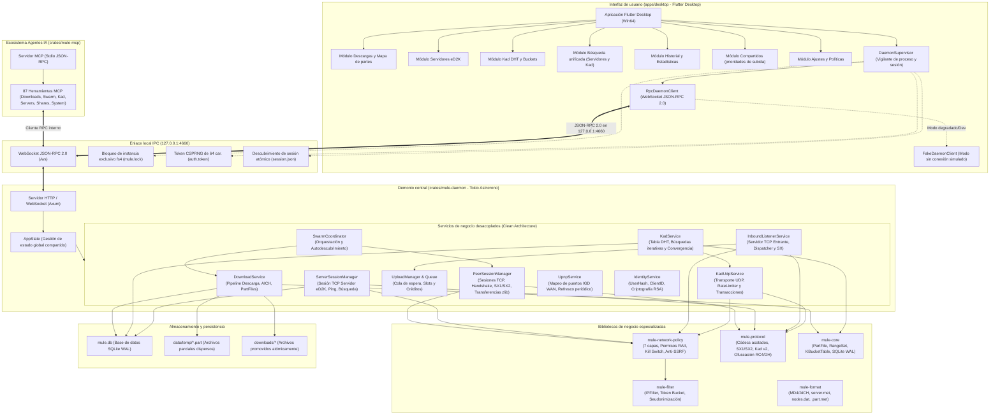

# Informe detallado: Arquitectura y estado de avance del proyecto eMuleRust

**Proyecto:** eMuleRust  
**Fecha:** 23 de septiembre de 2026  
**Versión del workspace:** `v0.2.0-RC1` (Desktop `v0.2.0-RC1+1`)  
**Autores:** Análisis de ingeniería del software y arquitectura de sistemas  
**Estado:** Documento de auditoría y síntesis técnica actualizado

---

## 1. Introducción y visión del proyecto

**eMuleRust** es una reimplementación moderna, modular y altamente segura de los protocolos históricos de intercambio entre pares **eD2K (eDonkey2000)** y de tabla de hash distribuida **Kademlia (Kad DHT)**, junto con un ecosistema de herramientas para agentes de IA mediante el protocolo **MCP (Model Context Protocol)**.

El sistema se estructura en tres componentes principales:
1. **Un motor de bajo nivel en Rust (`crates/`)**: gestor de almacenamiento disperso, códecs de red acotados, máquina de estados de protocolo, demonio local asíncrono (Tokio), swarm multifuente conforme a eMule, enrutamiento DHT Kad v2 con métrica numérica de 128 bits, persistencia SQLite WAL y política de red defensiva en 7 capas con anti-SSRF y limitación de caudal.
2. **Una interfaz gráfica de escritorio en Flutter Desktop (Windows)**: interfaz reactiva Clean Architecture (MVVM), ergonómica y modular conectada al demonio mediante un enlace bidireccional WebSocket JSON-RPC 2.0.
3. **Un servidor de herramientas para agentes de IA (`mule-mcp`)**: servidor MCP nativo que expone la totalidad del control de eMuleRust (descargas, swarm, servidores, Kad DHT, subida/compartidos, identidad y política de red) en forma de herramientas invocables por asistentes de IA.

### 1.1 Filosofía fundamental: Confinamiento y determinismo de laboratorio

El proyecto se ha construido en torno a una regla estricta de ingeniería:
* **Aislamiento loopback (`127.0.0.1`) por defecto**: ningún socket se comunica con redes públicas no controladas salvo cambio explícito de perfil de red. Los procedimientos de prueba, inyección y cualificación son 100 % reproducibles sin conexión.
* **Niveles de validación (Tiers de interoperabilidad)**:
  * **Tier 1 (Corpus estático)**: validación determinista sobre flujos de bytes reales fijos.
  * **Tier 2 (Par de referencia emulado)**: validación dinámica del handshake, los estados y la transferencia de bloques frente a un par simulado en loopback hermético.
  * **Tier 3 (Binario oficial fijado)**: validación frente al binario oficial eMule 0.50a ejecutado en bucle local estéril.
* **Garantía de cero fugas y privacidad**: anonimización sistemática de rutas del host y direcciones IP públicas en los registros y exportaciones, normalización Unicode NFC con neutralización de caracteres bidireccionales engañosos (anti-spoofing).

---

## 2. Arquitectura global del sistema

### 2.1 Esquema arquitectónico general



---

## 3. Detalle de los módulos y bibliotecas (Crates)

### 3.1 `crates/mule-format` — Hashing, analizadores de formatos y enlaces
Este crate está libre de toda lógica de red. Garantiza la manipulación de las estructuras de datos y formatos binarios oficiales de la red eDonkey2000:
* **Hashing criptográfico eD2K**: implementación optimizada del algoritmo MD4 por bloques contiguos de 9 728 000 bytes (9 500 KiB) y cálculo del hash raíz combinado.
* **Árboles AICH (Advanced Intelligent Corruption Handling)**: división jerárquica en subbloques de 180 KiB verificados mediante hash SHA-1.
* **Resolución de URIs `ed2k://`**: análisis y generación de enlaces canónicos (nombre, tamaño, hash raíz, fuentes AICH opcionales).
* **Decodificadores y codificadores de archivos de metadatos**:
  * `server.met`: lista de servidores de indexación eD2K con etiquetas de metadatos.
  * `nodes.dat`: contactos Kademlia (formatos v0, v1 y v2) con control estricto de límites ($\le 5\text{ MiB}$, $\le 10\,000$ contactos).
  * `.part.met`: importación defensiva de archivos de estado de eMule (formatos estándar `0xE0`, archivos grandes `0xE1`, recientes `0xE2`), con inversión algorítmica de los huecos (*gaps*) para reconstruir los rangos válidos.
  * `ipfilter.dat`: importación de rangos CIDR de direcciones IP bloqueadas.

### 3.2 `crates/mule-protocol` — Códecs de red acotados, ofuscación y máquinas de estados
Este componente contiene la lógica de red pura y garantiza la integridad del análisis de paquetes. Refactorizado en submódulos especializados (`framing/`, `ed2k/`, `kad/`, `lab/`):
* **Códecs eD2K entre pares (`ed2k/`)**:
  * Trama TCP acotada con magic bytes (`PR_EDONKEY = 0xE3`, `PR_EMULE = 0xC5`).
  * Opcodes soportados: `OP_HELLO`, `OP_HELLO_ANSWER`, `OP_OFFERFILES`, `OP_REQFILENAME`, `OP_SETREQFILEID`, `OP_FILESTATUSREQ`, `OP_FILESTATUS` (campos de bits y fuentes completas), `OP_REQUESTPARTS`, `OP_SENDINGPART`, `OP_COMPRESSEDPART` (descompresión zlib en flujo), `OP_END_OF_DOWNLOAD`, `OP_QUEUERANKING`, etc.
  * **Intercambio de fuentes v1 y v2 (`source_exchange/`)**: implementación completa de las peticiones y respuestas `OP_REQUESTSOURCES` / `OP_ANSWERSOURCES` y `OP_REQUESTSOURCES2` / `OP_ANSWERSOURCES2` con filtrado CIDR y validación de las capacidades de los pares mediante `misc_options1` y `misc_options2`.
* **Códecs eD2K de servidor (`ed2k/server/`)**:
  * Gestión completa de mensajes cliente-servidor: `OP_LOGINREQUEST`, `OP_SERVERSTATUS`, `OP_SEARCHREQUEST`, `OP_SEARCHRESULT`, `OP_GETSOURCES`, `OP_FOUNDSOURCES`.
* **Códecs Kad DHT (`kad/`)**:
  * Encapsulación UDP bajo `PR_KADEMLIA = 0xE4` y `PR_KADEMLIA_PACKED = 0xE5`.
  * Decodificación y codificación separadas (`kad/decoder/`, `kad/encoder.rs`, `kad/types.rs`, `kad/opcodes.rs`).
  * Resolución de colisiones de tramas en `OP_KADEMLIA2_SEARCH_RES` (0x3B) entre resultados de palabras clave y fuentes.
  * Mensajes DHT: Ping/Pong (`0x60`/`0x61`), Hello (`0x11`/`0x19`), Bootstrap (`0x00` heredado, `0x21`/`0x29` Kad v2), FindNode, Search/Publish Sources & Keywords.
* **Ofuscación de protocolo (`ed2k/obfuscation/`)**:
  * Intercambio de claves Diffie-Hellman de 768 bits (RFC 2409 grupo MODP 1) para servidores y pares.
  * Cifrado de flujo RC4 (`drop_bytes(1024)`) y derivación de claves MD5 conforme a las especificaciones oficiales de eMule.
* **Perfiles de compatibilidad explícitos**:
  * `Emule072a` (por defecto), `Emule050a` (histórico, trama idéntica), `Amule233`, `LegacyEdonkey`, `UnknownStrict`.

### 3.3 `crates/mule-core` — Modelo de dominio, almacenamiento disperso y persistencia
* **Motor de almacenamiento (`storage/part_file.rs`, `storage/finalizer.rs`)**:
  * Archivos parciales `.part` asignados de forma dispersa (*sparse files*).
  * Gestor de intervalos `RangeSet`: cálculo preciso de huecos, escrituras de bloques residuales.
  * Promoción atómica: verificación del hash MD4 global y posterior renombrado atómico hacia `downloads/`.
* **Tabla de enrutamiento Kademlia (`kad/`)**:
  * Identificador de 128 bits (`KadId`) con métrica de distancia numérica conforme a eMule `CUInt128` (comparación en enteros DWORDs con `leading_zeros` para el cálculo exacto de distancia).
  * 128 buckets de capacidad $K = 20$ contactos activos + caché de 10 sustitutos (desalojo LRU).
* **Persistencia SQLite WAL (`persistence/sqlite/`)**:
  * Tablas: `downloads`, `download_categories`, `download_history`, `servers`, `peer_sources`, `kad_contacts`, `kad_sources_index`, `kad_keywords_index`, `shared_files`, `credits`.

### 3.4 `crates/mule-network-policy` — Política de red defensiva y anti-SSRF
* **Pipeline de validación en 7 etapas (`request_tcp_connect`)**:
  1. Estado del ciclo de vida del motor.
  2. Perfil de red activo (`LocalLab`, `PublicEd2kPreview`, `PublicEd2kKadPreview`).
  3. Filtrado IP frente a los rangos prohibidos.
  4. Limitación de caudal por cubo de tokens (*Token Bucket*), incluyendo el **ratio anti-leech de eMule** (`emule_ud_ratio`, reproducción de `Preferences::GetMaxDownloadInBytesPerSec` — «don't be a Lam3r :)»): límite de subida < 20 KiB/s → descarga efectiva limitada a 3×/4×/5× la subida.
  5. Validación anti-SSRF: bloqueo de direcciones privadas (RFC 1918), CGNAT (RFC 6598 100.64/10), enlace local (RFC 3927), bogons (240/4) y despliegue de direcciones IPv4 mapeadas en IPv6.
  6. Presupuestos de recursos (número máx. de sockets globales, pares por archivo, sockets de escucha).
  7. Emisión de un permiso RAII (`SocketPermit`, `ListenPermit`).
* **Kill Switch atómico**: `disconnect_all()` corta inmediatamente todos los sockets mediante `CancellationToken`.

### 3.5 `crates/mule-filter` — Filtros IP y seudonimización
* Estructura de búsqueda de intervalos IP ultrarrápida (CIDR / inicio-fin) para la carga de archivos `ipfilter.dat`.
* Limitadores Token Bucket entrantes y salientes.
* Seudonimización determinista con sal para trazar pares sin comprometer su privacidad.

### 3.6 `crates/mule-daemon` — Demonio asíncrono Tokio y servidor RPC
Refactorizado según una arquitectura modular limpia:
* **Separación de manejadores RPC (`rpc/handlers/`)**:
  * Manejadores especializados por dominio: `downloads.rs`, `servers.rs`, `kad.rs`, `sources.rs`, `shares.rs`, `friends.rs`, `history.rs`, `categories.rs`, `network.rs`, `settings.rs`, `upnp.rs`, `lab.rs`.
* **Servicios desacoplados (`services/`)**:
  * `swarm_coordinator/`: orquestación de enjambre multifuente alineada con eMule 0.72a — cada archivo conecta sus fuentes hasta su tope (`maxsourceperfile` / `FT_MAXSOURCES`), actuando el límite global `max_global_download_peers` como `maxconnections`; reconsulta de fuentes por canal: TCP `SERVERREASKTIME` 15 min (umbral 90 % ≤ 750), UDP `UDPSERVERREASKTIME` 30 min (umbral 75 % ≤ 50), Kad `KADEMLIAREASKTIME` 1 h × `m_TotalSearchesKad` (≤ 7, `KADEMLIATOTALFILE` = 5 búsquedas simultáneas). Rebalanceo A4AF con cadencia de 8 min.
  * `peer_session/`: dividido en `connection.rs`, `handshake.rs`, `status_query.rs`, `source_exchange.rs`, `transfer.rs`.
  * `inbound_listener/`: escucha TCP entrante, `connection.rs`, `dispatcher.rs` para procesar `OP_HELLO`, `OP_REQUESTPARTS`, `OP_REQUESTSOURCES` entrantes.
  * `upload_queue.rs`: cola de espera de subida con gestión de rangos, slots activos y contabilización de créditos.
  * `kad/` y `kad_udp/`: enrutamiento iterativo con convergencia hacia `SEARCHTOLERANCE` (0x01000000), timeout UDP optimizado a 3 s, detección de endianness de red en direcciones IPv4.
  * `upnp/`: descubrimiento IGD, mapeo automático TCP/UDP y renovación periódica cada 45 minutos con reintentos exponenciales.
  * `identity.rs`: gestión del UserHash, generación y validación de firmas RSA.

### 3.7 `crates/mule-mcp` — Servidor Model Context Protocol (MCP)
* Servidor dedicado para interfaces de agentes de IA (Claude Desktop, Cursor, Antigravity, etc.) comunicándose vía stdio en JSON-RPC.
* 87 herramientas expuestas que cubren:
  * Descargas: `emule_list_downloads`, `emule_add_link`, `emule_pause_download`, `emule_resume_download`, `emule_remove_download`, `emule_rename_download`, `emule_set_destination`, `emule_download_set_category`, `emule_retry_download`, `emule_inspect_part_met`, `emule_import_part_met`.
  * Swarm y fuentes: `emule_list_sources`, `emule_add_manual_source`, `emule_connect_source`, `emule_disconnect_source`, `emule_clear_sources`, `emule_swarm_status`.
  * Servidores: `emule_list_servers`, `emule_connect_server`, `emule_disconnect_server`, `emule_update_servers_from_url`, `emule_inspect_server_met`, `emule_import_server_met`, `emule_search`, `emule_query_server_sources`.
  * Kad DHT: `emule_kad_status`, `emule_kad_bootstrap`, `emule_kad_start_udp`, `emule_kad_stop_udp`, `emule_kad_ping`, `emule_kad_find_node`, `emule_kad_list_contacts`, `emule_kad_search_sources`, `emule_kad_publish_source`, `emule_kad_publish_keywords`, `emule_kad_search_notes`, `emule_kad_publish_note`, `emule_kad_import_nodes_dat`.
  * Compartidos y subidas: `emule_list_shares`, `emule_add_share`, `emule_remove_share`, `emule_rename_share`, `emule_list_uploads`, `emule_cancel_upload`, `emule_start_listener`, `emule_stop_listener`, `emule_listener_status`.
  * Seguridad y red: `emule_get_network_policy`, `emule_set_network_profile`, `emule_network_disconnect_all`, `emule_import_ip_filter`, `emule_set_network_budgets`, `emule_upnp_status`, `emule_upnp_map_ports`, `emule_get_identity`, `emule_rotate_identity`, `emule_list_credits`.

### 3.8 `apps/desktop` — Interfaz de usuario Flutter Desktop Windows (histórico)
Desarrollada en Clean Architecture y MVVM (`v0.2.0-RC1+1`):
* **Descargas**: Mapa de partes interactivo bloque a bloque (9,28 MiB) con tooltips de desplazamiento, métricas de velocidad en vivo (calculada y sincronizada con el caudal agregado del swarm), arrastrar y soltar `.part.met`, gestión de categorías.
* **Búsqueda unificada**: selector bimotor (*Servidores eD2K* / *Red Kad DHT*), filtros de tamaño y adición directa a descargas.
* **Servidores**: estado de conexión, importación de listas `server.met`, ping de latencia y consulta de fuentes.
* **Kad DHT**: panel en tiempo real, ID Kad local, paquetes RX/TX, medidor de actividad de los 128 buckets, tabla de contactos con ping RTT, panel de arranque bootstrap e importación `nodes.dat`.
* **Historial y estadísticas**: eventos de descarga, visualizaciones agregadas en 4 ventanas temporales, política de purga automática y exportaciones anonimizadas JSON/CSV.
* **Supervisión del demonio (`DaemonSupervisor`)**: arranque automático de `mule-daemon.exe`, reconexión resiliente con retroceso exponencial, modo simulado sin conexión (`FakeDaemonClient`).

---

## 4. Historial detallado de versiones e hitos validados

| Versión / Hito | Fecha | Principales logros | Estado de validación |
| :--- | :--- | :--- | :--- |
| **v0.1.0-lab** | 13/09/2026 | Códec eD2K inicial, bucle de almacenamiento RangeSet, demonio Rust + UI Flutter, bloqueo fs4, certificación Tier 1 (100 %) y Tier 2 (100 %), arnés Tier 3. | ✅ Validado (235 pruebas totales) |
| **v0.1.1-lab** | 14/09/2026 | Cascada determinista del Workdir (`portable.flag`, etc.), doble bloqueo del modo lab, taxonomía de errores JSON-RPC 2.0 (-32000..-32010), política PowerShell RemoteSigned. | ✅ Validado y sellado |
| **v0.1.2-lab** | 14/09/2026 | Separación hermética de `data/` y `downloads/`, persistencia SQLite de eliminaciones, sonda de escritura (write-probe), pipeline QA E2E automatizado. | ✅ Validado y sellado |
| **v0.1.3-lab** | 15/09/2026 | **Interoperabilidad eMule 0.50a (Tier 3.1 a 3.6)**: handshake completo, bitfields de estado de archivo, transferencia de bloques de 9,28 MiB con residuo, reanudación tras caída. **Fase 8**: Mapa de partes interactivo, historial local y estadísticas, categorías jerárquicas, importación defensiva `.part.met`. Empaquetado Windows estándar y qa-loopback. | ✅ Certificado (151 pruebas Rust, 74 pruebas Flutter) |
| **v0.1.4** | 16/09/2026 | Swarm multifuente inicial, respaldo de ofuscación RC4/DH, conformidad DLP y auditoría de red, expansión de mensajes Kad DHT. | ✅ Validado y fusionado |
| **v0.1.5** | 17/09/2026 | Asignador dinámico de swarm (**Weighted Max-Min Fair-Share**), arranque de baja latencia de descargas (intervalos de autodescubrimiento 30s/60s/300s), interoperabilidad Kad heredada (`KADEMLIA_BOOTSTRAP_REQ_OLD`), polling Kad en la UI Flutter. | ✅ Validado y fusionado |
| **v0.1.6** | 18/09/2026 | **Source Exchange v4 (SX1 y SX2)**: intercambio completo de fuentes entre pares. **Gestión de bloques comprimidos**: descompresión zlib continua (`OP_COMPRESSEDPART`). **Integración MCP (`mule-mcp`)**: crate dedicado con 83 herramientas MCP para asistentes de IA. | ✅ Validado y fusionado |
| **v0.1.7** | 19/09/2026 | **Convergencia de búsqueda Kad DHT**: métrica de distancia numérica DWORDs (`CUInt128`), endianness IP de red corregida, convergencia iterativa hacia `SEARCHTOLERANCE` (0x01000000), resolución de colisión de opcodes en 0x3B, timeout UDP optimizado (3 s). **Refactorización Clean Architecture**: división modular de `mule-daemon`, `mule-protocol`, `mule-core`, `mule-mcp`. | ✅ Validado y fusionado |
| **v0.1.8** | 19/09/2026 | **Descarga multipares y Swarm eMule**: agregación de velocidades en vivo (`sync_transfer_rates`), gestión conforme de colas remotas (`Disconnected in queue` con re-ask a 10–15 m), protección del tope de cuota water-filling, dispatcher de subida (`OP_STARTUPLOADREQ`, `OP_ACCEPTUPLOADREQ`). **Cartografía**: inventario exhaustivo `INDEX.md`. | ✅ Compilado, probado y validado en condiciones reales |
| **v0.1.9** | 20/09/2026 | **Interoperabilidad eMule 0.72a (Fase 16)**: AICH + hashsets por parte, `.part.met`, multislots de subida + créditos SUI, USS, socket client-UDP, `OP_OFFERFILES`, callback LowID, nodo de almacenamiento Kad, `FIREWALLUDP` (WAN validado), buddy callback Kad, ofuscación servidor DH768+RC4 + paquetes comprimidos `0xD4` (WAN validado). | ✅ Validado en WAN real |
| **v0.2.0-RC1** *(Actual)* | 23/09/2026 | **Auditoría de límites y bootstrap Kad resiliente**: slots de subida 10→100 (`MAX_UP_CLIENTS_ALLOWED`), 4 slots garantizados, ritmo de fuentes alineado con `MaxConnPer5Sec`, entrantes vinculados a `maxConnections`, cola de bootstrap al estilo `s_liBootstrapList` (drenaje 2 s/15 s, `nodes.dat` autocargado). **USS fiel a eMule** (Last Common Route Finder ICMP Windows). **UX**: velocidades de subida medidas en tiempo real, pestaña Compartidos (categorías `shares.setCategory`, búsqueda, orden por total subido), chip de prioridad de 3 colores, barra de partes ampliada, localización completa, icono de aplicación. | ✅ Pruebas Rust + Flutter en verde |

---

## 5. Estado actual del código y modificaciones recientes

### 5.1 Síntesis de la refactorización Clean Architecture (v0.1.7)
El proyecto recibió una profunda reestructuración arquitectónica para garantizar una separación estricta de responsabilidades y una mantenibilidad óptima:
* **`mule-daemon`**:
  * Los monolíticos `methods.rs` y `services/` se dividieron en módulos de dominio autónomos: `rpc/handlers/` (categories, downloads, history, kad, lab, network, servers, settings, shares, sources, upnp) y `services/` (desglose de `peer_session/`, `inbound_listener/`, `downloads/`, `kad/`, `kad_udp/`, `upnp/`, `swarm_coordinator/`).
* **`mule-protocol`**:
  * Códecs divididos en `framing/`, `ed2k/` (con subcarpetas `decoder/`, `encoder/`, `obfuscation/`, `session/`, `sequencer/`, `server/`, `source_exchange/`, `storage/` — este último protegido tras `ed2k-loopback` para preservar la pureza sin E/S del crate, ADR 0003) y `kad/` (`decoder/`, `encoder.rs`, `types.rs`, `opcodes.rs`).
* **`mule-mcp`**:
  * División de las herramientas MCP por dominio funcional (`tools/downloads/`, `tools/shares/`, `tools/kad.rs`, `tools/servers.rs`, `tools/system.rs`).

### 5.2 Mejoras recientes en el árbol de trabajo
* **Sincronización del caudal global de descarga (`transfer.rs`)**:
  * La velocidad mostrada para un archivo ya no se sobrescribe con la última sesión de par inactiva; se calcula como la suma de las velocidades instantáneas de todas las sesiones activas para ese archivo (`sync_transfer_rates`).
  * Registros periódicos claros de progreso cada 10 segundos: `[DL_PROGRESS] File '...' (XX% - XX/XX MB) | Total Rate: XX KB/s`.
* **Detección precisa de capacidades de Source Exchange (`peer_info.rs`)**:
  * Consideración de la versión de Source Exchange anunciada en `misc_options1` (bits 12..15) además de `emule_info`.
* **Escucha entrante y Dispatcher (`inbound_listener/dispatcher.rs`)**:
  * Gestión completa y robusta de las peticiones `OP_REQUESTSOURCES` y `OP_REQUESTSOURCES2` en las conexiones entrantes con verificación de archivos compartidos y descargas locales.
* **Ciclo de vida `.part` endurecido (`downloads/`, `peer_session/transfer.rs`)**:
  * Pausa respetada en transferencia activa: las sesiones detienen sus peticiones cuando la descarga deja de estar activa, e `inject_range` nunca despausa (`Downloading` únicamente desde `Queued`/`WaitingForSources`) ni marca un rango recibido sin escritura exitosa (reapertura del `.part` o error).
  * `.part.met` persistidos periódicamente (~60 s, latido del coordinador) y en el cierre ordenado; `.part.met` huérfanos del directorio temporal recuperados al arrancar (adopción in situ, hashsets verificados, estado `Paused`); eliminación keep-files marcada como `.part.met.keep`.

### 5.3 Estrategias «Smart» de eMule 0.72a (Descarga y Subida)

* **Descarga (`mule-protocol/src/ed2k/sequencer.rs`, `mule-daemon`)**:
  * *Preview*: las partes 0 y N-1 se sirven con prioridad (`PR_VERYHIGH` eMule) para los archivos previsualizables.
  * *Least-received*: el par se asigna a la parte menos descargada que ofrece (distribución del swarm, partes escasas completadas antes).
  * *End-game*: ≤ 3 bloques restantes → se permite doble petición hacia otro par (máx. 2 asignaciones por bloque).
  * *NoNeededParts*: cierre limpio de los pares cuya máscara de bits no cubre ningún bloque faltante.
  * *Prioridades de archivo*: `downloads.priority` persistido (low/normal/high/release), RPC `downloads.setPriority`, ponderación de cuota de slots (×1/×2/×4/×8).
  * *A4AF*: `a4af_rebalance` intercambia una fuente desde un archivo saturado de menor prioridad hacia un archivo con escasez (sesiones monoarchivo → reconexión, 1 intercambio/tick).
* **Subida (`upload_queue.rs`, `dispatcher.rs`, `transfer.rs`)**:
  * *Créditos persistidos*: los bytes descargados desde un par verificado SUI se acreditan bajo `Md4(pubkey)` — fórmula exacta de eMule `min(2·DL/UL, √(DL/1Mio+2), tope lineal)` acotada a `[1.0, 10.0]` aplicada en ambos sentidos.
  * *Trickle slots*: un slot < 1 KiB/s tras 60 s se degrada (`Trickle`, fuera de cuota) y se promueve al mejor cliente en cola.
  * *Friend slots*: tabla `friends` + RPC `friends.*` → slot dedicado (`uh:<userhash>`).
  * *Anti-leecher mínimo*: rechazo de clientes sin `user_hash` cuando la cola está ≥ 90 % llena.
  * *Compartición parcial* (`CPartFile` eMule): una descarga activa es servible desde la primera parte eD2K completa — `SharedFile.is_partial` + `completed_parts`; `PARTSTATUS` solo anuncia las partes recibidas, cualquier rango fuera de partes completadas se rechaza, hashset/AICH nunca se calculan desde un `.part` incompleto. Publicados como fuentes Kad (`PublishSrc`) pero excluidos de palabras clave; ofrecidos al servidor con marcadores `0xFCFC` (ordenados por prioridad de subida, tope 200); `shares.setEnabled`/`setUploadPriority` los rechazan (el `.part` transitorio no debe persistirse como compartido completo); un fallo de lectura en disco deja la petición sin respuesta — nunca datos fabricados.
  * *Compartidos persistentes*: las descargas `Completed` se fusionan desde SQLite en `list_all_shared_files`/`get_shared_file` incluso fuera de `active` (supervivencia al reiniciar, rehash de archivos terminados en eMule) — el archivo destino debe existir.
  * *Cola de espera configurable*: `max_queue` (`AtomicUsize`, eMule `QueueSize`) controlada por `settings.set maxUploadQueue`.
* **Ajustes en tiempo de ejecución (Preferencias eMule)** — todos persistidos mediante `settings.set` y aplicados **en caliente**:
  * `nickname` (login servidor + hellos pares), `shareDownloadDir` (escaneo Incoming + RPC `shares.rescan` manual),
  * `obfuscationEnabled`/`obfuscationRequired` (listener entrante en vivo + conexiones salientes vía `AppState::effective_obfuscation()`),
  * `maxConnections`/`maxConnPerMin` (`ResourceBudgets`), `maxUploadQueue`,
  * `ed2kPort`/`kadPort` (puertos efectivos en `AtomicU16` sobre `AppState` — rebind en caliente del listener TCP y del socket Kad UDP, buddy connect-options y puertos UPnP actualizados),
  * `udpEnabled` (detiene/inicia `kad_udp` + `server_udp`, eMule «UDP desactivado»), `upnpEnabled` (map/unmap inmediato),
  * `capacityDownloadKbs`/`capacityUploadKbs` (capacidades de línea; la capacidad UL es la referencia USS), `ussEnabled` (`uss_config` persistido),
  * `maxGlobalDownloadPeers`/`maxPeersPerDownload`/`minPeersPerDownload`, `historyRetentionDays`, `defaultDownloadDir`.
  * `tempDir` (carpeta `.part` efectiva), `ichEnabled` (verificación MD4 de partes completadas),
    `rememberCancelled`/`rememberDownloaded` (filtrado de entradas de historial),
    `minUploadKbs` (mínimo por slot de subida, eMule `MinUpload`),
    `autoPriorityNewDownloads` (prioridad `high` para archivos ≥ 1 parte eD2K).
  * **Vigilante de servidor** (`AppState::spawn_server_watcher`, tick 15 s): `serverReconnect`
    (reconexión a `ServerSessionManager::last_target`, borrado en desconexión manual),
    `serverAutoconnect` (mejor servidor por `preference` en el primer tick),
    `serverAutoremoveDead` (eliminación tras 3 fallos), `serverAutoupdateList`
    + `serverAutoupdatePath` (importación `server.met` local una vez por sesión — sin fetch HTTP),
    `safeConnect` (`downloads.resume` rechazado mientras ni servidor eD2K ni Kad estén listos).

---

## 6. Balance de seguridad y robustez de red

Todos los requisitos procedentes de la auditoría de seguridad de conexiones de red se han aplicado y consolidado:

1. **Capa eD2K (TCP)**:
   * Identidad real del cliente (`user_hash`, `client_id`) propagada con indicadores de cifrado.
   * Protección de memoria con tamaño máximo de búfer de lectura (`MAX_READ_BUFFER_SIZE`).
   * Desconexión atómica sin bloqueo de puerto (`EADDRINUSE`) gracias a la espera explícita del join handle de la tarea de escucha.
   * Concurrencia garantizada mediante `AtomicBool` en el estado de escucha.

2. **Capa Kademlia (UDP)**:
   * Filtrado inmediato de cada datagrama entrante frente a la política anti-SSRF (`classify_ip`) y el IPFilter.
   * Limitador de caudal por IP (`IpRateLimiter`) que impide usar eMuleRust como reflector de ataques de denegación de servicio (DRDoS).
   * Acotamiento estricto del contenedor de transacciones en vuelo: timeout de 3 s, tope de 200 entradas, guarda RAII `InFlightTxGuard` que retira la entrada al descartarse el futuro (incluida cancelación por timeout externo), y purga de entradas con antigüedad superior a `timeout+2 s` en cada inserción — ninguna fuga puede saturar el mapa ni secuestrar una respuesta.
   * Invariante de bloqueo: `in_flight` nunca se retiene durante un await sobre `routing_table` (manejadores `HelloRes`/`BootstrapRes`), y `routing_table` nunca se retiene durante un await sobre `in_flight`/`downloads`/`firewall` (`KadService::get_status`) — un ciclo de ordenación inverso congeló el pipeline Kad en sesión WAN real y fue corregido.

3. **Capa UPnP IGD y WAN**:
   * Tarea de refresco periódico automático cada 45 minutos con reintentos progresivos.
   * Validación de la dirección IP WAN externa: rechazo formal de direcciones privadas (RFC 1918), loopback y CGNAT (RFC 6598 `100.64.0.0/10`).
   * Protección anti-Rogue IGD: pasarela IGD aceptada únicamente si está situada en las subredes locales legítimas.

---

## 7. Inventario de herramientas e integración de IA (MCP)

El proyecto dispone de una suite completa de 87 herramientas MCP integradas (`crates/mule-mcp`), que permite a agentes autónomos administrar, supervisar e interactuar con la aplicación:

| Dominio MCP | Herramientas principales | Descripción |
| :--- | :--- | :--- |
| **Sistema y ajustes** | `emule_status`, `emule_get_settings`, `emule_update_settings`, `emule_set_limits`, `emule_shutdown` | Supervisión global, actualización de cuotas, configuración dinámica. |
| **Descargas** | `emule_list_downloads`, `emule_add_link`, `emule_pause_download`, `emule_resume_download`, `emule_remove_download`, `emule_rename_download`, `emule_set_destination`, `emule_download_set_category`, `emule_inspect_part_met`, `emule_import_part_met` | Control completo del ciclo de vida de descargas y archivos parciales. |
| **Swarm y fuentes** | `emule_list_sources`, `emule_add_manual_source`, `emule_connect_source`, `emule_disconnect_source`, `emule_swarm_status` | Inspección y gestión precisa del enjambre de pares. |
| **Servidores eD2K** | `emule_list_servers`, `emule_connect_server`, `emule_disconnect_server`, `emule_search`, `emule_query_server_sources`, `emule_update_servers_from_url` | Búsqueda y gestión del directorio de servidores eD2K. |
| **Kad DHT** | `emule_kad_status`, `emule_kad_bootstrap`, `emule_kad_ping`, `emule_kad_find_node`, `emule_kad_list_contacts`, `emule_kad_search_sources`, `emule_kad_publish_source`, `emule_kad_publish_keywords`, `emule_kad_search_notes`, `emule_kad_publish_note` | Control y búsqueda distribuida en la tabla DHT Kademlia. |
| **Compartidos y subida** | `emule_list_shares`, `emule_add_share`, `emule_remove_share`, `emule_rename_share`, `emule_list_uploads`, `emule_start_listener`, `emule_stop_listener`, `emule_listener_status` | Gestión de archivos compartidos y del servidor de escucha entrante. |
| **Seguridad y política** | `emule_get_network_policy`, `emule_set_network_profile`, `emule_network_disconnect_all`, `emule_import_ip_filter`, `emule_set_network_budgets`, `emule_upnp_status`, `emule_get_identity`, `emule_rotate_identity`, `emule_list_credits` | Control del confinamiento, kill switch, IPFilter y gestión criptográfica. |

---

## 8. Comandos de validación y estado de las pruebas

Todas las comprobaciones se ejecutan de forma reproducible y sin conexión:

```powershell
# 1. Compilación del workspace completo (Rust v0.2.0-RC1)
cargo check --workspace --all-targets --all-features

# 2. Linter Rust
cargo clippy --workspace --all-targets --all-features -- -D warnings

# 3. Ejecución de todas las pruebas unitarias y de integración Rust
cargo test --workspace --all-features
```

---

## 9. Inventario exhaustivo de guías técnicas y walkthroughs (`docs/`)

Cada fase y subsistema de eMuleRust dispone de una guía técnica detallada de ejecución y validación, accesible mediante el índice maestro [`docs/walkthroughs/README.md`](../walkthroughs/README.md):

| Documento | Fase cubierta | Contenido clave |
| :--- | :--- | :--- |
| [`docs/walkthroughs/README.md`](../walkthroughs/README.md) | **Todas (1 a 15)** | Índice maestro, orientación temática y comandos de validación globales. |
| [`docs/walkthroughs/walkthrough_Phase_01_a_03c.md`](../walkthroughs/walkthrough_Phase_01_a_03c.md) | **Fase 1 a 3C** | Fundamentos Rust, demonio Tokio, UI inicial, endurecimiento del producto, bloqueos `fs4`, tokens CSPRNG, empaquetado. |
| [`docs/walkthroughs/walkthrough_Tier3_eMule050a.md`](../walkthroughs/walkthrough_Tier3_eMule050a.md) | **Tier 3.1 a 3.6** | Interoperabilidad loopback con eMule 0.50a oficial, handshake, bitfields, bloques de 9,28 MiB, residuo de 1 byte, recuperación ante fallos. |
| [`docs/walkthroughs/walkthrough_Phase_07.md`](../walkthroughs/walkthrough_Phase_07.md) | **Fase 7.2** | Modo portátil híbrido, aislamiento `data/` frente a `downloads/`, persistencia de eliminación SQLite, pipeline QA E2E. |
| [`docs/walkthroughs/walkthrough_Phase_08.md`](../walkthroughs/walkthrough_Phase_08.md) | **Fase 8.1 a 8.5** | Mapa de partes interactivo, historial local y estadísticas, categorías jerárquicas, importación defensiva `.part.met`, empaquetado multivariante. |
| [`docs/walkthroughs/walkthrough_Phase_09.md`](../walkthroughs/walkthrough_Phase_09.md) | **Fase 9.0 y 9.1** | Política de red defensiva (7 capas, permisos RAII, Kill Switch), filtro IP (`ipfilter.dat`), Token Bucket, seudonimización con sal. |
| [`docs/walkthroughs/walkthrough_Phase_10.md`](../walkthroughs/walkthrough_Phase_10.md) | **Fase 10.0 a 10.2** | Análisis local de `server.met`, sesión TCP real de servidor eD2K (Lugdunum), HighID/LowID, búsqueda y fuentes de servidor. |
| [`docs/walkthroughs/walkthrough_Phase_11.md`](../walkthroughs/walkthrough_Phase_11.md) | **Fase 11** | Swarm multifuente, asignador dinámico Water-Filling Max-Min, arranque de baja latencia (30s/60s/300s), etiquetas fijas eD2K. |
| [`docs/walkthroughs/walkthrough_Phase_12.md`](../walkthroughs/walkthrough_Phase_12.md) | **Fase 12** | Fundamentos Kad DHT, KadId de 128 bits, K-Buckets LRU, transporte UDP, bootstrap local y pantalla Kad UI. |
| [`docs/walkthroughs/walkthrough_Phase_13.md`](../walkthroughs/walkthrough_Phase_13.md) | **Fase 13** | Source Exchange v4 (SX1/SX2), bloques comprimidos zlib (`OP_COMPRESSEDPART`), y servidor nativo para Agente IA MCP (83 herramientas). |
| [`docs/walkthroughs/walkthrough_Phase_14.md`](../walkthroughs/walkthrough_Phase_14.md) | **Fase 14** | Convergencia de búsqueda Kad DHT (CUInt128 DWORDs, opcode 0x3B, decaimiento antiestancamiento) y refactorización Clean Architecture. |
| [`docs/walkthroughs/walkthrough_Phase_15.md`](../walkthroughs/walkthrough_Phase_15.md) | **Fase 15** | Descarga multipares real (`sync_transfer_rates`), respeto a las colas de eMule (`Disconnected in queue`), registros estratégicos, `INDEX.md`. |

---

## 10. Fase 16 — Funciones esenciales de eMule 0.72a (interoperabilidad de red)

Auditoría comparativa del demonio frente a las fuentes oficiales de **eMule 0.72a** (`D:\eMule0.72a-Sources`), seguida de la implementación de las funciones bloqueantes para transferencias eD2K/Kad reales:

### Implementado y probado localmente

| Función | Detalle |
| :--- | :--- |
| **Hashset por parte** (`0x51`/`0x52`) | Verificación MD4 incremental al completar cada parte de 9 728 000 bytes; desalojo selectivo de partes corruptas (`CPartFile::IsCorruptedPart`); tabla SQLite `file_part_hashes`; servicio de `OP_HASHSETANSWER` en subida. |
| **AICH de red completo** (`0x12`/`0x13`/`0x14`/`0x15`) | Árbol de Merkle SHA-1 de doble granularidad (`mule-format/src/aich/recovery.rs`); consenso de confianza `CAICHUntrustedHash` (≥10 IP únicas enmascaradas `0x00F0FFFF`, ≥92 %); recuperación a nivel de bloque de 180 KiB; servicio de ambos opcodes en subida. |
| **`OP_OFFERFILES`** (`0x15`) | Publicación de compartidos al servidor tras `OP_IDCHANGE`, semántica `CreateOfferedFilePacket` (marcadores de compresión, HighID/LowID, `FT_FILESIZE_HI` > 4 GiB, keep-alive vacío, límite 200). |
| **Callback LowID** (`0x1C`/`0x35`/`0x36`) | Fuentes LowID `lowid:<id>` rellamadas mediante relé de servidor; adopción de las conexiones entrantes correspondientes como sesiones de descarga; salvaguarda: sin callback si nosotros somos LowID. |
| **Escritura `.part.met`** | Formato exacto `CPartFile::SavePartFile` (`0xE0`/`0xE2`, etiquetas con nombre `\x09<i>`/`\x0A<i>`, `FT_AICH_HASH` base32); escritura atómica `.tmp`+rename; guardado al añadir, en cada parte, al pausar, **en el latido ~60 s y en el cierre ordenado** (`save_active_part_mets`); corrección del lector para las etiquetas de huecos con nombre. |
| **Recuperación de huérfanos `.part.met`** | Al arrancar, se escanea el directorio temporal en busca de `*.part.met` desconocidos para la base (eMule carga todos los `.part.met` presentes); adopción in situ mediante `rename` hacia `{uuid}.part` por la ruta aislada de importación (verificación hashset, partes corruptas desalojadas, estado `Paused`, cero red); `downloads.remove` keep-files renombra el met a `.part.met.keep` para impedir su resurrección. |
| **Kad — nodo de almacenamiento** | `kad_udp/storage.rs`: almacén acotado (TTL 5 h, 5 000 claves, 50 entradas/clave, 20 000 entradas); `PublishSourceReq`/`PublishKeywordReq` validados y persistidos, `SearchSourceReq`/`SearchKeywordReq` paginados; republicación periódica ~5 h (`KADEMLIAREPUBLISHTIMES`); **persistencia SQLite** (`kad_sources_index`/`kad_keywords_index`, purga + rehidratación al arrancar). |
| **Fin de transferencia limpio** (`0x56`/`0x57`) | `OP_CANCELTRANSFER` libera el slot de subida inmediatamente; `OP_OUTOFPARTS` emitido cuando ya no quedan bloques por solicitar (`SendOutOfPartReqsAndPacket`); emitido al cancelar. |
| **Subida comprimida** (`0x40`) | Servicio `OP_COMPRESSEDPART` zlib `Z_BEST_SPEED` (fragmentos ≤ 10 240 B) si `nDataCompVer` (MiscOptions1 bits 20-23); respaldo `SENDINGPART`; exclusiones `zip/rar/7z/cbz/cbr/ogm/ace`. |
| **Multislots de subida** | `UploadManager`: `HashMap` de sesiones activas, hasta `MAX_ACTIVE_UPLOADS` (10), promoción de la cola ponderada por créditos; `uploads.list` devuelve todos los slots. |
| **Socket client-UDP** (`0x90`–`0x93`) | Canal `PR_EMULE` multiplexado con el socket Kad; `OP_REASKFILEPING`/`REASKACK`/`FILENOTFOUND`/`QUEUEFULL` servidos y emitidos; keep-alive ~21 min hacia fuentes `Queued` con puerto UDP anunciado; rango UDP validado frente a reasks pendientes y aplicado a la sesión. |
| **Planificador global de ancho de banda** | `download_bucket` aplicado en los bucles de transferencia (en bruto + comprimido, sesiones salientes y callback); subida: bucket global por cuantos ≤10 240 B (equidad `UploadBandwidthThrottler`); límites vía API `network`. |
| **Servidor — `OP_SERVERLIST`, UDP y failover** (`0x32`/`0x94`/`0x9B`) | `OP_SERVERLIST` decodificado y fusionado en `ed2k_servers`; `ServerUdpService` sobre socket UDP dedicado — `OP_GLOBGETSOURCES2` hacia el servidor conectado (UDP = TCP+4), `OP_GLOBFOUNDSOURCES`/`GLOBSERVSTATRES` decodificados y fuentes persistidas; failover automático en `SwarmCoordinator` (otro servidor `allowed`, backoff 60 s global + 5 min/dirección); **republicación `OP_OFFERFILES` cada 30 min** + keep-alive vacío (`KeepConnectionAlive`). |
| **USS (Upload Speed Sense)** | `uss.rs`: ley `hping` de `LastCommonRouteFinder` (tolerancia %×4 / 200 ms, mediana móvil, divisores en rampa, cadencia 125 ms–1 s) aplicada a `upload_bucket`; sonda RTT TCP connect hacia el servidor conectado o host configurado (sin ICMP raw); `accept_new_client` regula la cola de subida; configuración persistida + RPC `limits`. |
| **Identidad de subida por userhash** | Cola y slots de subida indexados por `uh:<userhash>` (anuncio `OP_HELLO`) con respaldo `ip:port` — rango conservado tras reconexión bajo otra IP, identidades distintas tras NAT; `release_slot` acepta clave o dirección (compatibilidad RPC), respuestas `OP_REASKACK` por IP sin cambios; créditos indexados por clave pública SUI. |
| **SUI endurecido** | Migración `cryptkey.dat` heredado, orden de desafío diferido entrante/saliente, rol de firmante entrante, métricas SUI. |
| **Prueba de alcanzabilidad UDP Kad** (`0x62`/`0xA7`) | Semántica `CUDPFirewallTester`: `OP_FWCHECKUDPREQ` (`PR_EMULE`) enviado a ≤2 contactos verificados Kad≥6 mediante conexión TCP dedicada (hello `KadVersion=6`), correlación de datagramas `KADEMLIA2_FIREWALLUDP` por IP candidata, estados `unverified/testing/open/firewalled` + detección del puerto externo NAT (`use_extern`), presupuesto ~6 min; datagramas no solicitados ignorados; **descifrado de respuestas**: los pares eMule cifran `FIREWALLUDP` (`EncryptSendClient`: RC4/MD5(receiverKey‖rand), magic `0x395F2EC1`) — validado en WAN real — el bucle UDP descifra mediante la clave `GetUDPVerifyKey` conservada por el tracker antes de descartar un primer byte desconocido; en servidor: respuesta a los `OP_FWCHECKUDPREQ` entrantes (sondas hacia puerto interno y luego externo); estado expuesto en `kad.status`. |
| **Buddy callback Kad (LowID vía relé Kad)** (`0x51`/`0x52`/`0x5A`, `0x94`/`0x99`/`0x9F`/`0xA0`) | Tres roles eMule: *relé* — `FINDBUDDY_REQ` aceptado si verificado no-firewallado y sin buddy → `FINDBUDDY_RES` + pending (TTL 120 s), adopción TCP como enlace buddy (`BUDDYPING`→`BUDDYPONG`), `CALLBACK_REQ` reenviado como `OP_CALLBACK`, `OP_REASKCALLBACKUDP` reenviado como `OP_REASKCALLBACKTCP`; *solicitante* — `TAG_BUDDYHASH` (`0xF8`) persistido (`peer_sources.buddy_id`), fuentes LowID Kad `kadcb:<ip>`, `CALLBACK_REQ` vía tabla de enrutamiento, adopción entrante por IP (`pending_kad_callbacks`); *rellamada de servidor* — `OP_CALLBACKREQUESTED` dispara una conexión saliente (`connect_back`) en lugar de un registro. |
| **Paquetes de servidor comprimidos** (`OP_PACKEDPROT` `0xD4`) | TCP: descompresión zlib del payload antes del despacho (tope estricto 250 KiB, `Packet::UnPackPacket`), opcode preservado, proto restaurado a `PR_ED2K` — corrige los servidores «mudos» que comprimen `SEARCHRESULT`/`FOUNDSOURCES`; UDP: `decode_server_udp` descomprime los datagramas `0xD4` con el mismo límite; paquetes malformados ignorados limpiamente. |
| **Conexión de servidor ofuscada** (DH768+RC4, `ECS_PENDING_SERVER`) | Handshake cliente↔servidor dedicado (`ObfuscatedStream::connect_server_outgoing`): `[marker][G^A][padlen][pad]` en claro → pubkey del servidor → claves `RC4(MD5(S‖34))/RC4(MD5(S‖203))` drop-1024 → sincronizaciones cifradas; lectura de `ST_TCPPORTOBFUSCATION`/`ST_UDPPORTOBFUSCATION` (`0x97`/`0x98`) en `OP_SERVERIDENT`, persistencia por dirección; semántica `CServerSocket::ConnectTo` (intento único incluso sin puerto dedicado, `SetTriedCrypt`, respaldo texto plano); login enviado post-handshake; transporte `ObfuscatedStream<TcpStream>` transparente. |
| **Búsqueda de servidor: timeout UI** | Un servidor mudo dejaba `_isSearching` activo indefinidamente y bloqueaba cualquier búsqueda; timeout de 30 s con estado explícito, resultados tardíos siempre aceptados. |
| **Bootstrap Kad desde pares entrantes** | `maybe_bootstrap_from_peer` (limitación 1×/min, tabla < 50) activado también por conexiones entrantes que anuncian un puerto Kad (`CT_EMULE_UDPPORTS`), no solo las salientes. |
| **Notas Kad** (`0x35`/`0x45`/`0x3B`/`0x3A`/`0x4B`) | Comentarios/valoraciones de archivos — *red*: `KadNoteWire` + códecs acotados (`SEARCH_NOTES_REQ`, `PUBLISH_NOTES_REQ`, respuestas `0x3B` unificada y `0x3A` heredada, listas de etiquetas genéricas ≤32 preservando etiquetas desconocidas en `RawTag`); *almacenamiento*: índice `(target, source_id)` TTL 5 h, 100/archivo, filtro `file_size`, `load` en `PUBLISH_RES`, rechazo si UDP-firewallado; *persistencia*: `kad_notes_index` con etiquetas en blob de red; *saliente*: `send_search_notes`/`send_publish_notes`, `KadService::search_notes`/`publish_note` sobre los 20 contactos más cercanos, RPC `kad.searchNotes`/`kad.publishNote`; respuestas `0x3B` redecodificadas en forma de notas cuando hay una transacción `SearchNotesRes` pendiente. |
| **Herramientas MCP de notas** | `emule_kad_search_notes`/`emule_kad_publish_note`; timeout de `DaemonClient::call` ampliado a 60 s para `kad.search*`/`kad.publish*`. |
| **Kad — servicio de la DHT conforme a eMule** (`0x21`/`0x29`, `BOOTSTRAP`) | `KADEMLIA2_REQ` responde por fin con una verdadera `KADEMLIA2_RES` (`0x29`, contactos **verificados** más cercanos, descarte silencioso si `uCheck ≠ KadID` local — `Process_KADEMLIA2_REQ`) en lugar de un `BOOTSTRAP_RES` vacío que los pares descartaban; `BOOTSTRAP_REQ` devuelve KadID + puerto **TCP** eD2K + versión 8 + ≤20 contactos verificados diversificados (`spread_verified`). La tabla de enrutamiento se comparte con el listener (`set_routing_table`) y los contactos entrantes (`HelloReq`/`HelloRes`/`BootstrapRes`/`PublishSourceReq` validado) se aprenden como no verificados; `verified` solo se adquiere por respuesta solicitada o `HELLO_RES_ACK`, y el bootstrap solo lo asume con tabla vacía (`bAssumeVerified`). |
| **Kad — tolerancia e identidad de publicación** | Puerta `SEARCHTOLERANCE` (XOR ≤ `0x01000000`) en los tres manejadores `Publish*Req` entrantes — descarte silencioso fuera de tolerancia; `publish_source` anuncia la IPv4 pública observada (`FirewalledRes.observed_ip` o HighID de servidor vía `set_public_ipv4`) + puerto UDP efectivo + versión 8 (los indexadores eMule rechazan un contacto cuya IP anunciada ≠ IP del paquete). `find_node`/`search_notes`/`publish_note` unificados sobre `converge_closest_contacts` (ALPHA=5). |
| **Kad — robustez del pipeline UDP** | Diagnóstico del registro WAN: ciclo de bloqueos `in_flight`↔`routing_table` congelaba el bucle recv + mantenimiento + RPC Kad → orden corregido; fuga de transacciones en cancelación externa → `InFlightTxGuard` RAII + barrido en inserción; respuestas de búsqueda **multipaquetes** (`SEARCH_*_RES` en lotes ~50 entradas) enrutadas hacia un canal `mpsc` persistente y agregadas por `collect_search_batches` (ventana inactiva 350 ms, ≤12 paquetes / ≤300 entradas) — ~91 % de los resultados de palabras clave se perdían anteriormente. |

### Pendiente (hoja de ruta por prioridad)

1. ~~**Búsqueda UDP**: `OP_GLOBSEARCHREQ3` no emitido~~ — **entregado**: `encode_glob_search_req3` prefija el árbol REQ2 con la etiqueta `CT_SERVER_UDPSEARCH_FLAGS` (`SRVCAP_UDP_NEWTAGS_LARGEFILES`) cuando el servidor lo anuncia en `OP_GLOBSERVSTATRES`.

2. **Kad — tareas pendientes del análisis WAN** (post-endurecimiento):
   * *Agrupación de publicaciones de palabras clave*: `publish_keyword` converge ahora **por palabra clave** (eMule), pero sigue enviando 1 entrada por paquete (~70 paquetes/archivo); eMule agrupa hasta 150 fileIDs por palabra clave en lotes ≤50 entradas — relevante solo para la republicación masiva de múltiples archivos.
   * *Limitación de caudal por opcode*: `IpRateLimiter` global (120 pkt/s/IP) debe sustituirse por token buckets por opcode (eMule: REQ ~10/min, HELLO ~3/min, BOOTSTRAP ~2/min, CALLBACK 1/min) — indispensable antes de exponer las respuestas ricas `0x29` (vector de amplificación ~800 B para ~35 B).
   * *Topes anti-Sybil globales*: 1 KadID por IP y ≤10 contactos por /24 en toda la tabla (eMule), más allá del tope /24≤2 por bucket existente.
   * *Emparejamiento estricto de transacciones*: el emparejamiento acepta `IP+puerto` exacto **o** solo IP (`tx.target == peer_addr || tx.target.ip() == peer_addr.ip()`) — un paquete parásito de otro puerto puede resolver una transacción si se itera primero; preferir exacto primero y respaldo solo IP (caso NAT documentado).
   * *Recuentos*: `total_contacts` ignora los `replacements` de los k-buckets (expuestos aparte mediante `total_replacements` en `KadStatusSnapshot`, pero aún no contados en el total); el `status` de `PublishRes` es el *load* del indexador (0-100), no un booleano de éxito.
   * *Autobúsqueda `NODECOMPLETE`* periódica (~4 h en eMule) y revalidación del contacto más antiguo de cada bucket (`OnSmallTimer`); jitter + cadencia de la republicación (eMule: 1 publish/2 s, máx. 3 concurrentes).

Límites conocidos del buddy callback entregado: sin rol de *cliente buddy* (el demonio LowID no busca buddy para sí mismo — `FINDBUDDY_REQ` saliente no implementado), sin reemisión periódica de `BUDDYPING` en el lado solicitante. Límites conocidos de la prueba UDP entregada: la bandera «resultado sesgado» (solicitante ya conocido) en el servidor no se calcula (siempre 0), la clave de verificación UDP se acepta pero no se utiliza (sin cifrado Kad UDP) y el estado del cortafuegos aún no influye en las decisiones de publicación ni en el callback directo (MiscOptions2 `DirectUDPCallback` permanece en 0).

---

## 11. Fase 17 — Fidelidad de comportamiento eMule: compartidos parciales, contadores en tiempo real y barra de partes

Sesión de correcciones alineadas con las fuentes de eMule 0.72a, centrada en la fidelidad de la visualización y de los compartidos:

| Función | Detalle |
| :--- | :--- |
| **Compartidos parciales siempre publicados** | `shared_entry_for_active` solo devolvía una entrada `isPartial` a partir de la primera parte eD2K completa — los `.part` recientes nunca aparecían en «Archivos compartidos». Ahora toda descarga activa se lista desde su creación (eMule `CDownloadQueue::AddPartFilesToShare`: *«part files are always shared files»*), con `completed_parts` vacío; solo las partes completadas se anuncian (`PARTSTATUS`), se sirven (rangos fuera de partes rechazados) y se publican (Kad/servidor). |
| **Contadores de barra lateral en tiempo real** | Auditoría completa de las insignias: descargas/subidas/historial/búsqueda/servidores ya estaban gobernados por eventos o refetch post-RPC; corregidos: **Compartidos** — `shares.changed` emitido por `handlers/shares.rs` en `add`/`remove`/`rescan`/`setEnabled`/`setUploadPriority` + stream `sharesEvents` del cliente; **Kad DHT** — `kad.statusChanged` solo se emitía en los manejadores RPC: el bucle de mantenimiento (`kad.rs`, tick 30 s) ahora emite el evento mediante `set_event_channel` cuando `total_contacts` cambia realmente, sin emisión en el primer tick (evita intercalar un evento en las respuestas RPC en curso). |
| **Notificaciones transitorias eliminadas** | `StatusNotificationBanner` (banner superior «N fuentes encontradas»…) retirado; los 15 `SnackBar` inferiores (copias al portapapeles, «Descarga iniciada», rescan…) eliminados; el error al añadir enlace pasa a ser **inline** en el diálogo. Se conservan los banners persistentes (errores estructurados, versión incompatible). |
| **Selectores de archivos nativos** | Helper `core/file_picker_helper.dart` (`pickFile`, impl io vía `file_picker` 12.3, stub web — espejo de `pickFolder`); botones «Examinar» en: carpeta de descargas, carpeta temporal `.part`, `ipfilter.dat`, `server.met`, `nodes.dat`, y las tres rutas de importación `.part.met`. |
| **Barra de partes eMule 0.72a precisa por bytes** | Reescritura de `PartAvailabilityBar` reproduciendo `CPartFile::DrawStatusBar`: pizarra = bytes recibidos (teal si parte verificada), rojo = hueco sin fuente confirmada, degradado azul `RGB(0, 210−22·(n−1), 255)` (cian claro = raro → azul puro = común — el degradado plano anterior estaba invertido), amarillo `RGB(255,208,0)` = bloques en vuelo, franja verde 3 px = progreso global (`PROGRESS_HEIGHT`), paleta atenuada en pausa. Datos añadidos a la instantánea: `PartProgressSummary.receivedMask` (u64, mapa de bits de 64 celdas intraparte ≈152 KiB calculado desde el `RangeSet` real) y `DownloadSnapshot.pendingRanges` (rangos de `in_flight_blocks`, enriquecido en `broadcast_download_update`, `downloads.list`/`get`, `transfer.rs`, decaimiento `strategy.rs`). |
| **Disponibilidad real mediante `OP_FILESTATUS`** | Error de cableado: la máscara recibida de cada par solo llegaba a `update_peer_source_details` (SQLite, panel Fuentes) — nunca a `act.sources` del que depende `availableSourceCount` → barra totalmente roja. `status_query.rs` ahora registra cada `FILESTATUS` (inicial **y** keep-alive en cola de espera — los pares en cola cuentan, exactamente como `srclist` en eMule) en `act.sources` + emite `downloadUpdated`. `compute_part_summaries` aplica la convención eD2K `part_count == 0` = fuente completa (`ProcessFileStatus` → `memset(m_abyPartStatus, 1)`) e ignora las máscaras caducadas (> 30 min, `SOURCE_FRESHNESS_MS` compartido). Fiel a eMule: las fuentes descubiertas pero nunca contactadas no cuentan (`GetPartStatus() == NULL` → `IsPartAvailable` false) — el rojo significa «sin fuente confirmada». |
| **Pruebas WS endurecidas** | Los eventos de difusión van a toda sesión autenticada (`topics == None → forward`), suscrita o no — las pruebas que hacían `read.next()` sin filtrar el `id` fallaban cuando una notificación se intercalaba antes de la respuesta RPC. `ed2k_transfer_tests` y `daemon_adversarial` usan ahora el helper `read_response`/`next_response` filtrando por `id` en todas partes. |

**Validación**: `cargo check`/`clippy -D warnings` limpios; `cargo test -p mule-daemon` todo en verde (incluidas 3 nuevas pruebas unitarias `types.rs`: fuente completa, máscara parcial, fuente caducada).

---

## 12. Fase 18 — Experiencia de usuario: subida en tiempo real, renombrado, ratio eMule y localización

Sesión centrada en el control preciso de la subida, la fidelidad a eMule en los límites y la calidad de la interfaz:

| Función | Detalle |
| :--- | :--- |
| **Velocidades de subida medidas** | La vista Subidas mostraba el *límite configurado* del token bucket (fijo) en lugar del caudal servido. `UploadManager` mide ahora la velocidad por ventanas de muestreo (2 s) con decaimiento hacia 0 cuando el par deja de pedir; `statsTick` (2 s) emite `upload.uploadsUpdated` mientras haya slots activos. USS (`GetDatarate`) y la salvaguarda `MinUpload` aprovechan el caudal medido. |
| **Estadísticas de subida por compartido** | Pestaña Compartidos: velocidad actual por archivo (suma de slots activos, `UploadManager::per_file_rates_bps`) + total acumulado persistido en SQLite (`share_upload_stats`, deltas en cada `statsTick`, hidratado al arrancar — parciales incluidos). `shares.list` expone `uploadRateBps`/`uploadedBytes`; refresco al recibir `upload.uploadsUpdated` (debounce 1 s). |
| **Renombrado de archivo** | `downloads.rename` (`{id, newName}` — `display_name` + `target_path`, el `.part` UUID no se mueve; para una descarga terminada se renombran el archivo en disco y `shared_files`) y `shares.rename` (`{fileHash, newName}`, delega en `downloads.rename` si el hash respalda una descarga). Herramientas MCP `emule_rename_download`/`emule_rename_share`. |
| **Ratio subida/descarga eMule** | `emule_ud_ratio()` reproduce `Preferences::GetMaxDownloadInBytesPerSec` («don't be a Lam3r :)»): subida < 20 KiB/s → descarga limitada a 3× (<4 KiB/s), 4× (<10) o 5× (<20) — una descarga «ilimitada» también se limita. El límite *configurado* nunca se sobrescribe: el tope se recalcula en cada aplicación (`limits.set`, `apply_capacity_clamp`, arranque) y sigue al límite dinámico USS en cada tick (eMule `bDynamic`). `limits.get` expone `downloadConfiguredBytesPerSec`/`uploadConfiguredBytesPerSec`/`downloadRatioApplied`. |
| **Interruptores de red eD2K/Kad** | Ajustes → Conexión: el selector de perfil de 3 opciones se sustituye por dos interruptores que proyectan el `NetworkProfile` — eD2K desactivado → `local-lab`, Kad activado → `public-ed2k-kad-preview` (Kad implica eD2K). Contrato de seguridad sin cambios. |
| **Apodo por defecto «eMuleRust»** | `current_nickname()`, `settings.get`, el respaldo del campo vaciado y el HELLO de prueba de cortafuegos anuncian «eMuleRust»; el `TAG_SPECIAL_NAME` del HELLOANSWER refleja el apodo realmente configurado. |
| **Totales acumulados y gráfica de subida** | Barra superior: sparkline de doble curva (descarga rellena + subida línea teal) y chip «Σ ↓/↑» de los acumulados desde la instalación (`lifetime_*_bytes` persistidos, `event.statsTick`). |

---

## 13. Fase 20 — Interfaz web servida por el demonio, arranque sin configuración y paleta suavizada

Sesión centrada en el acceso del usuario a la interfaz web — sin servidor estático ni línea de comandos — y en el confort visual de la barra de partes:

| Función | Detalle |
| :--- | :--- |
| **UI web servida por el demonio** | El listener Axum sirve la interfaz estática (`tower_http::services::ServeDir` + respaldo `index.html` para enlaces profundos). Resolución de la carpeta: `--web-dir` / `MULE_WEB_DIR`, luego autodetección `<exe>/../web`, `<exe>/web`, o recursos integrados mediante `rust-embed`. El usuario abre `http://127.0.0.1:4660/` en su navegador — nada más que instalar ni lanzar. |
| **Autenticación transparente en loopback** | `GET /session-config.js` emite `window.MULE_SESSION = {endpoint, token}`: la UI se conecta a su propio demonio sin introducir credenciales. La ruta solo se monta si la dirección de escucha es loopback — `auth_token` nunca se sirve en una interfaz de red no local. |
| **Paleta estándar de partes** | La barra de disponibilidad utiliza colores primarios planos: azul = recibido, verde = verificado, rojo = sin fuente, amarillo = bloque en vuelo, verde = franja de progreso, degradado `RGB(0, 210-22·(n-1), 255)` cian→azul de eMule para raro→común. |

---

## 14. Conclusión

El proyecto **eMuleRust** ha superado con éxito los hitos de diseño más exigentes:
* La arquitectura ha alcanzado el estadio **v0.2.0-RC1** con una separación modular ejemplar (Clean Architecture) en todos los crates.
* Las funcionalidades de transferencia multifuente, descompresión continua zlib, Source Exchange v1/v2 y convergencia Kad DHT con cálculo métrico de 128 bits de eMule están plenamente operativas.
* La Fase 16 añadió la interoperabilidad de red esencial: verificación por hashset, AICH de red, publicación en servidor (`OP_OFFERFILES`), callback LowID, escritura `.part.met`, nodo de almacenamiento Kad, subida comprimida y multislots.
* La Fase 17 aportó la fidelidad de comportamiento para el usuario: compartidos parciales desde su creación, contadores de barra lateral en tiempo real (`shares.changed`, `kad.statusChanged` mediante mantenimiento), selectores de archivos nativos y barra de partes precisa por bytes alineada con `CPartFile::DrawStatusBar` (`receivedMask`, `pendingRanges`, disponibilidad `OP_FILESTATUS` real).
* La Fase 18 consolidó la experiencia de usuario: velocidades de subida realmente medidas (por slot y por compartido), renombrado de archivos (`downloads.rename`/`shares.rename`), ratio anti-leech eMule (`emule_ud_ratio`), interruptores de red eD2K/Kad y apodo «eMuleRust».
* La Fase 19 (v0.2.0-RC1) eliminó los últimos límites heredados de las versiones de prueba — slots de subida alineados con `MAX_UP_CLIENTS_ALLOWED` (100), ritmo de conexiones de fuentes al ritmo eMule — e hizo resiliente el arranque Kad mediante una cola de candidatos drenada en continuo (`s_liBootstrapList`) con autocarga de `nodes.dat`.
* La Fase 20 hizo utilizable la interfaz web para el usuario final: el demonio sirve la interfaz web directamente, `session-config.js` autentica sin entrada manual en loopback y la barra de partes adopta una paleta suavizada.
* La integración de un servidor **MCP nativo** confiere al proyecto una dimensión de observabilidad y automatización mediante inteligencia artificial única en el panorama de los clientes P2P.
* Las garantías de seguridad defensiva (anti-SSRF, aislamiento loopback por defecto, validación de IP WAN, kill switch atómico) aseguran una robustez de nivel industrial.
