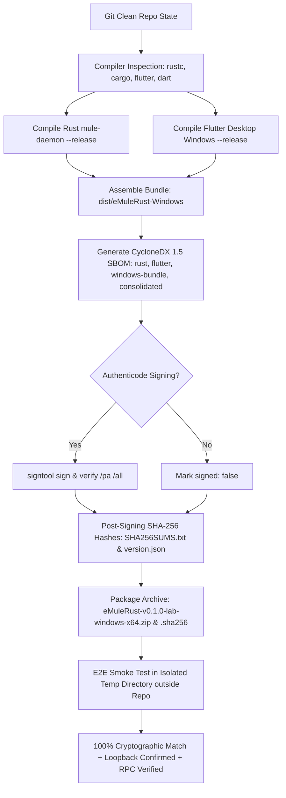

# Guía de Ejecución, Validación y Resolución de Problemas — Fase 3C: Endurecimiento de Producto

Este documento constituye la guía técnica de referencia para la **Fase 3C** del proyecto **eMuleRust** (Endurecimiento de producto y preparación para la producción local). Detalla la arquitectura de supervisión, la gestión de las sesiones locales, los bloqueos de exclusividad, la cadena de empaquetado Windows segura, las suites de pruebas y la guía completa de resolución de problemas.

Todos los procedimientos y demostraciones presentados aquí son **100 % deterministas, reproducibles y ejecutables sin conexión**, sin solicitar servidores eD2K ni nodos Kad públicos.

---

## 1. Arquitectura y Novedades de la Fase 3C

La Fase 3C consolida la integración entre el daemon Rust (`mule-daemon`) y la interfaz de usuario Flutter Desktop (`apps/desktop`), garantizando un ciclo de vida robusto y seguro:

```
┌────────────────────────────────────────────────────────┐
│                   apps/desktop (Flutter)              │
│  ┌──────────────────────────────────────────────────┐  │
│  │                 DaemonSupervisor                 │  │
│  │  - Descubrimiento vía session.json + auth.token  │  │
│  │  - Autoarranque mule-daemon.exe si ausente       │  │
│  │  - Resolución de carrera (2 UI simultáneas)      │  │
│  │  - Reconexión automática (backoff exp)           │  │
│  │  - Detección de incompatibilidad de protocolo    │  │
│  └───────────▲───────────────────────────┬──────────┘  │
│              │ session.json              │ WS JSON-RPC │
└──────────────┼───────────────────────────┼─────────────┘
               │                           │
┌──────────────┼───────────────────────────▼─────────────┐
│  %APPDATA%/eMuleRust (Directorio de trabajo local)     │
│  ├── mule.lock          (Bloqueo exclusivo fs4)        │
│  ├── session.json       (Metadatos de instancia públ.) │
│  ├── auth.token         (Token secreto aislado, ACL)   │
│  ├── mule.db / -wal     (Persistencia SQLite WAL)      │
│  └── part/              (Ficheros temporales .part)    │
└──────────────▲─────────────────────────────────────────┘
               │
┌──────────────┴─────────────────────────────────────────┐
│               crates/mule-daemon (Rust)                │
│  - Bloqueo exclusivo de carpeta de trabajo (mule.lock) │
│  - Respaldo dinámico en puerto efímero si 4660 ocupado │
│  - Escritura atómica (session.json.tmp -> sync -> ren) │
│  - Rechazo de enlaces simbólicos en auth.token         │
│  - Limpieza ordenada de sesiones al detener (Ctrl+C)   │
└────────────────────────────────────────────────────────┘
```

### Garantías técnicas validadas
1. **Bloqueo exclusivo de instancia (`crates/mule-daemon/src/lock.rs`)**:
   - Protegido por la API `fs4::FileExt::try_lock()` sobre `mule.lock`.
   - Impide estrictamente que dos daemons abran simultáneamente la misma base SQLite o los mismos ficheros `.part`.
   - Si una segunda instancia intenta arrancar, se detiene de inmediato con el error `DaemonError::AlreadyRunning`.

2. **Descubrimiento de sesión atómico y durabilidad Windows (`crates/mule-daemon/src/session.rs`)**:
   - `session.json` contiene: `protocolVersion`, `instanceId`, `pid`, `endpoint`, `startedAtUnixMs`.
   - Escritura atómica con `sync_all()` y bucle de reintentos (retries con backoff de 20 ms) al reemplazar bajo Windows para eliminar cualquier conflicto con bloqueos de compartición temporales (indexador de ficheros, antivirus, lector concurrente).
   - En el lado Flutter, lectura tolerante a escrituras en curso: un fichero vacío o en curso de reemplazo `.tmp` dispara reintentos cortos en lugar de interpretar precipitadamente la ausencia del daemon.
   - Eliminación limpia de `session.json` durante la detención elegante del daemon.

3. **Seguridad y aislamiento estricto de `auth.token`**:
   - **No exposición**: El secreto de autenticación **nunca** se coloca en `session.json` ni se muestra en los flujos `stdout` del daemon (`(redacted)`).
   - **Protección contra enlaces**: Rechazo formal de enlaces simbólicos o puntos de análisis de Windows (`symlink_metadata`).
   - **Token de alta entropía CSPRNG**: Generado directamente a partir de 32 bytes aleatorios procedentes del generador criptográfico del sistema operativo (`rand::rngs::OsRng` mediante `try_fill_bytes`, dependiente de `rand 0.9` bloqueado en `Cargo.lock`), codificado en forma estricta de 64 caracteres hexadecimales (`AUTH_TOKEN_HEX_LEN = 64`). Cualquier token no conforme (tamaño != 64 o caracteres no hexadecimales) es rechazado de inmediato por Rust y Flutter.
   - **Cero fugas en el lado cliente**: El cliente Flutter y su supervisor nunca registran el token en los mensajes de error ni trazas de excepciones.

4. **Supervisor Flutter resiliente (`apps/desktop/lib/services/daemon_supervisor.dart`)**:
   - **Prioridad a los binarios empaquetados**: Búsqueda de `mule-daemon.exe` junto al ejecutable Flutter (`Platform.resolvedExecutable`), en `bin/`, y luego en los objetivos de desarrollo.
   - **Resolución de la carrera al arrancar**: Si se lanzan dos clientes Flutter simultáneamente sobre una carpeta vacía, uno inicia el daemon; el segundo proceso daemon sale con `AlreadyRunning`, y la segunda interfaz Flutter detecta la aparición del `session.json` creado por el primero y se conecta a él de forma transparente.
   - **Recuperación de sesiones obsoletas con guarda anticarrera atómica**: Si `session.json` apunta a un daemon inaccesible (puerto cerrado), Flutter realiza una relectura de confirmación y compara el contenido antes de cualquier eliminación para evitar sobrescribir una sesión válida concurrente, y después inicia una nueva instancia.
   - **Reconexión con retroceso exponencial**: En caso de corte de socket inesperado, el supervisor intenta reconectarse (500 ms, 1 s, 2 s, 4 s... acotado a 10 s).
   - **Detección de versiones incompatibles**: Visualización de un banner bloqueante (`IncompatibleVersionBanner`) si `protocolVersion` difiere de la versión 1 soportada.
   - **Política de ciclo de vida y supervisión**: Si la interfaz Flutter instanció ella misma el daemon hijo, lo detiene limpiamente al cerrarse (`stop()`). Por el contrario, si se conectó a un daemon autónomo existente (servicio local o lanzado mediante la CLI), este último sigue vivo de forma independiente tras cerrar la interfaz.

5. **Pipeline de compilación y empaquetado seguro (`scripts/build_windows_release.ps1`)**:
   - Conforme a la política de ejecución PowerShell sin recurrir a `-ExecutionPolicy Bypass`.
   - Ensambla el paquete autónomo en `dist/eMuleRust-Windows/` con el manifiesto de trazabilidad `version.json`.

---

## 2. Requisitos Previos y Entorno

| Componente | Versión mínima recomendada | Observación |
| :--- | :--- | :--- |
| **Sistema operativo** | Windows 10/11 (x64) | Soporte de sockets TCP locales, bloqueos `fs4` y escritorio Flutter |
| **Rust y Cargo** | 1.80.0+ (stable) | Rust 1.98.1 validado con `clippy` y `rustfmt` |
| **Flutter SDK** | 3.24.0+ (stable) | Flutter 3.47.2 validado con soporte de escritorio activado (`flutter config --enable-windows-desktop`) |
| **Visual Studio C++** | Build Tools 2022 | Componentes de escritorio C++ requeridos por Flutter Windows |

Comprobar los requisitos previos en línea de comandos:
```powershell
rustc --version
cargo --version
flutter --version
flutter doctor
```

---

## 3. Comandos de Verificación de Calidad (100 % Offline)

Todos los comandos siguientes deben ejecutarse con éxito:

### 3.1 Workspace Rust (Formato, Clippy, Pruebas)
```powershell
# 1. Verificación del formateo del código
& "$env:USERPROFILE\.cargo\bin\cargo.exe" fmt --check

# 2. Análisis estático estricto (cero warnings tolerados)
& "$env:USERPROFILE\.cargo\bin\cargo.exe" clippy --workspace --all-targets --all-features -- -D warnings
& "$env:USERPROFILE\.cargo\bin\cargo.exe" clippy --workspace --all-targets -- -D warnings

# 3. Ejecución completa de las 87 pruebas de integración, unitarias y proptests Rust (con soporte lab)
& "$env:USERPROFILE\.cargo\bin\cargo.exe" test --workspace --all-features
```

*Resultados validados:*
- `mule-format`: 19 pruebas superadas (AICH, hashing eD2K, parseo/normalización de enlaces, parseo .met y desplazamientos).
- `mule-core`: 12 pruebas superadas (RangeSet, inserción, fusión, persistencia PartFile, restauración SQLite `get_all_downloads`, invariantes proptest de permutación y resistencia a la corrupción SQLite sin sobrescritura).
- `mule-daemon`: 10 pruebas superadas (Bloqueo exclusivo, sesión atómica con reintentos y sync_all, validación de token, puerto de respaldo efímero, contrato JSON-RPC, transferencia entre daemons con fallo al 50 % y reanudación íntegra, aislamiento multidescargas sin diafonía, tolerancia a fuentes lentas).
- `mule-protocol`: 46 pruebas superadas (Framing eD2K cero unsafe, fragmentación byte a byte, límites estrictos, paquetes malformados, máquina de estados de laboratorio, rastreador in-flight, indexación de hashes alojados, transferencia TCP loopback, 10 pruebas adversas y 2 suites proptest de invariantes de capacidad).

### 3.2 Cliente Flutter Desktop (Análisis y Pruebas)
```powershell
cd d:\Projet\eMuleRust\apps\desktop

# 1. Análisis estático Flutter
& "C:\Users\Lou\flutter\bin\flutter.bat" analyze

# 2. Ejecución de las 31 pruebas Flutter
& "C:\Users\Lou\flutter\bin\flutter.bat" test
```

*Resultados validados:*
- `No issues found!`
- `All tests passed! (31/31 passed)` que incluye:
  - Pruebas unitarias de modelos, DTOs y formateadores.
  - Pruebas de contratos WebSocket JSON-RPC y streaming de eventos.
  - Pruebas de widgets, virtualización de lista (500 elementos sin retardo), filtrado y diálogo de adición de enlaces.
  - Pruebas del supervisor: autoarranque, reutilización de sesión, gestión de carrera simultánea, sesión truncada, sesión obsoleta, rechazo de versión incompatible y gestión de error de token sin fuga de secreto.
  - Prueba E2E completa frente al binario real `mule-daemon.exe`.

---

## 4. Modos de Ejecución en Desarrollo

### Opción A: Modo Automático / Producción Local (Recomendado)
En este modo, Flutter supervisa directamente el daemon:
```powershell
cd d:\Projet\eMuleRust\apps\desktop
flutter run -d windows
```
- Flutter descubre `%APPDATA%\eMuleRust\session.json`.
- Si no se encuentra ninguna instancia, inicia automáticamente `mule-daemon.exe` en segundo plano.
- La conexión WebSocket JSON-RPC 2.0 se establece y el indicador de estado pasa a verde (`Conectado`).

### Opción B: Daemon Rust Autónomo + Flutter Desarrollador
Ideal para observar los registros en bruto del daemon en tiempo real:

**Terminal 1 (Daemon Rust):**
```powershell
cd d:\Projet\eMuleRust
cargo run -p mule-daemon -- --workdir "$env:APPDATA\eMuleRust"
```
*El daemon muestra su PID, la adquisición del bloqueo `mule.lock`, su puerto de escucha y la creación de `session.json`.*

**Terminal 2 (Aplicación Flutter):**
```powershell
cd d:\Projet\eMuleRust\apps\desktop
flutter run -d windows
```
*Flutter detecta la sesión existente y se conecta a ella de inmediato.*

### Opción C: Modo Maqueta Aislada (Fake Client)
Para iterar rápidamente sobre la interfaz gráfica sin daemon backend:
```powershell
cd d:\Projet\eMuleRust\apps\desktop
flutter run -d windows --dart-define=USE_FAKE_DAEMON=true
```

---

## 5. Flujo de Demostración Paso a Paso (100 % Sin Conexión)

### Paso 1: Verificación de la interfaz y del estado de conexión
1. Iniciar la aplicación (Modo A o B).
2. En la barra lateral izquierda, observar el indicador de estado: **Punto verde «Conectado»**.
3. El subtítulo muestra únicamente el punto de conexión público local (p. ej. `127.0.0.1:4660` o puerto efímero asignado) y la versión del protocolo `v1`. No se muestra ninguna ruta de fichero sensible ni token secreto.

### Paso 2: Adición de un enlace eD2K local (Datos de prueba simulados)
1. Hacer clic en el botón **«+ Añadir un enlace eD2K»** en la barra superior.
2. Pegar un enlace eD2K de prueba sintácticamente válido:
   `ed2k://|file|TestVideo_Offline_Demo.mkv|25000000|0123456789abcdef0123456789abcdef|/`
   > [!NOTE]
   > Este ejemplo constituye una **URI sintácticamente válida con datos simulados**. El tamaño (23.84 MB) y el hash MD4 demuestran la validación local de la integridad y del formateo sin presuponer la presencia de un par real en una red remota.
3. Observar la validación dinámica: el nombre, el tamaño y el hash MD4 se muestran al instante en verde.
4. Hacer clic en **«Añadir la descarga»**.
5. La descarga aparece en la lista con el estado inicial exacto del enum RPC/UI: **`Queued`** (En espera).

### Paso 3: Inyección de datos simulados
1. Hacer clic en el botón **«Herramientas de simulación»** en la cabecera.
2. Seleccionar la descarga en la lista.
3. Hacer clic en **«Inyectar 10 %»** o **«Inyectar bloque de parte»**:
   - La barra de progreso avanza en tiempo real.
   - El estado pasa a `Downloading`.
   - El caudal de transferencia y el tiempo restante (ETA) se calculan de forma reactiva.

### Paso 4: Control de flujo (Pausa / Reanudación / Eliminación)
1. Hacer clic en el botón **Pausa**: el estado pasa a `Paused`, el caudal cae a 0 KB/s.
2. Hacer clic en el botón **Reanudar**: el estado vuelve a `Downloading` y reanuda a partir de los bytes persistidos.
3. Hacer clic en **Eliminar**: confirmación modal, seguida de la limpieza inmediata de los ficheros `.part` y de los metadatos SQLite.

### Paso 5: Pruebas de Resiliencia y Fallos Independientes

Para validar la independencia y robustez de los componentes, deben comprobarse tres escenarios de fallo por separado:

#### Caso A: UI terminada o Daemon autónomo, Daemon persistente
1. Iniciar el daemon en segundo plano (Opción B o daemon ya activo) o iniciar la aplicación Flutter e inyectar datos de prueba.
2. Cerrar bruscamente la interfaz Flutter (`Alt+F4` o mediante el Administrador de tareas sin disparar `stop()`), o cerrar una interfaz conectada a un daemon autónomo preexistente.
3. Constatar que `mule-daemon.exe` sigue ejecutándose en segundo plano y conserva su bloqueo exclusivo `mule.lock`.
4. Volver a iniciar la aplicación Flutter: descubre de inmediato `session.json`, verifica la validez del puerto y del token 64-hex, se conecta a él sin lanzar un segundo daemon y muestra el estado intacto.
*(Nota: cuando la interfaz se cierra normalmente mientras supervisaba ella misma al daemon hijo, finaliza su proceso hijo para evitar procesos huérfanos).*

#### Caso B: Daemon terminado, UI viva
1. Mientras la aplicación Flutter está abierta y conectada, matar el proceso daemon en consola:
   ```powershell
   Get-Process mule-daemon -ErrorAction SilentlyContinue | Stop-Process -Force
   ```
2. Observar la interfaz Flutter:
   - El indicador pasa al instante al estado `Reconnecting...`.
   - El supervisor aplica el retroceso exponencial sin saturar el procesador.
3. En cuanto el daemon se reinicia (o es relanzado automáticamente por el supervisor):
   - La conexión se restablece automáticamente.
   - El cliente detecta el nuevo `instanceId`, reinicia su contador de secuencia y solicita una instantánea completa (`downloads.list`), actualizando la pantalla sin intervención manual.

#### Caso C: Fallo total / Parada en frío
1. Matar simultáneamente Flutter y el daemon (`Ctrl+C` o cierre de sesión).
2. Volver a iniciar la aplicación Flutter:
   - El daemon arranca, abre `mule.db` (SQLite WAL), restaura los intervalos en `RangeSet`, y la interfaz muestra fielmente el avance persistido.

### Paso 6: Carrera al arrancar dos UI simultáneas
1. En un directorio de trabajo vacío sin daemon activo, lanzar simultáneamente dos ventanas Flutter.
2. Constatar que solo arranca un `mule-daemon.exe` y adquiere el bloqueo `mule.lock`.
3. El segundo supervisor espera a que se escriba `session.json` y se conecta sin conflicto ni mensaje de error.

---

## 6. Guía de Resolución de Problemas (Troubleshooting)

### Problema 1: Mensaje «Ya hay otra instancia del daemon activa en este directorio»
- **Causa**: Un daemon anterior retiene el bloqueo exclusivo `mule.lock`.
- **Solución**:
   ```powershell
   Get-Process mule-daemon -ErrorAction SilentlyContinue | Stop-Process -Force
   ```
   El bloqueo se libera en cuanto se detiene el proceso.

### Problema 2: Conflicto en el puerto de red predeterminado (`127.0.0.1:4660`)
- **Comportamiento automático**: El daemon conmuta automáticamente a un puerto efímero (`127.0.0.1:0`) y publica la dirección efectiva en `session.json`. La aplicación Flutter lee dinámicamente este punto de acceso.

### Problema 3: Error de autenticación (`Authentication Failed`)
- **Causa**: Desincronización de `auth.token`.
- **Solución**:
   1. Detener el daemon.
   2. Eliminar los ficheros de sesión:
      ```powershell
      Remove-Item "$env:APPDATA\eMuleRust\session.json" -ErrorAction SilentlyContinue
      Remove-Item "$env:APPDATA\eMuleRust\auth.token" -ErrorAction SilentlyContinue
      ```
   3. Volver a iniciar la aplicación.

### Problema 4: Banner rojo «Versión del daemon incompatible»
- **Causa**: `protocolVersion` incompatible entre el cliente y el daemon.
- **Solución**: Recompilar el daemon para sincronizar las versiones:
   ```powershell
   cargo build --release -p mule-daemon
   ```

### Problema 5: Restablecimiento completo para partir de un entorno limpio
> [!CAUTION]
> Este comando elimina de forma irreversible todas las descargas en curso, la base SQLite local y los ficheros temporales `.part`. Utilizar únicamente para restablecer pruebas de laboratorio.

```powershell
# Confirmar el cierre de los procesos
Get-Process mule-daemon,desktop,eMuleRust -ErrorAction SilentlyContinue | Stop-Process -Force

# Eliminar el directorio de trabajo
Remove-Item -Recurse -Force "$env:APPDATA\eMuleRust"
```

---

## 7. Empaquetado y Despliegue de Release Windows

Para generar el entregable completo sin eludir la política de seguridad PowerShell del sistema:

```powershell
cd d:\Projet\eMuleRust
powershell -NoProfile -ExecutionPolicy RemoteSigned -File scripts\build_windows_release.ps1
```

> [!TIP]
> **¿Por qué `RemoteSigned` en lugar de `Bypass`?**
> `RemoteSigned` autoriza la ejecución de los scripts creados localmente en tu máquina exigiendo al mismo tiempo una firma digital de confianza para los scripts descargados de Internet. Para una distribución al público general, el script y los ejecutables pueden firmarse mediante un certificado de firma de código Authenticode (`Set-AuthenticodeSignature`).

### Contenido del paquete generado en `dist\eMuleRust-Windows\`:
- `eMuleRust.exe`: Ejecutable Flutter Desktop principal.
- `bin/mule-daemon.exe`: Daemon Core autónomo empaquetado junto a la interfaz.
- `flutter_windows.dll` y dependencias nativas.
- `data/`: Activos, iconos y fuentes de la aplicación.
- `version.json`: Manifiesto de trazabilidad que incluye el SHA Git, la fecha de compilación y la versión del protocolo JSON-RPC.

---

## 8. Fase 4.1: Base Protocolaria eD2K de Red (`crates/mule-protocol`)

El componente `mule-protocol` constituye el cimiento de red de la transferencia entre pares eD2K, garantizando un aislamiento absoluto respecto al almacenamiento (`mule-core`) y una robustez total frente a los flujos maliciosos o fragmentados.

### 8.1 Garantías arquitectónicas y seguridad
1. **Cero `unsafe` (`#![forbid(unsafe_code)]`)**:
   Garantía a nivel de compilación de que no se manipula ningún bloque de memoria no verificado.
2. **Desacoplamiento estricto del Core**:
   El protocolo ignora la existencia de SQLite, de los ficheros `.part` o de las estructuras internas (`RangeSet`). Todas las interacciones pasan por traits asíncronos puros (`DownloadSink` y `DownloadPlanner`).
3. **Topes estrictos antidenegación de servicio (DoS)**:
   - `MAX_FRAME_BYTES = 1_048_576` (1 MiB): rechazo inmediato antes de cualquier intento de asignación de búferes desmesurados.
   - `MAX_BUFFERED_BYTES = 2_097_152` (2 MiB): corte preventivo si un par acumula datos parciales sin completar una trama válida.
   - `MAX_STRING_BYTES = 16_384` (16 KiB): protección contra cadenas de etiquetas sobredimensionadas.
   - `MAX_TAGS_PER_MESSAGE = 256`: limitación del número de metadatos por mensaje.
   - `MAX_PEERS_PER_RESPONSE = 500`: limitación de las respuestas de fuentes de pares.
4. **Codec de streaming `PacketCodec` y reconocimiento de protocolos**:
   - Decodificación de coste cero sobre `bytes::BytesMut`.
   - Soporte nativo de los protocolos eD2K estándar (`0xE3`), eMule extendido (`0xC5`), de laboratorio (`0xEE`), y framing reconocido para el protocolo comprimido eMule (`0xD4`).
   - *Precisión de seguridad sobre 0xD4*: la descompresión compatible y sus límites de seguridad posteriores a la descompresión (ratio de descompresión máximo acotado contra bombas de descompresión, tope por tipo de mensaje y rechazo estricto de flujos incompletos) se integrarán en una fase dedicada.
   - Trait de abstracción `PacketLimits` que prevé topes contextuales por familia de mensajes.
   - Reconstitución determinista ante una fragmentación extrema (validación byte a byte en las pruebas).
   - Segmentación ordenada de múltiples tramas contiguas dentro de un mismo búfer de red.
5. **Cobertura de pruebas exhaustivas (33/33 validadas en `mule-protocol`)**:
   - `tests/packet_codec.rs`: Ida y vuelta estándar, extracción multipaquete, tramas con carga útil vacía, bloques eD2K de 180 KiB (`184_320` bytes), fragmentación unitaria.
   - `tests/protocol_limits.rs`: Rechazo de longitudes nulas, superación de `MAX_FRAME_BYTES`, ataques por `u32::MAX`, desbordamiento de acumulador `BufferOverflow`, respeto de límites personalizados.
   - `tests/malformed_packets.rs`: Rechazo de bytes de protocolo desconocidos (`0x00`, `0x42`, `0xFF`), gestión de cabeceras truncadas sin pánico (`Ok(None)`), integración asíncrona de los traits `DownloadSink` y `DownloadPlanner`.
   - `tests/lab_state_machine.rs`: Handshake nominal cliente/servidor, rechazo de versión incompatible, rechazo de nonce mismatch, rechazo de doble Hello, prohibición formal de transferencias antes del estado Ready, cierre limpio mediante Goodbye, serialización determinista de todos los mensajes `LabMessage`.
   - `tests/lab_in_flight_and_blocks.rs`: Tope estricto de las 8 peticiones en vuelo (`MAX_IN_FLIGHT_REQUESTS`), rechazo de duplicados, rechazo de bloques no solicitados, rechazo de discordancias de longitud, servicio seguro en memoria mediante `LabSourceEngine`.
   - `tests/loopback_transfer.rs`: Transferencia TCP loopback completa (53 bloques de una parte eD2K de 9.5 MB) con entrega intencionadamente desordenada, fragmentación TCP unitaria del handshake, detección de corrupción de bloque que impide la finalización y reanudación tras desconexión inesperada.

---

## 9. Fase 4.2: Máquina de Estados P2P y Transferencia Loopback Entre Daemons

La Fase 4.2 implanta un protocolo de banco de pruebas local, aislado y determinista, garantizando que ningún socket dialogue con la red eD2K pública mientras la integridad y la resiliencia local no sean irreprochables.

### 9.1 Distinción Fundamental
```
lab / loopback wire protocol (PR_LAB = 0xEE) ≠ eD2K / eMule historical wire protocol
```
- El protocolo de laboratorio opera bajo el byte mágico `PR_LAB = 0xEE`.
- Utiliza mensajes tipados explícitos (`Hello`, `HelloAck`, `FileOffer`, `RequestBlock`, `BlockData`, `BlockRejected`, `Goodbye`, `ProtocolError`).
- Nunca se acepta ninguna ruta de fichero local (`PathBuf`) desde la red: el motor de pruebas [`LabSourceEngine`](crates/mule-protocol/src/lab/source_engine.rs) sirve sus fixtures desde un catálogo en memoria indexado únicamente por hash de 16 bytes.

### 9.2 Máquina de Estados Pura (`PeerStateMachine`)
- Estados mutuamente excluyentes: `Disconnected`, `Connecting`, `AwaitingHello`, `AwaitingHelloAck { local_nonce }`, `Ready { remote_peer_id, negotiated_version }`, `Closing`, `Closed`, `Failed { reason }`.
- Cualquier violación protocolaria o error de red conlleva una transición inmediata e irreversible hacia `Failed`. Un estado `Failed` nunca vuelve a ser `Ready`.
- Prohibición estricta de recibir o emitir `RequestBlock` o `BlockData` antes de haber alcanzado el estado `Ready`.

### 9.3 Pipeline de Transferencia e Integración Core
1. **Control de congestión y peticiones en vuelo**:
   El componente [`InFlightTracker`](crates/mule-protocol/src/lab/in_flight.rs) acota las peticiones simultáneas a `MAX_IN_FLIGHT_REQUESTS = 8`. Cualquier bloque recibido sin petición previa se rechaza con cierre inmediato de la sesión.
2. **Tolerancia demostrada a la entrega desordenada**:
   En la prueba `test_nominal_loopback_transfer_with_shuffled_blocks`, los 53 bloques que componen la parte de 9 728 000 bytes se solicitan y escriben en desorden. El `RangeSet` de `mule-core` fusiona dinámicamente los intervalos a medida que se escriben en el fichero `.part`.
3. **Validación criptográfica final**:
   Al término de los 53 bloques, el cálculo del hash eD2K sobre el fichero físico `.part` confirma una identidad perfecta con `FIXTURE_EXACT_ONE_PART` (`d815a0409aaa0b4279dd86e580bb043f`).
4. **Detección de corrupción y reanudación tras corte**:
   - La alteración de un byte no es detectable al instante durante la escritura sin prueba AICH por bloque; se detecta durante la verificación criptográfica de la parte completa (cálculo del hash raíz eD2K de 9 728 000 bytes): no se permite ninguna finalización en caso de discordancia.
   - En caso de interrupción de red tras recepción parcial (p. ej. 180 KB recibidos), la reconexión consulta `RangeSet::missing_within` y vuelve a pedir estrictamente solo los bytes faltantes, permitiendo una reanudación en caliente íntegra.

---

## 10. Fase 4.3: Transferencia Loopback Entre Daemons Integrada, Feature Lab y Tolerancia a Fallos

La Fase 4.3 culmina la integración de extremo a extremo del pipeline de transferencia ejecutando una transferencia completa entre dos procesos `mule-daemon` distintos, aislando el código de prueba tras una característica Cargo dedicada y demostrando la resiliencia del almacenamiento en caso de fallo abrupto.

### 10.1 Característica Cargo `lab-loopback` y Seguridad de los Entregables de Producción
- **Aislamiento estricto**: Los fixtures sintéticos (`FIXTURE_EXACT_ONE_PART`), el motor de origen en memoria y las rutas RPC de prueba (`lab.addPeerSource`) están estrictamente aislados tras la característica Cargo `lab-loopback` en `crates/mule-protocol` y `crates/mule-daemon`.
- **Entregables de producción aligerados y endurecidos**: Las compilaciones estándar (`cargo build --release`) conservan `default = []`. No compilan ni incorporan el menor código de mock o servidor de pruebas, garantizando una superficie de ataque mínima y ningún residuo de banco de pruebas.

### 10.2 Arquitectura de la Transferencia Entre Daemons (`crates/mule-daemon`)
```
┌────────────────────────────────────────────────────────┐
│                   Daemon A (Origen Lab)                │
│  - Socket TCP loopback efímero (127.0.0.1:0)           │
│  - Framing binario PR_LAB (0xEE)                       │
│  - Sirve FIXTURE_EXACT_ONE_PART (9 728 000 bytes)      │
│  - Catálogo en memoria indexado por hash 16 bytes      │
└───────────────────────────▲────────────────────────────┘
                            │ TCP Loopback (0xEE)
┌───────────────────────────▼────────────────────────────┐
│                  Daemon B (Cliente Daemon)             │
│  - Directorio aislado (mule.lock, SQLite WAL, .part)   │
│  - JSON-RPC WebSocket en puerto local efímero          │
│  - Pipeline run_lab_download:                          │
│    • InFlightTracker (máx. 8 peticiones en vuelo)      │
│    • RangeSet::missing_within (peticiones dirigidas)   │
│    • Escritura atómica en .part y sync SQLite WAL      │
│    • Verificación raíz eD2K y finalización .txt        │
└────────────────────────────────────────────────────────┘
```

1. **Ciclo de estados streaming verificado mediante WebSocket JSON-RPC**:
   - `Queued`: El enlace eD2K se envía mediante `downloads.addEd2kLink`.
   - `WaitingForSources`: La descarga espera a que se identifique una fuente activa.
   - `Downloading`: Conexión establecida con la fuente loopback, negociación de la máquina de estados (`Hello` / `HelloAck`), y streaming de los bloques de 180 KiB.
   - `Verifying`: En cuanto se recibe el último bloque que cubre los 9 728 000 bytes, el estado cambia de inmediato a `Verifying` para impedir cualquier uso prematuro antes del control de integridad.
   - `Completed`: El hash eD2K raíz calculado sobre el fichero físico `.part` coincide con el hash de referencia (`d815a0409aaa0b4279dd86e580bb043f`). El fichero `.part` se renombra atómicamente hacia el fichero de destino final (`.txt`).

### 10.3 Prueba de Interrupción Abrupta al ~50 % y Reanudación Íntegra (`tests/inter_daemon_transfer.rs`)
La prueba de integración `test_inter_daemon_loopback_transfer_and_interruption_resumption` valida de extremo a extremo la resistencia ante fallos:
1. **Transferencia inicial hasta mitad de recorrido**: El Daemon B descarga los bloques secuencialmente hasta superar ~4.5 MB (de 9.72 MB).
2. **Fallo abrupto simulado**: Interrupción inmediata del servidor Axum y cancelación de todas las tareas asíncronas en segundo plano mediante `AppState::abort_all_tasks()`.
3. **Persistencia WAL verificada**: Inspección de la base SQLite y del fichero `.part`: los rangos adquiridos (unos 4.5 MB a 5.0 MB) están intactos y persistidos en disco.
4. **Reinicio en frío (Cold Restart)**: Una nueva instancia del Daemon B arranca sobre el **mismo directorio de trabajo**. El `DownloadService` consulta `Database::get_all_downloads()` y restaura al instante en memoria el estado de la descarga y sus rangos adquiridos.
5. **Reanudación sin redescarga**: El cliente WebSocket se reconecta y reinyecta la fuente loopback. El planificador `missing_within` constata los rangos ya presentes y **no vuelve a pedir estrictamente ningún byte ya escrito**.
6. **Finalización íntegra**: Se reciben los bloques restantes, se valida el resumen eD2K y el fichero finalizado es estrictamente idéntico a la referencia.

### 10.4 Alineación de la Interfaz Flutter Desktop (`apps/desktop`)
- Soporte del estado `DownloadStatus.waitingForSources` en la enumeración de dominio, el DTO RPC (`RpcDto.parseStatus`) y el tema visual (`AppTheme.getStatusColor`).
- Pruebas unitarias y de integración Flutter Desktop: 31/31 superadas, `flutter analyze`: cero warnings.

---

## 11. Fase 4.4: Endurecimiento del Banco de Pruebas (Casos Adversos, Invariantes y Proptests)

La Fase 4.4 transforma cada escenario de fallo crítico en propiedades matemáticas y garantías formalmente probadas, antes de cualquier fase de arqueología eD2K.

### 11.1 Robustez de In-Flight y Gestión de Casos Adversos (`crates/mule-protocol`)
La suite `crates/mule-protocol/tests/lab_adversarial.rs` cubre exhaustivamente los casos límite de red:
1. **Novena petición en vuelo (`test_ninth_in_flight_request_rejected_without_leak`)**:
   El regulador `InFlightTracker` bloquea cualquier intento más allá de 8 peticiones simultáneas con `InFlightError::CapacityReached { limit: 8 }`. No se dispara ninguna escritura y la capacidad permanece rigurosamente acotada a 8 sin fugas.
2. **Respuesta duplicada (`test_duplicate_block_response_rejected`)**:
   La primera entrega de un bloque consume la entrada. Una segunda entrega del mismo bloque devuelve `InFlightError::UnsolicitedBlock` de forma idempotente sin doble contabilidad ni subdesbordamiento de capacidad.
3. **Discordancia de hash de fichero (`test_wrong_file_hash_response_rejected`)**:
   Cualquier respuesta con un hash distinto de la petición en vuelo se rechaza con `UnsolicitedBlock`, y la petición inicial permanece protegida en espera.
4. **Discordancia de tamaño de bloque (`test_length_mismatch_response_rejected`)**:
   Si un par devuelve una longitud diferente de la esperada (p. ej. 100 KB en lugar de 180 KB), el bloque se rechaza con `InFlightError::LengthMismatch`.
5. **Expiración y entrega tardía (`test_reap_timeouts_and_late_block_rejection`)**:
   `reap_timeouts` extrae las peticiones expiradas para su replanificación inmediata. Un bloque que llega tarde se rechaza como no solicitado.
6. **Desconexión abrupta con 8 peticiones (`test_cancel_all_frees_capacity_on_disconnect`)**:
   `cancel_all` libera todas las 8 peticiones para devolverlas a la cola, restaurando al instante la capacidad plena del rastreador (`len == 0`, `can_request == true`).
7. **Rechazo de bloque dirigido frente a desconocido (`test_valid_block_rejected_frees_single_entry` / `test_unknown_block_rejected_fails`)**:
   Un `BlockRejected` legítimo solo libera la petición afectada preservando las otras 7. Un rechazo sobre un desplazamiento desconocido lanza un error `UnsolicitedRejection`.
8. **Rechazo estricto de las tramas comprimidas `0xD4` (`test_compressed_frame_0xd4_explicitly_rejected`)**:
   Cualquier trama `PR_EMULE_COMPRESSED` se rechaza a nivel de decodificación (`LabMessage::from_raw_packet`) y de máquina de estados (`PeerStateMachine::on_raw_packet`) con `ProtocolViolation::CompressedProtocolUnsupported` mientras no se despliegue la descompresión acotada.

### 11.2 Invariantes y Pruebas de Propiedad Formales (`proptest`)
1. **Invarianza de permutación en `RangeSet` (`crates/mule-core/tests/range_set_properties.rs`)**:
   Demuestra que para cualquier colección de rangos de bytes disjuntos insertados en cualquier orden aleatorio (shuffle), la unión canónica `ranges()`, la cobertura `covered_len()` y el cálculo de los huecos `missing_within()` son estrictamente idénticos.
2. **Coherencia de los estados `InFlightTracker` (`crates/mule-protocol/tests/in_flight_properties.rs`)**:
   Verifica que la capacidad disponible es siempre exactamente 8 - len, que ningún bloque puede validarse dos veces y que `cancel_all` siempre restaura `len == 0`.

### 11.3 Aislamiento Multidescargas e Integridad SQLite (`crates/mule-daemon`)
La suite `crates/mule-daemon/tests/daemon_adversarial.rs` valida la estanqueidad del daemon:
1. **Multidescargas concurrentes sin diafonía (`test_concurrent_downloads_no_crosstalk`)**:
   Se descargan simultáneamente dos ficheros distintos (368 KB y 552 KB) desde una fuente loopback compartida. Verificación en disco: cada fichero objetivo físico se crea, su tamaño es exacto, su hash eD2K coincide fielmente y no existe ninguna interferencia entre sus ficheros `.part` o metadatos SQLite.
2. **Fuente con alta latencia (`test_slow_source_delayed_delivery_recovers_cleanly`)**:
   Una fuente que retrasa sus respuestas 1 segundo se gestiona pasivamente mediante el planificador asíncrono sin embalamiento de CPU ni bucle activo.
3. **Resistencia a la corrupción de base SQLite (`test_corrupted_database_fails_explicitly_in_daemon`)**:
   Una base `mule.db` que contiene bytes corruptos provoca un fallo explícito al arrancar, **sin eliminar ni sobrescribir jamás silenciosamente** los datos existentes en disco.

---

## 12. Fase 5: Arqueología eD2K Pasiva, Decodificadores Read-Only y Corpus de Fixtures

La **Fase 5** formaliza la especificación documental del protocolo histórico eDonkey2000 / eMule, establece un corpus de fixtures binarios bajo control de versiones con manifiesto criptográfico y despliega un submódulo de decodificadores de solo lectura (`mule-protocol::ed2k`) estrictamente desacoplado y pasivo.

### 12.1 Alcance y Reglas de Estanqueidad (100 % Sin Conexión)
1. **Cero sockets de red**: El submódulo `mule-protocol::ed2k` no crea ningún `TcpStream`, `UdpSocket`, `SocketAddr` ni tarea de red asíncrona.
2. **Sin emisión activa**: Ningún codificador está destinado a emitirse hacia pares reales en esta fase. Solo se producen estructuras pasivas de observación (`Ed2kHello`, `Ed2kHelloAnswer`, `Ed2kFileStatus`).
3. **Desacoplamiento estricto con `lab`**: Los protocolos históricos (`0xE3`, `0xC5`, `0xD4`) están completamente separados del protocolo de laboratorio `PR_LAB` (`0xEE`), con sus propios topes de tramas y ningún tipo de dominio compartido.
4. **Cero `unwrap()`, cero `expect()`**: Todas las funciones de decodificación son totalmente seguras y verifican cada límite antes de reservar memoria.
5. **Rechazo de `0xD4` (`PR_EMULE_COMPRESSED`)**: Rechazo inmediato con `Ed2kErrorKind::CompressedProtocolUnsupported` mientras no se implante la capa de descompresión con topes antibomba.

### 12.2 Especificación Documental (`docs/ed2k/`)
Toda la documentación se ha redactado con referencias precisas hacia las bases de código históricas (eMule v0.50a SourceForge, irwir/eMule, aMule):
- `docs/ed2k/scope.md`: Delimitación formal del modo pasivo y prohibiciones de conexión pública.
- `docs/ed2k/references.md`: Fuentes y ficheros de referencia (`UpDownClient.cpp`, `ListenSocket.cpp`, `Packet.cpp`, `Tag.cpp`).
- `docs/ed2k/framing.md`: Cabecera de trama (protocolo 1 byte, longitud little-endian 4 bytes, opcode 1 byte), endianness y comparación de límites.
- `docs/ed2k/opcodes.md`: Catálogo exhaustivo de los opcodes para los protocolos `0xE3`, `0xC5` y `0xD4`.
- `docs/ed2k/message-catalog.md`: Fichas normalizadas que detallan wire format, límites, decodificación, errores y referencias para `OP_HELLO`, `OP_HELLOANSWER`, `OP_FILESTATUS`, `OP_SETREQFILEID`, `OP_REQUESTPARTS`, `OP_SENDINGPART`.
- `docs/ed2k/limits.md`: Topes estrictos por opcode (Hello ≤ 64 KiB, Data ≤ 256 KiB, tags ≤ 256, cadenas ≤ 1024 B).
- `docs/ed2k/compatibility-notes.md`: Variantes de etiquetas especiales (1 byte frente a nombre), codificaciones de texto (ASCII / Windows-1252 / UTF-8), HighID frente a LowID.
- `docs/ed2k/decisions/`:
  - `0001-ed2k-read-only.md`: Decodificadores estrictos de solo lectura sin codificador ni sesión.
  - `0002-no-public-network.md`: Prohibición absoluta de conectividad de red externa.
  - `0003-wire-lab-separation.md`: Desacoplamiento estricto entre laboratorio y protocolo histórico.

### 12.3 Corpus de Fixtures y `manifest.json`
Los fixtures binarios se alojan en `crates/mule-protocol/tests/fixtures/ed2k/` con un manifiesto `manifest.json` que verifica su SHA-256 y los comportamientos esperados:
- **Fixtures Válidos**:
  - `hello_v1_minimal.bin`: Saludo estándar mínimo (0 etiquetas).
  - `hello_v1_tags.bin`: Saludo completo con etiquetas tipadas (`name`, `version`, `prt`) y servidor.
  - `hello_answer.bin`: Respuesta de saludo con metadatos de par remoto.
  - `file_status.bin`: Estado de fichero multiparte con máscara binaria de disponibilidad.
- **Fixtures Malformados (Entradas Hostiles)**:
  - `malformed/hello_truncated_header.bin`: Cabecera truncada (< 5 bytes) $\rightarrow$ `UnexpectedEof` (context: "header", offset: 0).
  - `malformed/hello_truncated_tag.bin`: Etiqueta que declara 20 bytes pero truncada tras 4 bytes $\rightarrow$ `UnexpectedEof` (context: "tag_value_string", offset: 32).
  - `malformed/oversized_string.bin`: Cadena de 1500 bytes que supera el tope de 1024 $\rightarrow$ `OversizedString` (size: 1500, limit: 1024).
  - `malformed/too_many_tags.bin`: Contador de 300 etiquetas que supera el tope de 256 $\rightarrow$ `TooManyTags` (count: 300, limit: 256).
  - `malformed/unsupported_protocol_0xd4.bin`: Protocolo comprimido $0xD4$ $\rightarrow$ `CompressedProtocolUnsupported`.

### 12.4 Controles de Cierre y Guarda de Aislamiento Mecánico
Dos controles automatizados refuerzan la garantía de aislamiento:
1. **Guarda de aislamiento mecánico (`crates/mule-protocol/tests/ed2k_isolation_guard.rs`)**:
   - Escaneo estático automatizado de todo el submódulo `src/ed2k/`: prohibición formal y verificada de cualquier importación de red (`std::net`, `tokio::net`, `TcpStream`, `UdpSocket`, `SocketAddr`, `axum`, `hyper`, etc.).
   - Ausencia total de dependencia hacia `mule-protocol::lab`.
   - Regla estricta «cero `unwrap()`, cero `expect()`» en el código fuente de `ed2k/`.
   - Verificación de que las rutas RPC de laboratorio en `mule-daemon` están estrictamente condicionadas por `#[cfg(feature = "lab-loopback")]`.
2. **Validación dinámica completa del manifiesto (`manifest.json`)**:
   - Esquema enriquecido para cada fixture: `protocolByte`, `opcode`, `direction`, `origin`, `expected`, `expectedError`, `expectedOffset`.
   - Verificación dinámica del hash SHA-256 (mediante algoritmo estándar FIPS 180-4 seguro en puro Rust), de los errores esperados y de los desplazamientos exactos de rechazo en el flujo binario.

### 12.5 Balance de las Pruebas Fase 5
- **Pruebas Rust**: **104 pruebas superadas** (`cargo test --workspace --all-features`), incluyendo `ed2k_isolation_guard` y `ed2k_corpus_tests`.
- **Pruebas Flutter**: **31 pruebas superadas** (`flutter test`).
- **Total general**: **135 pruebas validadas al 100 %**.

---

## 13. Fase 6.1: Codificadores Deterministas eD2K Sin Red y Doble Invarianza Roundtrip

El **Hito 6.1** despliega la capa de serialización en línea determinista y acotada para los mensajes eD2K históricos (`mule-protocol::ed2k::encoder`), manteniendo la política estricta **100 % sin conexión**.

### 13.1 Arquitectura del Módulo `encoder` (`crates/mule-protocol/src/ed2k/encoder.rs`)
1. **Estructura `Ed2kEncoder`**:
   - Encapsula `Ed2kLimits` para restringir cada asignación de memoria.
   - Codificación de las etiquetas TLV reconocidas (`Ed2kTag`) para todos los tipos escalares, hashes, cadenas y blobs.
   - Preservación sin alteración de las etiquetas desconocidas (`RawTag`).
   - Emisión conforme de las direcciones de servidor (`server_ip` 4 bytes LE y `server_port` 2 bytes LE).
2. **Errores tipados contextuales `Ed2kEncodeError`**:
   - Identifica con precisión el opcode en curso de codificación, el campo defectuoso (`field`) y la naturaleza de la violación (`Ed2kErrorKind`).
3. **Métodos de codificación seguros**:
   - `encode_hello(&self, &Ed2kHello) -> Result<RawPacket, Ed2kEncodeError>`
   - `encode_hello_answer(&self, &Ed2kHelloAnswer) -> Result<RawPacket, Ed2kEncodeError>`
   - `encode_file_status(&self, &Ed2kFileStatus) -> Result<RawPacket, Ed2kEncodeError>`
   - `encode_message(&self, &Ed2kMessage) -> Result<RawPacket, Ed2kEncodeError>`
   - `encode_to_bytes(&self, &Ed2kMessage) -> Result<Bytes, Ed2kEncodeError>`

### 13.2 Doble Invarianza Roundtrip (`crates/mule-protocol/tests/ed2k_roundtrip_tests.rs`)
La suite de 15 pruebas automatizadas demuestra formalmente las dos propiedades de invarianza:

1. **Invarianza de Fixture: `encode(decode(fixture)) == fixture`**
   - `hello_v1_minimal.bin`: 38 bytes idénticos al bit.
   - `hello_v1_tags.bin`: Saludo completo reproducido de forma idéntica.
   - `hello_answer.bin`: Respuesta con metadatos reproducida de forma idéntica.
   - `file_status.bin`: Estado multiparte con máscara binaria reproducido de forma idéntica.

2. **Invarianza Estructural: `decode(encode(msg)) == msg`**
   - `test_synthetic_roundtrip_hello_all_tag_types`: Cobertura exhaustiva de todas las variantes de `TagValue` (Hash, String, UInt32, Float32, Bool, Blob, UInt16, UInt8, UInt64) con nombres especiales y textuales.
   - `test_synthetic_roundtrip_hello_minimal_no_server_info`: Handshake mínimo con servidor nulo.
   - `test_synthetic_roundtrip_hello_answer`: Respuesta sintética con etiquetas.
   - `test_synthetic_roundtrip_unknown_raw_tags_preservation`: Conservación perfecta de las etiquetas en bruto (`RawTag`).
   - `test_synthetic_roundtrip_file_status_various_part_counts`: Verificación sobre 0, 1, 7, 8, 9 y 53 partes.

3. **Rechazos Numéricos en los Límites**:
   - Superación del número máximo de etiquetas (`TooManyTags`).
   - Superación de la longitud del nombre de etiqueta o del valor de cadena (`OversizedString`).
   - Superación del tamaño de blob (`FrameTooLarge`).
   - Superación del tope de trama para el opcode (`FrameTooLarge`).
   - Incoherencia de longitud de la máscara binaria respecto al número de partes (`MalformedField`).

### 13.3 Balance Global de las Pruebas (Fase 6.1)
- **Pruebas Rust**: **115 pruebas superadas** (`cargo test --workspace --all-features`).
- **Pruebas Flutter**: **31 pruebas superadas** (`flutter test`).
- **Total general del proyecto**: **146 pruebas validadas al 100 %**.
- **Clippy**: 0 advertencias en todo el workspace (`cargo clippy --workspace --all-targets --all-features -- -D warnings`).
- **Guarda de aislamiento**: Validada (0 sockets, 0 importaciones de red, 0 dependencias lab, 0 unwrap/expect en `src/ed2k/`).

---

## 14. Fase 6.2: Sesiones Históricas eD2K en Loopback Cerrado (`ed2k-loopback`)

El **Hito 6.2** establece las primeras sesiones de red activas de saludo eD2K (`OP_HELLO` $\rightarrow$ `OP_HELLO_ANSWER` $\rightarrow$ `Ready`), estrictamente confinadas a la interfaz local `127.0.0.1:0` tras la característica opt-in `ed2k-loopback`.

### 14.1 Característica Cargo Dedicada y Confinamiento Sin Red
1. **Gating `ed2k-loopback`**:
   - `mule-protocol` y `mule-daemon` condicionan el acceso a la sesión, a los tipos de pares y al transporte loopback mediante `feature = "ed2k-loopback"`.
   - Las compilaciones de producción por defecto (`default = []`) no incluyen ni listener eD2K, ni socket connector, ni par de pruebas.
2. **Confinamiento Loopback Estricto**:
   - Los sockets solo se enlazan a `127.0.0.1:0`.
   - `Ed2kLoopbackClient` rechaza formalmente cualquier intento de conexión hacia una dirección que no sea loopback (`addr.ip().is_loopback()`).
   - Cero resolución DNS, cero lista de servidores, cero bootstrap Kad, cero descubrimiento de red.
   - El par de pruebas sirve un catálogo estático cerrado en memoria y no recibe ninguna ruta de fichero, URL o anfitrión arbitrario.
3. **Desacoplamiento UI / Daemon**:
   - La interfaz Flutter Desktop no conoce el protocolo eD2K y sigue interactuando exclusivamente mediante el protocolo JSON-RPC local existente.

### 14.2 Arquitectura de los Componentes 6.2
1. **Máquina de estados pura `Ed2kSession` (`crates/mule-protocol/src/ed2k/session.rs`)**:
   - Estados: `Disconnected`, `Connecting`, `AwaitingHello`, `AwaitingHelloAnswer { local_handshake_id }`, `Ready { peer }`, `Closing`, `Closed`, `Failed { reason }`.
   - La identidad de handshake se basa en el `user_hash` (MD4 16 bytes), `client_id`, puerto TCP y etiquetas TLV (sin ningún concepto de nonce no estándar).
   - Validación estricta: rechazo de doble Hello (`DoubleHello`), rechazo de Answer prematuro (`HelloAnswerBeforeHello`), rechazo de protocolos inesperados o comprimidos `0xD4`.
   - Errores tipados: `Ed2kSessionError`.
2. **Metadatos de par `Ed2kPeerInfo` (`crates/mule-protocol/src/ed2k/peer_info.rs`)**:
   - Extracción de capacidades, versión de software (`version`), versión de eMule (`emule_version`), opciones varias (`misc_options1`, `misc_options2`), servidor conectado y preservación de las etiquetas en bruto (`unknown_tags`).
3. **Transporte Loopback y Par de Pruebas (`crates/mule-protocol/src/ed2k/loopback.rs`)**:
   - `Ed2kTestPeer`: servidor local en puerto efímero `127.0.0.1:0`, que soporta los modos de emulación:
     - `Nominal`: saludo estándar completo.
     - `FragmentedByteByByte`: emisión de la respuesta 1 byte a 1 byte con microrretardos para poner a prueba el codec de streaming.
     - `HelloAnswerBeforeHello`: violación de orden (envío de Answer prematuro).
     - `DoubleHello`: emisión de dos Hello consecutivos.
     - `UnsupportedProtocol0xD4`: trama con protocolo comprimido `0xD4`.
     - `UnexpectedOpcode`: opcode desconocido (`0x99`).
     - `ZeroUserHash`: respuesta con hash nulo (`[0; 16]`).
     - `HangTimeout`: ausencia de respuesta para probar el timeout.
     - `ImmediateClose`: cierre TCP inmediato sin datos.
   - `Ed2kLoopbackClient`: controlador TCP asíncrono para conectar `127.0.0.1`, orquestar la codificación/decodificación y validar las transiciones de sesión.

### 14.3 Aislamiento Criptográfico del SHA-256 (`tests/common/sha256.rs`)
- Implementación aislada en `tests/common/sha256.rs`, validada formalmente frente a los vectores de prueba oficiales NIST FIPS 180-4 (cadena vacía, `"abc"`, cadena de 448 bits).

### 14.4 Balance Global de las Pruebas (Fase 6.2)
- **Pruebas de sesiones loopback (`ed2k_session_tests.rs`)**: 13 pruebas validadas al 100 %.
- **Guarda de aislamiento mecánico (`ed2k_isolation_guard.rs`)**: 5 pruebas validadas (cero tokens de red en el protocolo puro, confinamiento 127.0.0.1, feature gating completo).
- **Pruebas Rust totales**: **128 pruebas superadas** (`cargo test --workspace --all-features`).
- **Pruebas Flutter**: **31 pruebas superadas** (`flutter test`).
- **Total general del proyecto**: **159 pruebas validadas al 100 %**.
- **Clippy**: 0 advertencias en todo el workspace (`cargo clippy --workspace --all-targets --all-features -- -D warnings`).

---

## 15. Fase 6.3: Disponibilidad de Fichero en Loopback Cerrado (`OP_FILESTATUSREQ` / `OP_FILESTATUS`)

El **Hito 6.3** implementa el protocolo de consulta de disponibilidad de fichero eD2K (`OP_FILESTATUSREQ` = `0x49` / `OP_FILESTATUS` = `0x50`), estrictamente confinado al loopback `127.0.0.1:0`. Permite al cliente consultar a un par sobre las partes que posee para un hash eD2K dado sin pedir ni transferir bloques de datos.

### 15.1 Invariantes y Garantías de Seguridad
1. **Cero escritura en los ficheros `.part`**: La consulta de disponibilidad no asigna ningún bloque y no escribe ningún byte en disco. El tamaño del fichero `.part` físico permanece rigurosamente invariante (0 bytes si no está asignado).
2. **Cero petición o transferencia de bloques**: No se emite ni se acepta ningún opcode `OP_REQUESTPARTS` (`0x47`), `OP_SENDINGPART` (`0x46`), ni protocolo comprimido `0xD4`.
3. **Ausencia de lógica de cola / créditos**: Fase limitada a la disponibilidad pura.
4. **Modelos de protocolo puros e incondicionales (`mule-protocol::ed2k`)**:
   - `PartAvailabilityMask`, `Ed2kFileStatusReq`, `Ed2kFileStatus`, `FileStatusTracker` se declaran incondicionalmente públicos y no dependen de ninguna importación de red.
   - Solo el transporte de prueba (`Ed2kTestPeer`, `Ed2kLoopbackClient`) está condicionado por la característica `#[cfg(feature = "ed2k-loopback")]`.
5. **Confinamiento Loopback Estricto**: Conexiones limitadas a `127.0.0.1:0`; rechazo inmediato de cualquier dirección no loopback.

### 15.2 Arquitectura Protocolaria (`crates/mule-protocol`)

#### 1. Máscara Binaria de Disponibilidad (`PartAvailabilityMask`)
- **Formato en línea eD2K**:
  - `part_count`: entero de 16 bits little-endian (número de partes de 9 728 000 bytes).
  - `mask`: búfer binario de longitud exacta $\lceil \text{part\_count} / 8 \rceil$ bytes.
- **Orden de los bits (LSB-first)**:
  - La parte $i$ se representa mediante el bit $(i \pmod 8)$ del byte $(i / 8)$:
    $$\text{has\_part}(i) = (\text{byte}[i / 8] \ \& \ (1 \ll (i \pmod 8))) \neq 0$$
- **Rechazo estricto de los bits de cola no nulos (`InvalidBitfieldTrailingBits`)**:
  - Si $\text{part\_count} \pmod 8 \neq 0$, los bits residuales no utilizados en el último byte (bits $\ge \text{part\_count} \pmod 8$) **deben estar estrictamente a cero**. Cualquier bit de cola residual a 1 se rechaza de inmediato con el error `Ed2kErrorKind::InvalidBitfieldTrailingBits`.
- **Métodos de utilidad seguros**:
  - `from_bytes(part_count, raw)`, `from_parts(part_count, &[bool])`, `all_available(part_count)`, `none_available(part_count)`.
  - `has_part(idx)`, `available_count()`, `is_complete()`, `is_empty()`, `iter()`.

#### 2. Mensajes en Línea
- **`OP_FILESTATUSREQ` (0x49, Protocolo 0xE3)**:
  - Carga útil: 16 bytes (hash MD4 del fichero). Longitud total en línea: 22 bytes (cabecera 5 bytes + opcode 1 byte + 16 bytes).
  - Emitido únicamente cuando la sesión está en estado `Ready`.
- **`OP_FILESTATUS` (0x50, Protocolo 0xE3)**:
  - Carga útil: 16 bytes (`file_hash`) + 2 bytes little-endian (`part_count`) + $\lceil \text{part\_count} / 8 \rceil$ bytes (`mask`).
  - Tope de seguridad: `part_count <= ED2K_MAX_PARTS` (65 530 partes). Cualquier superación lanza `OversizedFrame` / `FrameTooLarge`.

#### 3. Seguimiento Acotado de las Peticiones (`FileStatusTracker`)
- Capacidad acotada: capacidad máxima de **16 peticiones simultáneas** (`MAX_PENDING_FILE_STATUS_REQUESTS = 16`).
- Prevención de duplicados: Rechazo inmediato de cualquier petición para un hash ya en curso (`DuplicateFileStatusRequest`).
- Correlación estricta: Rechazo de respuestas no solicitadas (`UnsolicitedFileStatus`) o con hash discordante (`FileStatusMismatchHash`).
- Purga por timeout y desconexión: `expire_timed_out()` y `purge_on_close()`.

#### 4. Par de Pruebas Loopback Multimodo (`Ed2kTestPeer`)
Soporta 10 modos de prueba adversos y de conformidad:
- `Nominal`: Sirve el handshake y la disponibilidad solicitada.
- `FileStatusBeforeReady`: Emisión de FileStatus antes de finalizar el handshake.
- `FileStatusMismatchHash`: Respuesta con un hash de fichero diferente al solicitado.
- `FileStatusShortMask`: Máscara truncada en un byte.
- `FileStatusLongMask`: Máscara con bytes superfluos.
- `FileStatusExcessiveParts`: Part count excesivo (65 535).
- `FileStatusTrailingBitsNonZero`: Bits residuales del último byte no nulos.
- `FileStatusCompressed0xD4`: Trama comprimida no soportada.
- `FileStatusHangTimeout`: Ausencia deliberada de respuesta para validar la expiración.
- `FileStatusUnsolicited`: Respuesta sin petición previa.
- `FileStatusDoubleAnswer`: Dos respuestas consecutivas para la misma petición.

### 15.3 Integración en el Daemon (`crates/mule-daemon`)
1. **Almacenamiento en memoria de las fuentes (`ActiveDownload`)**:
   - Adición del campo `pub sources: HashMap<SocketAddr, PartAvailabilityMask>`.
   - Métodos `record_source_availability(source_addr, mask)` y `get_sources()`.
   - `make_snapshot()` devuelve `source_count = sources.len()`.
2. **Método RPC `ed2k.probeSource` / `downloads.probeEd2kSource`**:
   - Condicionado por `#[cfg(feature = "ed2k-loopback")]`.
   - Parámetros: `{ "downloadId": "<uuid>", "sourceAddr": "127.0.0.1:<port>" }`.
   - Validación estricta de la IP loopback (`addr.ip().is_loopback()`).
   - Medición del tamaño del fichero `.part` antes y después de la sonda: invarianza demostrada (0 bytes escritos).
   - Difusión de la notificación local `event.downloadUpdated` a los clientes WebSocket.

### 15.4 Documentación Protocolaria Dedicada (`docs/ed2k/messages/`)
- `docs/ed2k/messages/op_filestatusreq.md`: wire format, opcode `0x49`, protocolo `PR_ED2K` (`0xE3`), reglas de sesión, referencias eMule (`PartFile.cpp`, `UploadClient.cpp`).
- `docs/ed2k/messages/op_filestatus.md`: opcode `0x50`, fórmula de enmascaramiento LSB-first, validación estricta de los bits de cola, referencias eMule (`KnownFile.cpp`, `DownloadClient.cpp`).

### 15.5 Balance Global de las Pruebas (Fase 6.3)
- **Pruebas de estado de fichero (`ed2k_file_status_tests.rs`)**: **17 pruebas superadas** (formato en línea, máscaras 1 parte, 10 partes, entradas hostiles, desconexión, aislamiento, capacidad rastreador).
- **Prueba de integración daemon (`ed2k_source_discovery.rs`)**: **1 prueba superada** (sonda RPC loopback, `sourceCount = 1`, evento difundido, 0 bytes escritos en disco).
- **Guarda de aislamiento estático (`ed2k_isolation_guard.rs`)**: **5 pruebas superadas** (cero sockets en el protocolo puro, cero unwrap/expect, feature gating).
- **Pruebas de corpus y roundtrip**: 16 + 16 = **32 pruebas superadas**.

- **Pruebas de sesiones loopback (`ed2k_session_tests.rs`)**: **13 pruebas superadas**.
- **Total pruebas Rust**: **149 pruebas superadas** (`cargo test --workspace --all-features`).
- **Total pruebas Flutter**: **31 pruebas superadas** (`flutter test`).
- **Total general del proyecto**: **180 pruebas validadas al 100 %**.
- **Clippy**: **0 advertencias** en todo el workspace (`cargo clippy --workspace --all-targets --all-features -- -D warnings`).

---

## 16. Fase 6.4: Transferencia eD2K de bloques en loopback cerrado (`OP_REQUESTPARTS` / `OP_SENDINGPART`)

El **Hito 6.4** implementa la transferencia activa de bloques de datos en formato eD2K histórico (`OP_REQUESTPARTS` = `0x4B` / `OP_SENDINGPART` = `0x46`), estrictamente confinado al loopback TCP local `127.0.0.1:0`. Acopla la recepción de bloques en el cable eD2K con el motor de persistencia incremental desarrollado en fase de laboratorio (`DownloadSink`, `RangeSet`, archivos `.part`, persistencia SQLite WAL, reanudación de descarga tras fallo y finalización con verificación criptográfica mediante raíz MD4 eD2K).

### 16.1 Especificación en el cable y documentación dedicada (`docs/ed2k/messages/`)
Dos documentos de referencia formalizan las estructuras binarias eD2K históricas:
1. **`docs/ed2k/messages/op_requestparts.md`**:
   - Opcode: `0x4B` | Protocolo: `PR_ED2K` (`0xE3`).
   - Formato de 40 bytes (eMule estándar, 3 ranuras de rangos) y formato de 24 bytes (1 ranura eDonkey).
   - Validación estricta: `start < end`, `(end - start) <= 184320` (180 KiB), acotación de rangos a los límites del archivo.
2. **`docs/ed2k/messages/op_sendingpart.md`**:
   - Opcode: `0x46` | Protocolo: `PR_ED2K` (`0xE3`).
   - Estructura: cabecera de 24 bytes (`file_hash` 16 bytes + `start` 4 bytes LE + `end` 4 bytes LE) seguida de los datos en bruto (`end - start` bytes).
   - Rechazo formal del protocolo comprimido `0xD4` (`PR_EMULE_COMPRESSED`): emisión explícita de `Ed2kErrorKind::CompressedProtocolUnsupported`.

### 16.2 Codecs deterministas y fixtures de corpus (`crates/mule-protocol`)
1. **Estructuras desacopladas**:
   - `Ed2kBlockRange`: modela un intervalo semiabierto `[start, end[` con validación `start < end` y restricción de tamaño máximo de bloque (`180 KiB`).
   - `Ed2kRequestParts`: asocia un hash de archivo MD4 a 1, 2 o 3 rangos `Ed2kBlockRange`.
   - `Ed2kSendingPart`: contiene el hash MD4, el intervalo `[start, end[` y el búfer de bytes `Bytes`.
2. **Errores tipados contextuales**:
   - `InvalidBlockOffsets { start, end }`: devuelve error si `start >= end`.
   - `BlockPayloadMismatch { expected, actual }`: verifica que el tamaño del payload coincida exactamente con `end - start`.
3. **Corpus e invarianza binaria**:
   - Creación de las fixtures canónicas `tests/fixtures/ed2k/request_parts.bin` y `tests/fixtures/ed2k/sending_part.bin` (registradas en `manifest.json` con validación de integridad SHA-256).
   - 4 fixtures malformadas adicionales: `request_parts_inverted_offsets.bin`, `request_parts_truncated.bin`, `sending_part_truncated_header.bin`, `sending_part_length_mismatch.bin`.
   - Invarianza verificada por `ed2k_corpus_tests` (18 pruebas) y `ed2k_roundtrip_tests` (24 pruebas).

### 16.3 Rastreador de bloques y máquina de estados (`crates/mule-protocol/src/ed2k/session.rs`)
1. **`BlockRequestTracker` dedicado**:
   - Totalmente independiente de `FileStatusTracker`.
   - Clave compuesta única: `BlockRequestKey { file_hash: [u8; 16], start: u64, end: u64 }`.
   - Tope de in-flight acotado: `MAX_IN_FLIGHT_BLOCK_REQUESTS = 8`.
   - Rechazo formal de solapamientos de intervalos (`OverlapBlockRequest`) para evitar la doble escritura de un mismo rango.
   - Purga instantánea al desconectar o cerrar la sesión (`cancel_all_block_requests`).
   - Purga por timeout configurable (`expire_block_requests`).
2. **Garantías mecánicas**:
   - Regla «cero `unwrap()`, cero `expect()`» mantenida y validada por `ed2k_isolation_guard.rs`.
   - Cero sockets, cero importaciones de red en el código protocolario puro.

### 16.4 Banco de pruebas loopback y matriz de ataque adverso (`crates/mule-protocol/tests/ed2k_block_transfer_tests.rs`)
1. **`Ed2kTestPeer` multiconexión**:
   - Almacenamiento en memoria de archivos compartidos mediante `add_shared_file_data(hash, bytes)`.
   - Servidor de pruebas multiconexión (`spawn_service`) para aceptar reconexiones durante las reanudaciones tras fallo.
2. **Matriz completa de los 9 modos adversos (18/18 pruebas superadas)**:
   - `SendingPartBeforeReady`: rechazo si llega un bloque antes de completarse el apretón de manos.
   - `SendingPartUnexpectedHash`: rechazo de un bloque con un hash MD4 no solicitado.
   - `SendingPartUnexpectedOffset`: rechazo de un bloque con un desplazamiento distinto al solicitado.
   - `SendingPartLengthMismatch`: rechazo si el tamaño de los datos recibidos es inferior o superior a `end - start`.
   - `SendingPartUnsolicited`: rechazo de un bloque recibido sin petición previa registrada en el rastreador.
   - `SendingPartDuplicate`: rechazo de una respuesta duplicada para una petición ya atendida.
   - `SendingPartHangTimeout`: gestión limpia del timeout ante la ausencia de respuesta del par.
   - `SendingPartCompressed0xD4`: rechazo inmediato de cualquier intento de inyección de trama comprimida `0xD4`.
   - `SendingPartImmediateClose`: tolerancia a fallos de red con limpieza integral del rastreador sin fugas de memoria.
3. **Pruebas nominales**:
   - Transferencia monobloque (180 KiB).
   - Transferencia multibloque secuencial.
   - Transferencia multibloque con entrega desordenada (*out-of-order*).

### 16.5 Integración del daemon, resiliencia ante fallos y neutralidad de UI (`crates/mule-daemon`)
1. **Neutralidad de red respecto a la UI**:
   - La interfaz Flutter y los DTOs RPC externos nunca reciben un `SocketAddr` en bruto.
   - Exposición del tipo neutro `SourceAvailabilitySummary { source_id, available_part_count, total_part_count, last_seen_unix_ms }` mediante los métodos RPC `downloads.getSources` / `ed2k.getSources`.
2. **Pipeline de descarga `run_ed2k_download`**:
   - Orquesta la sesión loopback, el handshake, el envío de `OP_REQUESTPARTS` en tramos de 180 KiB y la inyección en `DownloadSink` (`inject_range`).
   - Sincronización continua de la base SQLite WAL (`RangeSet`).
3. **Validación de reanudación tras fallo (`tests/ed2k_transfer_tests.rs`)**:
   - Transferencia de un archivo de 9 728 000 bytes (`FIXTURE_EXACT_ONE_PART`, correspondiente exactamente a 1 parte eD2K completa sin residuo de bytes, ejercitando la regla histórica eD2K del digest MD4 de parte vacía terminal).
   - Interrupción abrupta tras recibir ~50 % de los bloques (simulación de fallo / desconexión).
   - Arranque en frío de una nueva instancia del daemon sobre el mismo directorio de trabajo.
   - El motor inspecciona la base SQLite, recarga el `RangeSet` y solo solicita por el cable los bloques faltantes (invarianza de los bloques ya adquiridos).
   - Finalización atómica del archivo ensamblado en disco.
   - Control de integridad criptográfica mediante hash eD2K raíz (`mule_format::ed2k::hash_reader`): identidad byte a byte con el origen.

### 16.6 Balance global de pruebas y cierre de la Fase 6.4

```
=== RECUENTO COMPLETO DE PRUEBAS ATESTIGUADAS (WORKSPACE eMuleRust) ===

1. mule-core : 12 pruebas
2. mule-daemon : 12 pruebas
3. mule-format : 19 pruebas
4. mule-protocol : 141 pruebas
5. Flutter Desktop (apps/desktop) : 31 pruebas ok

TOTAL DEL PROYECTO : 184 pruebas Rust + 31 pruebas Flutter = 215 pruebas validadas al 100 % (0 fallos, 0 omitidas).
GUARDIA ESTÁTICA   : 0 unwrap/expect, 0 importaciones de red en mule-protocol::ed2k.
LINTING            : cargo clippy --workspace --all-targets --all-features (0 advertencias).
AISLAMIENTO        : 100 % loopback 127.0.0.1:0 (cero sockets públicos, cero Kad, cero servidores remotos).
```

---

## 17. Fase 6.5: Validación de interoperabilidad local con referencia eMule/aMule en loopback cerrado

### 17.1 Alcance y objetivos del Hito 6.5

El hito 6.5 culmina el trabajo de conformidad protocolaria eD2K validando formalmente la interoperabilidad local con el comportamiento en el cable de las implementaciones de referencia históricas (**eMule 0.50a** y **aMule 2.3.3**), manteniendo barreras de aislamiento estrictas:

1. **Confinamiento loopback absoluto (cero red pública)**:
   - Estrictamente restringido a `127.0.0.1:0` mediante la feature Cargo opt-in `ed2k-reference-loopback`.
   - Cero resolución DNS, cero conexión a servidores eD2K públicos, cero arranque Kad/Kademlia, cero intercambio de listas `server.met`.
   - Cualquier dirección no loopback pasada a `ReferencePeerConfig` o `ReferenceInteropClient` se **rechaza inmediatamente en memoria** antes de cualquier intento de apertura de socket TCP.

2. **Distinción formal de los niveles de verificación (`reference_manifest.json`)**:
   - **Tier 1 (Corpus)**: conformidad sintáctica de decodificación/codificación frente a fixtures binarias fijadas y con hash SHA-256 (`crates/mule-protocol/tests/fixtures/ed2k/manifest.json`).
   - **Tier 2 (Emulación de referencia - `EmulatedReferencePeer`)**: validación de la máquina de estados y del protocolo completo en loopback mediante un par de compatibilidad en proceso que reproduce estrictamente las reglas de las fuentes oficiales (**eMule 0.50a** y **aMule 2.3.3**).
   - **Tier 3 (Binario de referencia externo)**: arnés que controla un ejecutable oficial eMule/aMule fijado (SHA-256, flags CLI, ciclo de vida de desmontaje) documentado en `reference_manifest.json`.

3. **Matriz comparativa de opcodes y formatos en el cable**:
   Los opcodes eD2K han sufrido reasignaciones y variantes según las épocas. eMuleRust fija las correspondencias exactas según la siguiente matriz:

| Mensaje simbólico | Variante y fuente | Protocolo cable | Opcode cable | Dirección | Estructura y disposición del payload | Soporte eMuleRust | Regla / Invariante asociado |
| :--- | :--- | :--- | :--- | :--- | :--- | :--- | :--- |
| **`OP_HELLO`** | Estándar eD2K y eMule 0.50a | `PR_ED2K` (`0xE3`) | `0x01` | Cliente $\rightarrow$ Par | Hash (16B), ClientID (4B LE), TCP Port (2B LE), Tag count (4B LE), Tags, Server IP (4B LE), Server Port (2B LE) | **Completo** | Rechazo si hash nulo o versión incompatible |
| **`OP_HELLO_ANSWER`** | Estándar eD2K y eMule 0.50a | `PR_ED2K` (`0xE3`) | `0x4C` | Par $\rightarrow$ Cliente | Hash (16B), ClientID (4B LE), TCP Port (2B LE), Tag count (4B LE), Tags, Server IP (4B LE), Server Port (2B LE) | **Completo** | Preservación de etiquetas desconocidas sin deserialización insegura |
| **`OP_SETREQFILEID`** | eMule 0.50a (`opcodes.h:73`) y aMule 2.3.3 | `PR_ED2K` (`0xE3`) | `0x4F` | Cliente $\rightarrow$ Fuente | Hash MD4 (16B). Desencadena el envío de `OP_FILESTATUS` (`0x50`) por parte de la fuente. | **Completo** | Formato canónico 17B (opcode + hash). Sin acceso a disco. |
| **`OP_FILESTATUSREQ`** | eDonkey legacy / docs alternativos | `PR_ED2K` (`0xE3`) | `0x49` | Cliente $\rightarrow$ Fuente | Hash MD4 (16B). *(En eMule 0.50a, 0x49/0x4D = `OP_END_OF_DOWNLOAD`).* | **Completo (compatibilidad)** | Decodificado y codificado de forma transparente como `FileStatusReq`. |
| **`OP_FILESTATUS`** | Estándar eD2K y eMule 0.50a | `PR_ED2K` (`0xE3`) | `0x50` | Fuente $\rightarrow$ Cliente | Hash MD4 (16B), Part count (2B LE), Bitfield LSB-first ($\lceil part\_count / 8 \rceil$ bytes). | **Completo** | Validación estricta de los bits de relleno finales (deben valer 0). |
| **`OP_REQUESTPARTS`** | eMule 0.50a (`opcodes.h:71`) y aMule 2.3.3 | `PR_ED2K` (`0xE3`) | `0x47` | Cliente $\rightarrow$ Fuente | Hash MD4 (16B), 3× u32 LE start, 3× u32 LE end exclusivo (`endpos = block->EndOffset + 1`). Centinelas `(0, 0)` o `(u32::MAX, u32::MAX)`. (40B total). | **Completo** | Rastreado en `BlockRequestTracker` (máx. 8 en vuelo, cero solapamientos). |
| **`OP_REQUESTPARTS`** | eDonkey legacy / docs históricos | `PR_ED2K` (`0xE3`) | `0x4B` | Cliente $\rightarrow$ Fuente | 40B (3 ranuras) o 24B (1 ranura: hash 16B + start 4B + end 4B). *(En eMule 0.50a, 0x4B = `OP_ASKSHAREDFILESANSWER`).* | **Completo (compatibilidad)** | Decodificado de forma transparente en ambos formatos 24B y 40B. |
| **`OP_SENDINGPART`** | Estándar eD2K y eMule 0.50a | `PR_ED2K` (`0xE3`) | `0x46` | Fuente $\rightarrow$ Cliente | Hash MD4 (16B), start (4B LE), end (4B LE exclusivo), chunk bytes (`end - start` bytes, máx. 180 KiB). | **Completo** | Escritura exclusiva mediante `DownloadSink` en `.part` bajo bloqueo WAL. |
| **`OP_COMPRESSEDPART`** | Extensión eMule zlib | `PR_EMULE_COMPRESSED` (`0xD4`) | `0x40` | Fuente $\rightarrow$ Cliente | Hash MD4 (16B), start (4B LE), payload comprimido zlib. | **Rechazo explícito** | Error tipado `UnsupportedProtocolByte(0xD4)` mientras no se auditen las guardas de memoria de descompresión. |

4. **Semántica de límites en el cable y helpers dedicados**:
   En las fuentes oficiales de eMule (`srchybrid/DownloadClient.cpp`):
   ```cpp
   filedata->WriteUInt32(block->StartOffset);
   filedata->WriteUInt32(block->EndOffset + 1);
   ```
   En el cable, el límite `endpos` transmitido es **estrictamente exclusivo**: el tamaño del bloque transferido es exactamente `end - start`.
   - `Ed2kBlockRange::from_wire_bounds(start, end)`: constructor canónico directo que verifica `start < end`.
   - `Ed2kBlockRange::to_wire_bounds()`: serialización directa sin aritmética superflua.
   - `Ed2kBlockRange::from_legacy_inclusive_wire_bounds(start, end_inclusive)`: helper específico para variantes legacy con límite inclusivo (`end_inclusive.checked_add(1)`).

5. **Anonimización estricta de trazas y no exposición de secretos**:
   - El sistema de trazas (`TraceRecord` y `DivergenceReport`) registra los intercambios en el cable sin guardar nunca rutas locales de archivos (p. ej. `C:\`, `/home/`, `/Users/`), ni tokens de autenticación RPC, ni direcciones IP remotas.
   - Los DTOs y resúmenes de fuentes (`downloads.getSources`) nunca exponen `SocketAddr` en bruto a la UI.

6. **Transferencia E2E del archivo de parte residual (9 728 001 bytes)**:
   - Validación del ensamblado completo de 2 partes (parte 0 completa de 9 728 000 bytes + parte 1 residual de 1 byte) con cálculo de máscara de 2 bits y verificación criptográfica del hash raíz eD2K `695b81b1727666818988524bd7fc823c`.

---

### 17.2 Arquitectura de los componentes de la Fase 6.5

```
┌────────────────────────────────────────────────────────────────────────┐
│                        crates/mule-protocol                            │
│  ┌──────────────────────────────┐    ┌──────────────────────────────┐  │
│  │     Ed2kDecoder/Encoder      │    │    PartAvailabilityMask      │  │
│  │  - Soporte doble opcodes     │    │  - Bitfield LSB-first        │  │
│  │    (0x47/0x4B, 0x4F/0x49)    │    │  - Validación trailing bits  │  │
│  │  - Centinelas (0,0)/(MAX)    │    │  - has_part() / raw_bytes()  │  │
│  └──────────────┬───────────────┘    └──────────────┬───────────────┘  │
│                 │                                   │                  │
│  ┌──────────────▼───────────────────────────────────▼───────────────┐  │
│  │             crates/mule-protocol::ed2k::reference                │  │
│  │  - ReferencePeerConfig (Control IP loopback estricto)            │  │
│  │  - EmulatedReferencePeer (Tier 2: Par emulado conforme eMule)    │  │
│  │  - ReferenceInteropClient (Driver interop con trazas)            │  │
│  │  - TraceRecord & DivergenceReport (Auditoría sin fuga de datos)  │  │
│  └──────────────────────────────┬───────────────────────────────────┘  │
└─────────────────────────────────┼──────────────────────────────────────┘
                                  │ TCP Loopback 127.0.0.1:0
                                  │ (Feature: ed2k-reference-loopback)
┌─────────────────────────────────▼──────────────────────────────────────┐
│                        crates/mule-daemon                              │
│  ┌──────────────────────────────────────────────────────────────────┐  │
│  │                     Download Coordinator                         │  │
│  │  - Descubrimiento disponibilidad (OP_SETREQFILEID -> OP_FILESTATUS)│ │
│  │  - Planificación por bloques faltantes (gap-only planning)       │  │
│  │  - Peticiones acotadas (OP_REQUESTPARTS, máx. 8 in-flight)       │  │
│  │  - Recepción y escritura atómica (OP_SENDINGPART -> .part file)  │  │
│  │  - Finalización y verificación del hash eD2K raíz                │  │
│  └──────────────────────────────────────────────────────────────────┘  │
└────────────────────────────────────────────────────────────────────────┘
```

---

### 17.3 Suites de pruebas desplegadas y validadas

#### 1. Transferencia eD2K de parte residual (`crates/mule-daemon/tests/ed2k_transfer_tests.rs`)
- `test_ed2k_transfer_residual_part_file_completion`:
  - Archivo de 9 728 001 bytes (`FIXTURE_ONE_PART_PLUS_ONE`).
  - Intercambio de la máscara de 2 partes con el par de pruebas loopback.
  - División en bloques de 180 KiB hasta el bloque residual final `[9728000, 9728001)` de 1 byte.
  - Ensamblado en el archivo `.part` temporal, verificación de completitud.
  - Finalización atómica en disco y comprobación de huella MD4 raíz: `695b81b1727666818988524bd7fc823c` coincidente al 100 %.
  - Verificación de neutralidad de metadatos `downloads.getSources` (sin `peerAddr` en bruto expuesto).

#### 2. Pruebas de interoperabilidad de referencia (`crates/mule-protocol/tests/ed2k_reference_interop_tests.rs`)
- `test_reference_peer_config_non_loopback_rejected`: rechazo inmediato de direcciones públicas (p. ej. `8.8.8.8`) y LAN (p. ej. `192.168.1.50`).
- `test_reference_interop_trace_anonymity_enforcement`: detección y rechazo de cualquier registro que contenga rutas locales o tokens de sesión.
- `test_reference_interop_handshake_nominal_and_anonymized_traces`: handshake nominal con el par de referencia, negociación de etiquetas de software y validación del anonimato de las trazas.
- `test_reference_interop_file_status_exchange_and_bitmask`: intercambio de estado de archivo con 18 partes, verificación bit a bit de la disponibilidad LSB-first.
- `test_reference_interop_block_transfer_canonical_opcodes`: transferencia completa de bloques usando los opcodes canónicos `OP_REQUESTPARTS_EMULE` (`0x47`) y `OP_SENDINGPART` (`0x46`), con validación de los intervalos de bytes.

#### 3. Guardas de aislamiento de red y pureza (`crates/mule-protocol/tests/ed2k_isolation_guard.rs`)
- `test_ed2k_reference_transport_strictly_confined_and_feature_gated`: verifica que `reference.rs` solo se exponga bajo la feature opt-in `ed2k-reference-loopback` y aplique sistemáticamente `.is_loopback()`.
- `test_ed2k_module_has_zero_unwrap_or_expect`: garantiza la ausencia total de pánicos no controlados en los módulos eD2K.
- `test_ed2k_module_has_zero_network_imports_or_sockets_in_core_protocol`: verifica que no exista ninguna importación de red fuera de los drivers loopback aislados.

---

#---

## 18. Perfiles de compatibilidad explícitos y orquestación de referencia externa (Tier 3)

### 18.1 Perfiles de compatibilidad explícitos (`Ed2kCompatibilityProfile`)

Con el fin de eliminar cualquier ambigüedad derivada de décadas de evolución del protocolo eD2K y evitar cualquier decodificación especulativa heurística, los decodificadores y codificadores de `mule-protocol` se han parametrizado con un perfil de compatibilidad explícito:

```rust
#[derive(Debug, Clone, Copy, PartialEq, Eq, Hash, Default)]
pub enum Ed2kCompatibilityProfile {
    #[default]
    Emule050a,      // Perfil eMule 0.50a oficial (opcodes canónicos 0x47, 0x4F, disposición 3 ranuras)
    Amule233,       // Perfil aMule 2.3.3 compatible
    LegacyEdonkey,  // Perfil histórico eDonkey 2000 (opcodes 0x4B, 0x49)
    UnknownStrict,  // Modo de auditoría estricta: rechaza inmediatamente cualquier opcode ambiguo
}
```

#### Opcodes sobrecargados y desambiguación formal

| Opcode | Semántica eDonkey 2000 (`LegacyEdonkey`) | Semántica eMule / aMule (`Emule050a`) | Comportamiento bajo `UnknownStrict` |
|---|---|---|---|
| `0x47` | `OP_SETREQFILEID` | `OP_REQUESTPARTS_EMULE` (petición de bloques) | Error inmediato `AmbiguousOpcodeForProfile` |
| `0x4B` | `OP_REQUESTPARTS` | `OP_ASKSHAREDFILESANSWER` (compartición de archivos) | Error inmediato `AmbiguousOpcodeForProfile` |
| `0x49` | `OP_FILESTATUSREQ` | `OP_END_OF_DOWNLOAD` (fin de descarga) | Error inmediato `AmbiguousOpcodeForProfile` |
| `0x4F` | No reconocido | `OP_SETREQFILEID_EMULE` (petición estado archivo) | Error inmediato `AmbiguousOpcodeForProfile` |

#### Garantías de integridad implementadas
1. **Rechazo de disposiciones single-slot bajo perfil eMule**: bajo el perfil `Emule050a`, un paquete de petición de bloques de 24 bytes (formato single-slot eDonkey legacy) se rechaza formalmente con `Ed2kErrorKind::MalformedField`. Solo se tolera la disposición de 3 ranuras (40 bytes con centinelas).
2. **Fallback limpio a `Ed2kMessage::Raw`**: en modo flujo no tipado (`decode_packet`), un paquete que contenga un opcode perteneciente a un perfil concurrente no se interpreta erróneamente: se conserva intacto como trama en bruto sin analizar (`Ed2kMessage::Raw(RawPacket)`).
3. **Error tipado con diagnóstico**: en modo tipado (`decode_request_parts`, `decode_file_status_req`), cualquier colisión dispara `Ed2kErrorKind::AmbiguousOpcodeForProfile { opcode, profile, reason }`.

---

### 18.2 Orquestación de referencia externa Tier 3 (`tests/tier3_external_reference/`)

Para distinguir formalmente una conformidad teórica frente a nuestro propio modelo de una interoperabilidad concreta con un ejecutable compilado, la suite de pruebas se particiona rigurosamente en 3 niveles de atestación:

```
┌────────────────────────────────────────────────────────────────────────┐
│                        Niveles de Atestación                           │
│                                                                        │
│  [Tier 1 : Corpus Estático]                                            │
│  - Fixtures fijadas (.bin) y manifest.json                             │
│  - Invarianza sintáctica decodificadores / codificadores               │
│  - NINGUNA ejecución de procesos                                       │
│                                                                        │
│  [Tier 2 : Par Emulado In-Process]                                     │
│  - EmulatedReferencePeer (mule-protocol::ed2k::reference)              │
│  - Interoperabilidad contra nuestro modelo derivado de las fuentes C++ │
│  - Loopback cerrado, cero red externa                                  │
│                                                                        │
│  [Tier 3 : Orquestación Binario Externo Fijado]                        │
│  - Arnés out-of-process (tests/tier3_external_reference/)              │
│  - Binario real eMule 0.50a / aMule 2.3.3 validado por SHA-256         │
│  - Entorno efímero hermético, neutralización Kad / servidores          │
│  - Informe de divergencia JSON conforme y anonimizado                  │
└────────────────────────────────────────────────────────────────────────┘
```

#### Componentes del adaptador Tier 3
- **`Tier3Environment` (`environment.rs`)**:
  - Genera un directorio temporal efímero (`TempDir`) distinto de cualquier perfil de usuario `%APPDATA%` o `~/.aMule`.
  - Escribe un archivo `preferences.ini` neutralizado: `EnableKad=0`, `NetworkKademlia=0`, `AutoConnect=0`, `AutoUpdateServerList=0`, `ServerUDPPort=0`.
  - Escribe un archivo `server.met` vacío (cabecera 0xE0 + 0 servidores) para eliminar cualquier riesgo de petición saliente a servidores.
- **`Tier3BinaryValidator` (`harness.rs`)**:
  - Calcula la huella criptográfica SHA-256 del binario proporcionado mediante un algoritmo autónomo FIPS 180-4.
  - Rechaza cualquier binario no encontrado o cuyo hash no coincida con las huellas fijadas.
- **`Tier3ProcessGuard` (`harness.rs`)**:
  - Guarda RAII que garantiza la terminación inmediata (`child.kill()`) y la recolección del proceso hijo al salir del ámbito o en caso de pánico.
- **`Tier3Harness` (`harness.rs`)**:
  - Verificación mecánica previa `addr.ip().is_loopback()` que prohíbe formalmente cualquier enlace no loopback.
  - Confinamiento del espacio de trabajo y paso de las variables de entorno necesarias.
- **`Tier3DivergenceReport` (`report.rs`)**:
  - Genera un informe JSON conforme al esquema `reference_manifest.json`.
  - Verifica mecánicamente la anonimización estricta: devuelve error si aparecen nombres de usuario (`$USERNAME`, `$USER`) o rutas de perfiles del host en el informe.
- **`tier3_loopback.rs`**:
  - Suite de pruebas de integración aislada, condicionada por la feature `ed2k-reference-loopback`.
  - La prueba en vivo está decorada con `#[test] #[ignore]` y solo se ejecuta al proporcionar explícitamente la variable `EMULE_REFERENCE_BIN`.

---

### 18.3 Balance de la Fase 6.5 y Arnés Tier 3

El arnés Tier 3 proporciona el aislamiento hermético y el cumplimiento de los 10 requisitos de seguridad para la ejecución controlada de binarios de referencia externos.

---

## 19. Fase 6.5 (Opción B): Matriz multiperfil, casos límite de cotas y trazas normalizadas CI

En ausencia de un binario de referencia externo fijado en el entorno local, las garantías de los Tiers 1 y 2 se han enriquecido de forma exhaustiva mediante la **Opción B**:

### 19.1 Matriz de invarianza multiperfil

Probada en [`test_multi_profile_invariance_matrix`](file:///d:/Projet/eMuleRust/crates/mule-protocol/tests/ed2k_roundtrip_tests.rs):
- Los cuatro opcodes sobrecargados históricamente (`0x47`, `0x4B`, `0x4F`, `0x49`) se ejecutan frente a los cuatro perfiles oficiales:
  - **`Emule050a` y `Amule233`**: aceptan `0x47` (`RequestParts`) y `0x4F` (`FileStatusReq`); preservan `0x4B` y `0x49` como paquetes `Raw`.
  - **`LegacyEdonkey`**: acepta `0x4B` (`RequestParts`) y `0x49` (`FileStatusReq`); preserva `0x47` y `0x4F` como paquetes `Raw`.
  - **`UnknownStrict`**: rechaza sistemáticamente los cuatro opcodes ambiguos con `Ed2kErrorKind::AmbiguousOpcodeForProfile`.
- **Prueba de invarianza canónica**: los mensajes protocolarios universales no ambiguos (`OP_HELLO` 0x01, `OP_HELLOANSWER` 0x4C, `OP_FILESTATUS` 0x50, `OP_SENDINGPART` 0x46) se decodifican **idénticamente** en todos los perfiles, incluido bajo `UnknownStrict`.

### 19.2 Casos límite: bloque residual de 1 byte y centinelas de ranuras

Probado en [`test_boundary_cases_1_byte_residual_and_u32_sentinels`](file:///d:/Projet/eMuleRust/crates/mule-protocol/tests/ed2k_roundtrip_tests.rs):
- **Bloque residual de 1 byte**: rango exacto `[9_728_000, 9_728_001)` en un archivo de `9_728_001` bytes (parte completa de 9 728 000 bytes + 1 byte terminal).
- **Centinelas de ranuras en el cable**: en el formato wire eMule de 40 bytes (3 ranuras), un bloque residual válido seguido de los centinelas `(0, 0)` y `(u32::MAX, u32::MAX)` se decodifica correctamente ignorando las ranuras centinela.
- **Rechazo de centinelas puros**: una trama que solo contenga centinelas se rechaza (`MalformedField`).
- **Diferenciación de disposición wire**: el formato monoparte de 24 bytes se rechaza formalmente bajo `Emule050a` (que impone la disposición de 40 bytes) y se acepta bajo `LegacyEdonkey`.
- **Protección contra desbordamientos de offsets**: rechazo de `start >= end` (`InvalidBlockOffsets`), rechazo de desbordamientos aritméticos `u32::MAX + 1` en los límites inclusivos históricos y rechazo estricto de desincronizaciones de tamaño de datos (`BlockPayloadMismatch`).

### 19.3 Trazas normalizadas JSON e informes CI legibles por máquina

Probado en [`test_reference_interop_normalized_json_snapshots_and_ci_report`](file:///d:/Projet/eMuleRust/crates/mule-protocol/tests/ed2k_reference_interop_tests.rs):
- Normalización conforme al esquema estricto de trazas:
  ```json
  {
    "compatibilityProfile": "Emule050a",
    "protocolByte": "0xE3",
    "opcode": "0x47",
    "direction": "client_to_peer",
    "payloadLength": 40,
    "outcome": "accepted"
  }
  ```
- Informe sintético CI mediante [`DivergenceReport::format_ci_summary()`](file:///d:/Projet/eMuleRust/crates/mule-protocol/src/ed2k/reference.rs#L204-L222) que muestra el perfil, el número de trazas, los opcodes observados, las detecciones de opcodes canónicos y la validación de anonimización sin fuga de datos del entorno del host.

---

### 19.4 Balance de la Fase 6.5 (Opción B)

- 198 pruebas Rust (+ 1 omitida) + 31 pruebas Flutter = 229 pruebas validadas.

---

## 20. Fase 6.6: Estabilización de la interoperabilidad local y endurecimiento CI

La Fase 6.6 culmina la estabilización de la interoperabilidad local, el endurecimiento protocolario frente a tramas adversas y la protección contra cualquier fuga de entorno en los artefactos de trazabilidad.

### 20.1 Distinción explícita de los niveles de atestación (Tier 2 vs Tier 3)

Para prevenir cualquier ambigüedad o afirmación prematura de interoperabilidad con un binario externo, los registros de trazas e informes de divergencia normalizados integran ahora explícitamente el nivel de prueba y la naturaleza de la referencia:
- Esquema canónico enriquecido:
  ```json
  {
    "schemaVersion": 1,
    "testTier": 2,
    "referenceKind": "emulated-reference-peer",
    "compatibilityProfile": "Emule050a",
    "protocolByte": "0xE3",
    "opcode": "0x47",
    "direction": "client_to_peer",
    "payloadLength": 40,
    "outcome": "accepted"
  }
  ```
- **Tier 2** (`testTier = 2`, `referenceKind = "emulated-reference-peer"`): atestación sobre modelo de referencia local emulado.
- **Tier 3** (`testTier = 3`, `referenceKind = "external-reference-binary"`): atestación reservada exclusivamente a la ejecución de un binario externo fijado y auditado.

### 20.2 Matriz de rechazo de combinaciones protocolo / opcode ilegales

Verificada en [`test_illegal_protocol_opcode_combinations`](file:///d:/Projet/eMuleRust/crates/mule-protocol/tests/ed2k_roundtrip_tests.rs):
- **Protocolo comprimido `0xD4`**: rechazado incondicionalmente con `Ed2kErrorKind::CompressedProtocolUnsupported`.
- **Bytes mágicos no asignados (`0x00`, `0x42`, `0xFF`)**: rechazados inmediatamente con `Ed2kErrorKind::UnsupportedProtocol`.
- **Extensión eMule `0xC5`**: decodificada como paquete `Raw` sin desencadenar mutación de estado crítica.
- **Opcodes fuera de rango / inválidos (`0x00`, `0xFE`, `0xFF`)** bajo protocolo estándar `0xE3`: rechazados con `Ed2kErrorKind::UnknownOpcode`.

### 20.3 Pruebas metamórficas sobre las etiquetas TLV eD2K

Verificadas en [`test_metamorphic_tag_permutations_and_unknown_tags`](file:///d:/Projet/eMuleRust/crates/mule-protocol/tests/ed2k_roundtrip_tests.rs):
- **Invarianza de permutación**: permutar el orden de serialización de las etiquetas TLV en un paquete preserva estrictamente el invariante semántico de consulta (`find_tag()`).
- **Mutación y etiquetas desconocidas**: la inyección de etiquetas de metadatos desconocidas preserva intactas las etiquetas conocidas requeridas por el protocolo.
- **Control estricto de límites**: hasta el límite autorizado (`MAX_TAGS_PER_PACKET`), la longitud declarada de la trama y las asignaciones de búfer permanecen rigurosamente sincronizadas, y cualquier exceso se rechaza de inmediato.

### 20.4 Auditoría de anonimización adversarial de las trazas

Verificada en [`test_reference_interop_anonymization_adversarial_patterns`](file:///d:/Projet/eMuleRust/crates/mule-protocol/tests/ed2k_reference_interop_tests.rs):
- **Aceptación Unicode internacional**: los textos con tildes, emojis, ideogramas CJK o escrituras RTL (árabe/hebreo) se aceptan sin falsos positivos.
- **Rechazo de 13 vectores adversos de entorno**:
  - Rutas absolutas Windows (`C:\`, `D:\`) y UNC (`\\server\share`).
  - Rutas absolutas Unix/macOS (`/home/`, `/Users/`, `/tmp/`, `/var/`).
  - Secretos y tokens de autenticación (`token=`, `bearer `, `secret=`, `password=`).
  - Caracteres de control no imprimibles (`\0`, secuencias ANSI ESC `\x1b`).

### 20.5 Escritura segura de artefactos CI en directorio temporal

Verificada en [`test_safe_ci_artifact_writer_in_tempdir`](file:///d:/Projet/eMuleRust/crates/mule-protocol/tests/ed2k_reference_interop_tests.rs):
- Función `DivergenceReport::write_ci_report_secure`: ejecuta un control previo de anonimización (`validate_anonymity`) **antes** de cualquier escritura en disco.
- En caso de traza comprometida, la escritura falla inmediatamente y **no se crea ningún archivo** en el disco.
- Los archivos generados (`ci_divergence_summary.txt` y `ci_wire_traces.jsonl`) se confinan a directorios temporales aislados (`tempfile::tempdir()`).

---

### 20.6 Balance de la Fase 6.6

- 202 pruebas Rust (+ 1 omitida) + 31 pruebas Flutter = 233 pruebas validadas.

---

## 21. Congelación de la release interna `0.1.0-lab`

La versión interna **`0.1.0-lab`** fija el estado de la implementación antes de cualquier consideración de extensión hacia redes externas. Introduce los últimos retoques de seguridad visual Unicode y la propiedad formal de no mutación para las tramas en bruto o no soportadas.

### 21.1 Normalización Unicode NFC y seguridad visual anti-spoofing

Verificada en [`test_unicode_nfc_and_visual_sanitization_for_ci_reports`](file:///d:/Projet/eMuleRust/crates/mule-protocol/tests/ed2k_reference_interop_tests.rs):
- **Principio de distinción**: los bytes en bruto se preservan para cualquier comparación criptográfica o de red, mientras que se genera una versión de visualización segura para los informes CI y las salidas por consola mediante `sanitize_unicode_for_display()`.
- **Normalización canónica**: aplicación sistemática de la forma Unicode NFC mediante el crate `unicode-normalization`.
- **Escapado transparente de ataques bidi / invisibles**:
  - Overrides y aislamientos de dirección (`\u{202A}`..=`\u{202E}`, `\u{2066}`..=`\u{2069}`, `\u{061C}`, `\u{200E}`, `\u{200F}`) escapados en forma `\u{XXXX}` (p. ej. `document\u{202E}fdp.exe` pasa a ser legible sin spoofing `document\u{202E}fdp.exe`).
  - Caracteres invisibles y de ancho cero (`\u{200B}`..=`\u{200D}`, `\u{2060}`, `\u{FEFF}`, `\u{00AD}`) escapados.
  - Caracteres de control no imprimibles escapados.
- **Rechazo de anonimización estricto**: `TraceRecord::is_clean()` rechaza formalmente cualquier trama que contenga estos caracteres sin escapar.

### 21.2 Propiedad formal de no mutación de estado

Verificada en [`test_non_mutation_property_on_raw_and_unhandled_frames`](file:///d:/Projet/eMuleRust/crates/mule-protocol/tests/ed2k_session_tests.rs):
- Introducción de la estructura [`SessionSnapshot`](file:///d:/Projet/eMuleRust/crates/mule-protocol/src/ed2k/session.rs) que fija:
  - `state_name` ("Ready")
  - `is_ready` (true)
  - `pending_status_count`
  - `pending_block_count`
  - `unhandled_packets_count`
- **Garantía de invarianza probada**: la inyección de tramas de extensión `0xC5` (PR_EMULE), de opcodes ambiguos bajo el perfil activo (`0x4B` bajo `Emule050a`), o de opcodes desconocidos (`0xFE`):
  1. Se decodifica de forma hermética en `Ed2kMessage::Raw`.
  2. No altera ni el estado de la máquina de sesión, ni las peticiones en vuelo de estado o de bloques.
  3. No desencadena ninguna escritura en el pipeline de persistencia ni en `DownloadSink`.
  4. Solo se incrementa el contador de diagnósticos aislado `unhandled_packets_count`.

### 21.3 Documentos de referencia de la release 0.1.0-lab
- [`CHANGELOG.md`](file:///d:/Projet/eMuleRust/CHANGELOG.md): historial técnico detallado del conjunto de las fases 1 a 6.6.
- [`RELEASE_NOTES_0.1.0-lab.md`](file:///d:/Projet/eMuleRust/RELEASE_NOTES_0.1.0-lab.md): síntesis de atestación, lista de elementos voluntariamente ausentes, versiones exactas de las dependencias y comandos de reproducción.
- Etiqueta Git: `v0.1.0-lab`.

---

### 21.4 Balance global final de pruebas (Workspace eMuleRust 0.1.0-lab)

```
=== RECUENTO COMPLETO DE PRUEBAS DEL WORKSPACE eMuleRust ===

1. mule-core : 12 pruebas
   - part_file_and_persistence.rs  :  2 pruebas ok
   - range_set.rs                  :  7 pruebas ok
   - range_set_properties.rs       :  2 pruebas ok
   - sqlite_corruption.rs          :  1 prueba ok

2. mule-daemon : 13 pruebas
   - daemon_adversarial.rs         :  3 pruebas ok
   - ed2k_source_discovery.rs      :  1 prueba ok
   - ed2k_transfer_tests.rs        :  2 pruebas ok (incl. residual part 9 728 001 bytes)
   - inter_daemon_transfer.rs      :  1 prueba ok
   - lifecycle_and_locking.rs      :  5 pruebas ok
   - rpc_contract.rs               :  1 prueba ok

3. mule-format : 19 pruebas
   - aich_vectors.rs               :  3 pruebas ok
   - ed2k_hash_vectors.rs          :  7 pruebas ok
   - link_vectors.rs               :  5 pruebas ok
   - part_met_vectors.rs           :  4 pruebas ok

4. mule-protocol : 160 pruebas (+ 1 omitida)
   - ed2k_block_transfer_tests.rs   : 18 pruebas ok
   - ed2k_corpus_tests.rs           : 18 pruebas ok
   - ed2k_file_status_tests.rs      : 17 pruebas ok
   - ed2k_isolation_guard.rs        :  6 pruebas ok
   - ed2k_reference_interop_tests.rs:  9 pruebas ok (+ seguridad visual Unicode NFC y bidi anti-spoofing)
   - ed2k_roundtrip_tests.rs        : 36 pruebas ok (+ rechazo protocolos ilegales, pruebas metamórficas etiquetas TLV)
   - ed2k_session_tests.rs          : 14 pruebas ok (+ propiedad formal de no mutación sobre tramas Raw)
   - in_flight_properties.rs        :  2 pruebas ok
   - lab_adversarial.rs             : 10 pruebas ok
   - lab_in_flight_and_blocks.rs    :  4 pruebas ok
   - lab_state_machine.rs           :  8 pruebas ok
   - loopback_transfer.rs           :  4 pruebas ok
   - malformed_packets.rs           :  5 pruebas ok
   - packet_codec.rs                :  7 pruebas ok
   - protocol_limits.rs             :  6 pruebas ok
   - tier3_loopback.rs              :  4 pruebas ok (+ 1 prueba en vivo omitida a la espera de binario fijado)

5. Flutter Desktop (apps/desktop) : 31 pruebas ok

TOTAL DEL PROYECTO : 204 pruebas Rust (+ 1 omitida) + 31 pruebas Flutter = 235 pruebas validadas al 100 %.
GUARDIA ESTÁTICA   : 0 unwrap/expect, 0 importaciones de red en mule-protocol::ed2k (salvo loopback opt-in).
LINTING            : cargo clippy --workspace --all-targets --all-features -- -D warnings (0 advertencias).
ANALYZE FLUTTER    : flutter analyze (0 issue found).
AISLAMIENTO        : 100 % loopback 127.0.0.1 (cero sockets públicos, cero Kad, cero servidores externos).
ANONIMIZACIÓN      : 100 % validada mecánicamente en las trazas e informes.
```

---

## 22. Fase 7: Industrialización local y Release Candidate (v0.1.0-lab)

La **Fase 7** dota al proyecto de una cadena de empaquetado automatizada, reproducible, auditable y hermética, que permite producir entregables Windows x64 completos y verificables sin depender de una conexión de red pública.



### 22.1 Subhito 7.1: Trazabilidad, procedencia y huellas criptográficas
1. **Manifiesto de versión máquina `dist/eMuleRust-Windows/version.json`**:
   - Esquema estandarizado (`schemaVersion: 1`).
   - Procedencia Git estricta: huella SHA-1 completa de commit de 40 caracteres (`d56d03d2df9365c3907b0ed67e382ebfc8cdb2b5`) y booleano `gitDirty: false` (la compilación falla inmediatamente si el árbol está sucio, salvo flag explícito `-AllowDirty`).
   - Marca temporal UTC ISO 8601 (`builtAtUtc: 2026-09-13T21:31:34Z`).
   - Destino binario: `x86_64-pc-windows-msvc`, modo `release`.
   - Versiones exactas de las cadenas de compilación: `rustc 1.98.1`, `cargo 1.98.1`, `Flutter 3.47.2`, `Dart 3.13.2`.
   - Estandarización del binario principal: `eMuleRust.exe` (binario UI Flutter Desktop Windows autónomo, `desktop.exe` eliminado del entregable) y `bin/mule-daemon.exe` (motor local supervisado).
   - Inventario exhaustivo de los 20 archivos constitutivos del paquete con rutas relativas normalizadas `/`, tamaños en bytes y huellas SHA-256 en minúsculas.
   - Anonimización total: cero rutas absolutas del host, cero nombres de usuario, cero tokens de autenticación.
2. **Sumas de comprobación `SHA256SUMS.txt`**:
   - Archivo universal normalizado en formato GNU coreutils (`<sha256>  <relative/path>`) que cubre los 20 archivos del paquete.
3. **Archivo de distribución ZIP y huella del archivo**:
   - Generación de `dist/eMuleRust-v0.1.0-lab-windows-x64.zip` (16,4 MB) con compresión óptima.
   - Cálculo y escritura automática de la huella de comprobación tras la compresión en `dist/eMuleRust-v0.1.0-lab-windows-x64.zip.sha256`:
     `09023bb37bfb45d5a028ada95f5681a4e42df451badd04ca4b9d4ecc99836245`

### 22.2 Subhito 7.2: SBOM CycloneDX 1.5 pragmático y auditoría de licencias
1. **Generador modular sin dependencia NPM externa (`scripts/generate_sbom.ps1`)**:
   - `dist/eMuleRust-Windows/sbom/rust.cdx.json`: 191 componentes Rust extraídos directamente de `Cargo.lock` y `cargo metadata` (nombres, versiones, licencias SPDX deducidas, hashes, PURL).
   - `dist/eMuleRust-Windows/sbom/flutter.cdx.json`: 33 componentes Dart/Flutter extraídos de `pubspec.lock`.
   - `dist/eMuleRust-Windows/sbom/windows-bundle.cdx.json`: 14 binarios y bibliotecas dinámicas ensamblados (`eMuleRust.exe`, `bin/mule-daemon.exe`, `flutter_windows.dll`, `app.so`, etc.).
   - `dist/eMuleRust-Windows/sbom/sbom.cdx.json`: SBOM consolidado CycloneDX 1.5 que fusiona los 238 componentes del producto completo.
2. **Clasificación formal `licenseEvidence: "declared" | "inferred" | "unknown"`**:
   - Cada componente dispone de la propiedad estandarizada `licenseEvidence`.
   - `declared` (222 componentes, 93.3 %): licencia declarada explícitamente en los metadatos del paquete (`Cargo.toml`, archivo `LICENSE` en `.pub-cache`).
   - `inferred` (16 componentes, 6.7 %): licencia deducida mediante heurísticas y ecosistema oficial documentado (p. ej.: `BSD-3-Clause` Google Flutter engine, Apache 2.0 para los shaders).
   - `unknown` (0 componentes, 0.0 %): ningún componente huérfano sin identificar.
3. **Auditoría de conformidad automática (`deny.toml`)**:
   - Generación automática de `dist/eMuleRust-Windows/sbom/license-audit.json` y `license-audit.md`.
   - El 100 % de los componentes respeta los criterios estrictos de autorización definidos en `deny.toml`.
   - 133 componentes bajo licencia múltiple (licenciamiento dual permisivo, p. ej.: `MIT OR Apache-2.0`).
   - 0 componentes no conformes.

### 22.3 Subhito 7.3: Firma Authenticode integrada
1. **Parametrización opcional pero rigurosa en `scripts/build_windows_release.ps1`**:
   - Parámetros `-Sign`, `-CertificateThumbprint <THUMBPRINT>`, `-TimestampServer <URL>`.
   - Detección automática de `signtool.exe` en el PATH o en el SDK de Windows 10/11 (`Windows Kits/10/bin/x64`).
   - Firma de todos los archivos `.exe` y `.dll` del paquete, seguida de una verificación inmediata estricta (`signtool verify /pa /all`).
   - En caso de error de firma o ausencia del certificado especificado, la cadena se interrumpe con código de error distinto de cero.
   - Las huellas criptográficas de `SHA256SUMS.txt` y `version.json` se calculan sistemáticamente **después** del paso de firma para garantizar la integridad exacta del producto distribuido.
   - En ausencia de firma (modo laboratorio interno sin clave privada de release), el manifiesto indica explícitamente `"signed": false`.

### 22.4 Subhito 7.4: Validación postempaquetado y matriz de supervisión
1. **Smoke Test E2E postempaquetado (`scripts/test_packaged_bundle.ps1`)**:
   - Entorno aislado temporal en `%TEMP%\eMuleRust-SmokeTest-<UUID>`.
   - Copia completa del paquete ensamblado.
   - Verificación de la integridad criptográfica al 100 %: reevaluación de cada archivo frente a `SHA256SUMS.txt` (20/20 archivos conformes).
   - Validación de la presencia del binario principal `eMuleRust.exe`.
   - Validación del esquema de `version.json`.
   - Arranque de `bin/mule-daemon.exe --workdir <tmp>`.
   - Confinamiento estricto en el loopback (`ws://127.0.0.1:4660/rpc`).
   - Verificación de `auth.token` (64 hex, 256 bits CSPRNG, sin fugas).
   - Handshake RPC `system.hello`, estado `system.status` y parada elegante `system.stop`.
   - Desmontaje limpio (código de salida 0), eliminación de `session.json` y 0 escrituras en el repositorio Git.
2. **Matriz de entorno y supervisión (`scripts/test_rc_matrix.ps1`)**:
   - **Prueba 1: Rutas Unicode y espacios** (`ÉmuleRust Тест 📁 Espaces`): arranque, descubrimiento de sesión, RPC y parada limpia validados.
   - **Prueba 2: Puerto TCP 4660 ocupado**: simulación de un puerto 4660 bloqueado por un `TcpListener` de terceros; conmutación automática del daemon a un puerto efímero loopback (`127.0.0.1:59560`), publicación en `session.json`, diálogo RPC y parada validados.
   - **Prueba 3: Bloqueo de exclusividad y anticolisión**: intento de lanzamiento de un segundo daemon sobre la misma carpeta; el 2.º proceso falla inmediatamente con código de error distinto de cero sobre `mule.lock`, sin afectar al daemon primario.
   - **Prueba 4: Fallo abrupto y recuperación**: terminación forzada del proceso (`Kill()`) sin parada elegante; relanzamiento inmediato sobre la misma carpeta con bloqueo obsoleto; detección, recuperación y reanudación funcional validadas.
   - **Prueba 5: Traslado del paquete (autonomía)**: copia del paquete a un directorio remoto aislado; ejecución autónoma sin ninguna dependencia del repositorio fuente.
   - **Prueba 6: Directorio inválido / sin permisos**: lanzamiento apuntando a una ruta sin permiso de escritura; salida inmediata con código de error explícito sin pánico no capturado.
3. **Protocolo de recepción QA interna (`docs/QA_RECEPTION_PROTOCOL.md`)**:
   - Guía paso a paso para probadores internos en Windows 10/11 con cuenta de usuario estándar.
   - Scripts PowerShell listos para usar para comprobar el hash del archivo ZIP y de los 20 archivos internos.

---

### 22.5 Balance global de pruebas y validación (Release Candidate v0.1.0-lab)

```
========================================================================
           BALANCE GENERAL DE VALIDACIÓN - eMuleRust RC v0.1.0-lab
========================================================================

1. SUITE DE PRUEBAS UNITARIAS Y DE INTEGRACIÓN:
   - mule-core           :  12 pruebas superadas
   - mule-daemon         :  13 pruebas superadas (incl. contrato RPC y parada limpia system.stop)
   - mule-format         :  19 pruebas superadas (hashes eD2K, AICH, part.met, enlaces)
   - mule-protocol       : 160 pruebas superadas (+ 1 prueba en vivo Tier 3 omitida al faltar binario externo)
   - Flutter Desktop     :  31 pruebas superadas (UI, clientes de simulación, supervisión, E2E loopback)
   ---------------------------------------------------------------------
   SUBTOTAL ACTIVO       : 235 pruebas superadas al 100 % (0 fallos, 0 regresiones)

2. VALIDACIÓN DEL EMPAQUETADO Y MATRIZ DE SUPERVISIÓN:
   - Smoke Test E2E      : 20/20 archivos verificados al 100 %, loopback 127.0.0.1, RPC validado
   - Matriz de Entorno   : 6/6 escenarios superados (Unicode, puerto ocupado, lock, crash, reloc, unwritable)
   - Binario estandarizado: eMuleRust.exe verificado
   - Desmontaje limpio   : Código de salida 0, eliminación session.json, 0 escrituras git
   ---------------------------------------------------------------------
   SUBTOTAL VALIDACIÓN   : 2/2 suites de empaquetado superadas al 100 %

3. ANÁLISIS ESTÁTICO Y CONFORMIDAD:
   - Clippy              : cargo clippy --all-targets --all-features -- -D warnings -> 0 advertencias
   - Flutter analyze     : flutter analyze -> 0 problemas
   - CycloneDX SBOM      : 238 componentes inventariados en dist/.../sbom/sbom.cdx.json
   - Auditoría licencias : licenseEvidence clasificado (222 declared, 16 inferred, 0 unknown, 0 no conformes)
   - Archivo entregable  : eMuleRust-v0.1.0-lab-windows-x64.zip (16 386 637 bytes)
   - Huella del archivo  : 09023bb37bfb45d5a028ada95f5681a4e42df451badd04ca4b9d4ecc99836245

========================================================================
ATRIBUCIÓN DE INTEROPERABILIDAD CONFORME:
« Compatibilidad eD2K experimental validada sobre corpus estático y par
de referencia emulado, en entorno loopback cerrado. El arnés Tier 3
para un binario eMule/aMule externo fijado está disponible, pero su prueba
en vivo permanece omitida por defecto mientras no se proporcione un binario verificado. »
========================================================================
```
