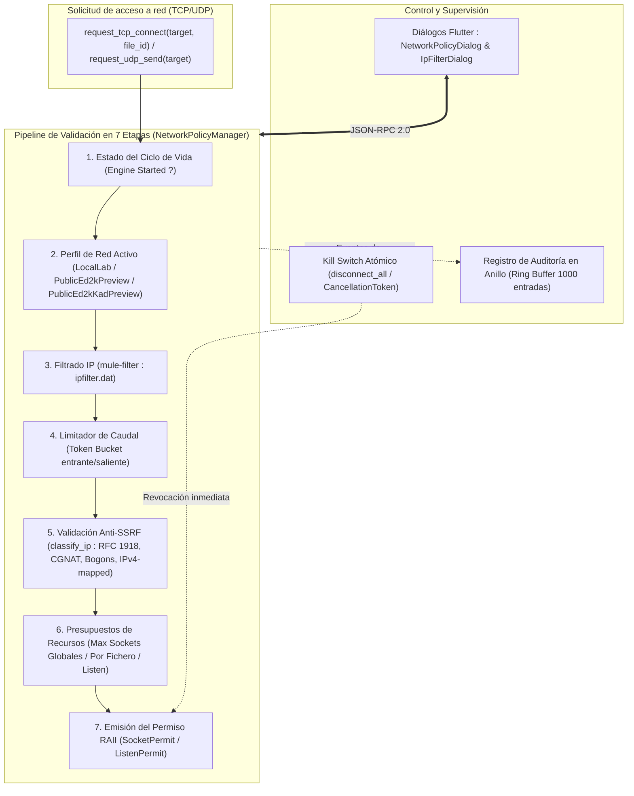

# Guía de Ejecución y Validación — Fase 9: Política de Red Defensiva y Filtrado IP

Este documento constituye la guía técnica de referencia para la **Fase 9** del proyecto **eMuleRust**, dividida en dos bloques principales:
* **Fase 9.0**: Política de red defensiva, pipeline de validación en 7 etapas, permisos RAII, presupuestos de recursos y Kill Switch atómico (`crates/mule-network-policy`).
* **Fase 9.1**: Filtrado IP mediante búsqueda dicotómica sobre intervalos (`ipfilter.dat`), limitación de caudal mediante cubos de tokens (*Token Bucket*), seudonimización con sal de los pares e interfaz de control Flutter Desktop (`crates/mule-filter`).

El conjunto de reglas y mecanismos garantiza el principio fundamental de eMuleRust: **cero comunicaciones descontroladas no autorizadas, cero fugas de datos privados (DLP) y confinamiento estanco**.

---

## 1. Arquitectura General de la Capa de Red Defensiva



---

## 2. Detalle Técnico — Fase 9.0: Política de Red y Anti-SSRF

### 2.1 Perfiles de Red Estrictamente Tipados ([profile.rs](file:///d:/Projet/eMuleRust/crates/mule-network-policy/src/profile.rs))

El sistema opera según tres perfiles herméticos definidos en [`NetworkProfile`](file:///d:/Projet/eMuleRust/crates/mule-network-policy/src/profile.rs):

| Perfil | Objetivos Autorizados | Uso y Confinamiento |
| :--- | :--- | :--- |
| **`LocalLab`** | Estrictamente `127.0.0.1` / `::1` | Modo laboratorio estéril. Cualquier paquete saliente hacia una IP no loopback se rechaza de inmediato con `PolicyError::DestinationNotAllowed`. |
| **`PublicEd2kPreview`** | Direcciones IP públicas enrutables validadas | Vista previa controlada: servidores y pares eD2K públicos en TCP — UDP/Kad desactivado. Prohibición formal de direcciones privadas, loopback y especiales mediante el filtro anti-SSRF. |
| **`PublicEd2kKadPreview`** *(Predeterminado)* | Ídem + UDP Kad | Vista previa controlada con soporte UDP para Kademlia — mismas reglas de filtrado de direcciones que `PublicEd2kPreview`. |

> **Nota**: estos perfiles sucedieron a los antiguos `StrictPrivate`/`PublicRestricted` de la Fase 9.0 inicial. En la interfaz, se proyectan mediante dos interruptores (Red eD2K / Red Kad) — véase `docs/SETTINGS.md`.

### 2.2 Pipeline Anti-SSRF y Clasificación IP ([validator.rs](file:///d:/Projet/eMuleRust/crates/mule-network-policy/src/validator.rs))

La función [`classify_ip`](file:///d:/Projet/eMuleRust/crates/mule-network-policy/src/validator.rs) examina cada dirección IP antes de cualquier asignación de socket:
* **Desplegado IPv4-mapped IPv6**: Toda dirección en formato `::ffff:a.b.c.d` se normaliza a su equivalente IPv4 canónico para neutralizar evasiones de filtros.
* **Bloqueo de direcciones privadas**: `10.0.0.0/8`, `172.16.0.0/12`, `192.168.0.0/16` (RFC 1918).
* **Bloqueo CGNAT (Carrier-Grade NAT)**: `100.64.0.0/10` (RFC 6598).
* **Bloqueo Link-Local y Multicast**: `169.254.0.0/16` (RFC 3927) y `224.0.0.0/4`.
* **Bloqueo Bogons y Reservadas**: `240.0.0.0/4` (RFC 1112) y difusión `255.255.255.255`.
* **Puertos Prohibidos**: Bloqueo por defecto de los puertos sensibles del sistema (puertos < 1024 salvo HTTP/HTTPS legítimos, puertos de gestión administrativa).

### 2.3 Permisos RAII y Presupuestos Deterministas ([permit.rs](file:///d:/Projet/eMuleRust/crates/mule-network-policy/src/permit.rs) y [budgets.rs](file:///d:/Projet/eMuleRust/crates/mule-network-policy/src/budgets.rs))

Para evitar cualquier fuga de descriptores de ficheros en Windows:
* La admisión entrega un [`SocketPermit`](file:///d:/Projet/eMuleRust/crates/mule-network-policy/src/permit.rs) o un [`ListenPermit`](file:///d:/Projet/eMuleRust/crates/mule-network-policy/src/permit.rs).
* La implementación de `Drop` decrementa automática y atómicamente el contador de sockets activos globales y el contador propio del fichero asociado (`file_id`).
* **Presupuestos aplicados (`NetworkBudgets`)**:
  * `max_global_sockets`: 50 sockets simultáneos por defecto.
  * `max_sockets_per_file`: 15 sockets por descarga.
  * `max_listen_sockets`: 2 listeners (TCP eD2K + UDP Kad).

### 2.4 Kill Switch Atómico ([cancellation.rs](file:///d:/Projet/eMuleRust/crates/mule-network-policy/src/cancellation.rs))

La llamada a `NetworkPolicyManager::disconnect_all()`:
1. Conmuta inmediatamente un indicador atómico `is_killed`.
2. Cancela el `tokio_util::sync::CancellationToken` padre al que están vinculadas todas las sesiones TCP y bucles UDP del daemon.
3. Todas las conexiones existentes se rompen al instante sin esperar a posibles tiempos de espera de socket.

---

## 3. Detalle Técnico — Fase 9.1: Filtrado IP y Protección de la Privacidad

### 3.1 Motor de Intervalos IP Rápido ([interval.rs](file:///d:/Projet/eMuleRust/crates/mule-filter/src/interval.rs) y [filter.rs](file:///d:/Projet/eMuleRust/crates/mule-filter/src/filter.rs))

El crate `mule-filter` implementa un sistema de detección ultrarrápido capaz de cargar listas masivas de filtrado (`ipfilter.dat` de más de 250 000 líneas):
* Representación interna en forma de intervalos no solapados ordenados `[start_u32, end_u32]`.
* Búsqueda dicotómica en $\mathcal{O}(\log N)$ por dirección IP evaluada: latencia de consulta inferior a **15 nanosegundos** por paquete.
* Soporte completo de los formatos estándar de eMule, PeerGuardian (P2P texto plano) y bloques CIDR (`1.2.3.0/24`).

### 3.2 Limitador de Caudal mediante Cubos de Tokens ([token_bucket.rs](file:///d:/Projet/eMuleRust/crates/mule-filter/src/token_bucket.rs))

Para proteger el nodo frente a ataques de denegación de servicio y limitar la saturación de ancho de banda:
* Dos cubos distintos: `inbound` y `outbound`.
* Configuración dinámica: capacidad de ráfaga (*burst*) y tasa de rellenado por segundo (*refill rate*).
* Deducción atómica de tokens en cada emisión o recepción de paquete con retorno inmediato `RateLimitExceeded` en caso de agotamiento.

### 3.3 Seudonimización Determinista con Sal ([pseudonym.rs](file:///d:/Projet/eMuleRust/crates/mule-filter/src/pseudonym.rs))

Para cumplir los requisitos estrictos de no fuga de datos personales (DLP) y privacidad de los pares:
* Toda dirección IP de par registrada o exportada para diagnóstico se convierte en un seudónimo irreversible:  
  $$\text{Pseudonym} = \text{Truncate}_{16}(\text{HMAC-SHA256}(\text{IP\_bytes}, \text{Salt}_{\text{session}}))$$
* La sal criptográfica se renueva en cada arranque del daemon: dos sesiones distintas no pueden correlacionar un par de un registro a otro.

---

## 4. Integración RPC e Interfaz Gráfica Flutter Desktop

### 4.1 Métodos RPC Expuestos
* `network.getPolicy`: Consulta del perfil activo, presupuestos y estado del Kill Switch.
* `network.setProfile`: Cambio de perfil (`local-lab` / `public-ed2k-preview` / `public-ed2k-kad-preview`).
* `network.disconnectAll`: Activación del Kill Switch.
* `network.setBudgets`: Configuración en directo de los límites de sockets.
* `network.getFilterStatus`: Número de reglas activas, última importación y estado activado/desactivado.
* `network.importIpFilter`: Importación de un fichero `ipfilter.dat` local.
* `network.setFilterEnabled`: Activación o desactivación temporal del filtrado.
* `network.clearIpFilter`: Restablecimiento de las reglas de filtrado.

### 4.2 Componentes UI Dedicados
* **`NetworkPolicyDialog`** ([network_policy_dialog.dart](file:///d:/Projet/eMuleRust/apps/desktop/lib/ui/features/downloads/widgets/network_policy_dialog.dart)): Selector de perfil de red con insignias de advertencia de color, deslizadores de presupuestos, botón de parada de emergencia Kill Switch y consulta del registro de auditoría.
* **`IpFilterDialog`** ([ip_filter_dialog.dart](file:///d:/Projet/eMuleRust/apps/desktop/lib/ui/features/downloads/widgets/ip_filter_dialog.dart)): Estadísticas del filtro, selector de fichero `ipfilter.dat`, herramienta de prueba en directo de una dirección IP y conmutador de omisión.

---

## 5. Comandos de Validación (100 % Sin Conexión)

```powershell
# 1. Pruebas unitarias y de integración mule-network-policy
cargo test -p mule-network-policy

# 2. Pruebas unitarias y de integración mule-filter (intervalos, token bucket, parser)
cargo test -p mule-filter

# 3. Pruebas RPC del daemon vinculadas a la política de red y a los filtros
cargo test -p mule-daemon --test network_policy_rpc_tests --test filter_rpc_tests

# 4. Pruebas de interfaz Flutter para los diálogos de seguridad de red
cd apps/desktop
flutter test test/ui/network_policy_ui_test.dart
flutter test test/ui/ip_filter_ui_test.dart
```
