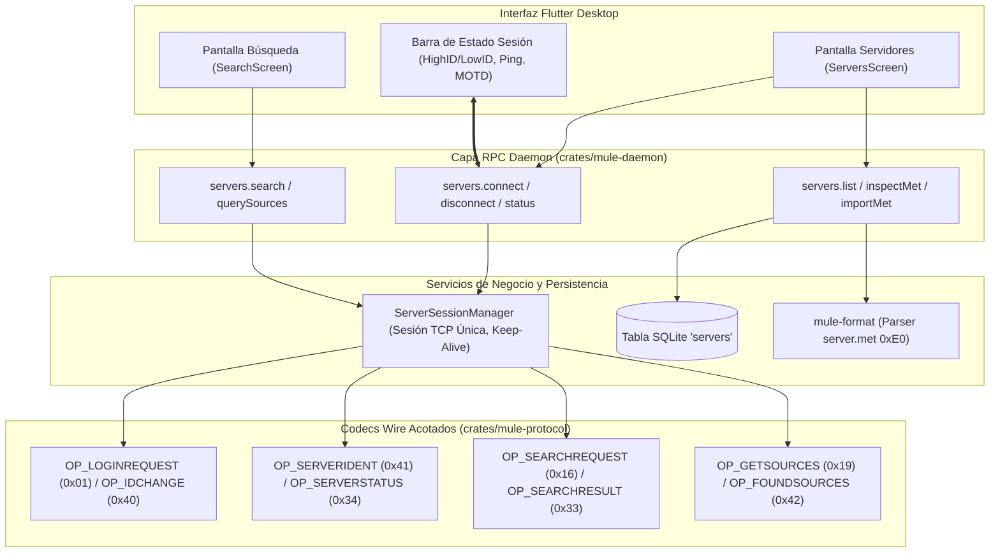
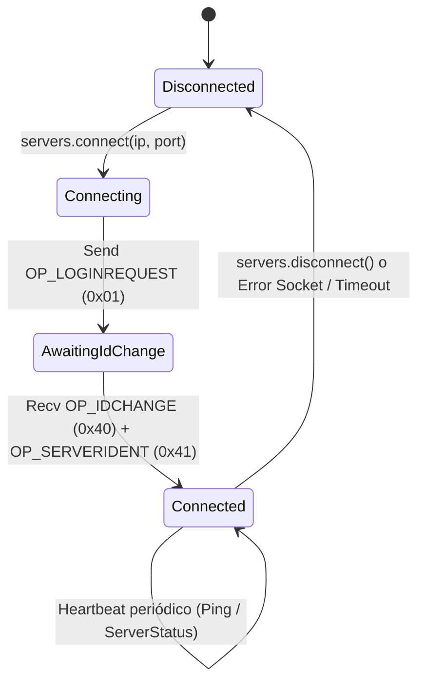

# Guía de Ejecución y Validación — Fase 10: Infraestructura de Servidores eD2K

Este documento constituye la guía técnica de referencia para la **Fase 10** del proyecto **eMuleRust**, dedicada a la integración completa de la pila cliente-servidor eD2K:
* **Fase 10.0**: Decodificación binaria de ficheros `server.met`, modelo de dominio, persistencia SQLite WAL e interfaz de administración local sin sockets externos.
* **Fase 10.1**: Conexión TCP real a los servidores eD2K (Lugdunum / eMule Sunrise), negociación de sesión, identificación, obtención de HighID/LowID y seguimiento de salud (ping/heartbeat).
* **Fase 10.2**: Motor de búsqueda remoto en catálogo de servidor y resolución dinámica de las fuentes de descarga.

Todos los desarrollos respetan la regla de oro de eMuleRust: **control total del usuario, verificación defensiva de cada byte de red y gestión irreprochable del ciclo de vida de los sockets**.

---

## 1. Arquitectura Global del Subsistema de Servidores



---

## 2. Fase 10.0: Directorio Local, Parser `server.met` y Persistencia

### 2.1 Formato Binario `server.met` ([server_met.rs](file:///d:/Projet/eMuleRust/crates/mule-format/src/met/server_met.rs))

El formato histórico de eMule comienza con un byte mágico `0xE0` seguido del número de servidores codificado en 32 bits (Little-Endian):
* Para cada servidor:
  * **IP del anfitrión**: 4 bytes (Little-Endian).
  * **Puerto TCP**: 2 bytes (Little-Endian).
  * **Número de etiquetas de metadatos**: 4 bytes.
  * **Etiquetas TLV**: Nombre del servidor (`TAG_SERVER_NAME = 0x01`), Ping (`TAG_SERVER_PING = 0x0C`), Usuarios (`TAG_SERVER_USERS = 0x0E`), Ficheros (`TAG_SERVER_FILES = 0x0F`), Descripción, Preferencia.

El parser [`ServerMetReader`](file:///d:/Projet/eMuleRust/crates/mule-format/src/met/server_met.rs) aplica controles estrictos antidenegación de servicio:
* Acotación absoluta a 10 000 servidores por fichero.
* Rechazo de etiquetas corruptas con informe de errores detallado.
* Normalización Unicode NFC de las cadenas con saneamiento de caracteres de control.

### 2.2 Persistencia SQLite ([sqlite/servers.rs](file:///d:/Projet/eMuleRust/crates/mule-core/src/persistence/sqlite/servers.rs))

Los servidores se almacenan en la tabla SQLite `servers` con gestión de unicidad sobre `(ip, port)`:
* Estado de activación (`enabled`), preferencia (`Low`, `Normal`, `High`), fallos consecutivos (`failed_count`).
* Mantenimiento en caché de las métricas: último ping, número de usuarios y de ficheros informados.

---

## 3. Fase 10.1: Conexión TCP Real y Negociación de Sesión

### 3.1 Máquina de Estados de Sesión de Servidor ([server_session.rs](file:///d:/Projet/eMuleRust/crates/mule-daemon/src/services/server_session.rs))

El gestor de sesión garantiza el invariante: **como máximo una conexión de servidor activa simultáneamente**.



### 3.2 Paquetes Wire Tratados ([crates/mule-protocol/src/ed2k/server/](file:///d:/Projet/eMuleRust/crates/mule-protocol/src/ed2k/server/))

| Opcode | Nombre | Dirección | Descripción |
| :--- | :--- | :--- | :--- |
| `0x01` | `OP_LOGINREQUEST` | Cliente $\to$ Servidor | Emisión del UserHash, ClientID inicial (0), Puerto TCP de escucha y nombre de usuario. |
| `0x38` | `OP_SERVERMESSAGE` | Servidor $\to$ Cliente | Mensaje de bienvenida (MOTD) o advertencias legales del servidor. |
| `0x40` | `OP_IDCHANGE` | Servidor $\to$ Cliente | Asignación del identificador de cliente final (**ClientID**). |
| `0x41` | `OP_SERVERIDENT` | Servidor $\to$ Cliente | Identidad del servidor: nombre canónico, descripción, versión Lugdunum. |
| `0x34` | `OP_SERVERSTATUS` | Servidor $\to$ Cliente | Telemetría en directo: número total de usuarios conectados y de ficheros indexados. |

### 3.3 Determinación HighID frente a LowID

La dirección IP asignada en `OP_IDCHANGE` determina la calidad de conectividad:
* Si $\text{ClientID} \ge 16\,777\,216$ ($0x01000000$): **HighID** — El servidor pudo establecer una conexión de retorno en nuestro puerto TCP entrante. El cliente puede comunicarse directamente con cualquier par.
* Si $\text{ClientID} < 16\,777\,216$: **LowID** — El puerto TCP entrante es inaccesible desde el exterior (cortafuegos o NAT estricto). Las transferencias entre dos clientes LowID son imposibles sin retransmisión del servidor.

---

## 4. Fase 10.2: Motor de Búsqueda y Resolución de Fuentes

### 4.1 Búsqueda Remota de Ficheros ([search.rs](file:///d:/Projet/eMuleRust/crates/mule-protocol/src/ed2k/server/search.rs))

El envío de la petición `OP_SEARCHREQUEST` (`0x16`) permite consultar la base de datos del servidor:
* Expresión en árbol codificada en prefijo (operadores booleanos AND, OR, NOT, filtros de tamaño mínimo/máximo, extensiones de fichero).
* Recepción en flujo de `OP_SEARCHRESULT` (`0x33`): cada entrada contiene el nombre del fichero, el tamaño exacto en bytes, el hash eD2K raíz (16 bytes) y el número de fuentes completas y parciales conocidas.

### 4.2 Petición de Fuentes al Servidor ([sources.rs](file:///d:/Projet/eMuleRust/crates/mule-protocol/src/ed2k/server/sources.rs))

En cuanto una descarga está activa:
1. El cliente emite `OP_GETSOURCES` (`0x19`) transmitiendo el hash eD2K (16 bytes) y el tamaño del fichero.
2. El servidor responde con `OP_FOUNDSOURCES` (`0x42`): lista de direcciones `IP:port` de los pares que alojan todo o parte del fichero.
3. Las fuentes se deduplican, se filtran frente al anti-SSRF y al IPFilter y se transmiten al `SwarmCoordinator`.

---

## 5. Comandos de Validación (100 % Sin Conexión)

```powershell
# 1. Validación del parser de vectores server.met
cargo test -p mule-format --test server_met_vectors

# 2. Validación de los codecs en línea cliente-servidor
cargo test -p mule-protocol --test server_codec_tests

# 3. Validación de la persistencia SQLite de los servidores
cargo test -p mule-core --test sqlite_servers_tests

# 4. Pruebas de integración de conexión, búsqueda y fuentes de servidor
cargo test -p mule-daemon --test server_connection_tests --test servers_rpc_tests

# 5. Pruebas de interfaz Flutter para las pantallas Servidores y Búsqueda
cd apps/desktop
flutter test test/ui/servers_view_test.dart
flutter test test/ui/servers_connection_test.dart
flutter test test/ui/search_view_test.dart
```
