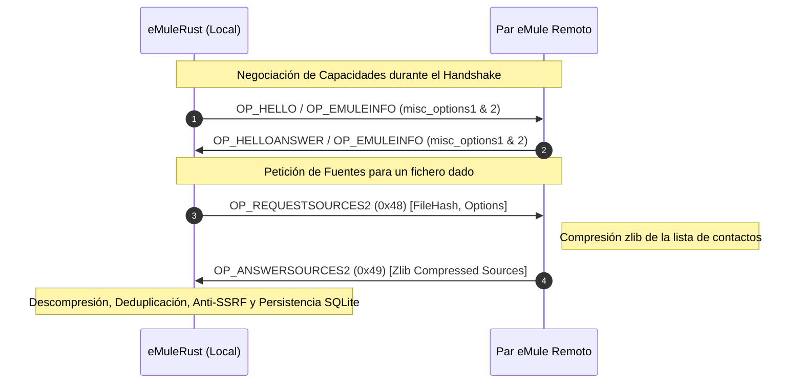

# Guía de Ejecución y Validación — Fase 13: Source Exchange v4, Bloques Comprimidos y Servidor Agente IA (MCP)

Este documento constituye la guía técnica de referencia para la **Fase 13** (versión `v0.1.6`) del proyecto **eMuleRust**, caracterizada por la culminación de la interoperabilidad avanzada entre pares y la apertura a los agentes autónomos:
* **Source Exchange v4 (SX1 y SX2)**: Protocolo descentralizado de intercambio de fuentes entre pares sin intermediario de servidor, con compresión zlib y negociación de versión mediante `misc_options1`.
* **Streaming de Bloques Comprimidos zlib**: Soporte nativo del paquete `OP_COMPRESSEDPART` (0x40) que permite una reducción drástica del ancho de banda durante la transferencia de bloques de 180 KB.
* **Servidor Model Context Protocol (MCP)**: Creación del crate dedicado `crates/mule-mcp` que expone **83 herramientas MCP** para el control completo del nodo por parte de agentes de inteligencia artificial.

---

## 1. Source Exchange v4: Descubrimiento Entre Pares Descentralizado



### 1.1 Variantes Soportadas ([crates/mule-protocol/src/ed2k/source_exchange/](file:///d:/Projet/eMuleRust/crates/mule-protocol/src/ed2k/source_exchange/))

* **SX1 (Estándar)**:
  * Petición: `OP_REQUESTSOURCES` (`0x43`).
  * Respuesta: `OP_ANSWERSOURCES` (`0x44`).
  * Formato: Lista en bruto o comprimida de direcciones IPv4 (4 bytes LE) y puertos TCP (2 bytes LE).
* **SX2 (Extendido)**:
  * Petición: `OP_REQUESTSOURCES2` (`0x48`).
  * Respuesta: `OP_ANSWERSOURCES2` (`0x49`).
  * Formato: Soporte de identificadores Kad, indicadores de cifrado criptográfico y UserHash de los pares compartidos.

### 1.2 Negociación de Capacidades ([peer_info.rs](file:///d:/Projet/eMuleRust/crates/mule-protocol/src/ed2k/peer_info.rs))

Las capacidades de Source Exchange de un par se extraen dinámicamente al recibir `OP_EMULEINFO` u `OP_HELLO`:
* Decodificación de la etiqueta `CTAG_EMULE_MISCOPTIONS1` (`0xFA`):
  * Bits 12 a 15: Versión SX anunciada (Versión 1, 2, 3 o 4).
* Solo se consulta a los pares que anuncian explícitamente el soporte de SX, evitando errores de paquetes no reconocidos en clientes históricos estrictos.

---

## 2. Transferencia de Bloques Comprimidos (`OP_COMPRESSEDPART`)

En la red eDonkey2000 moderna, los clientes recientes ya no emiten los datos en bruto mediante `OP_SENDINGPART` (`0x46`), sino que comprimen sistemáticamente cada bloque de 180 KB mediante zlib:
* **Opcode en línea**: `OP_COMPRESSEDPART` (`0x40`).
* **Cabecera de trama**:
  * Hash del fichero objetivo: 16 bytes.
  * Desplazamiento de inicio en el fichero: 4 u 8 bytes (soporte de ficheros muy grandes > 4 GB).
  * Tamaño descomprimido esperado: 4 bytes.
  * Datos comprimidos: flujo en bruto zlib (Deflate).

### Pipeline de Recepción en Streaming ([transfer.rs](file:///d:/Projet/eMuleRust/crates/mule-daemon/src/services/peer_session/transfer.rs))
1. **Descompresión continua en memoria**: Uso del descompresor `flate2::read::ZlibDecoder` con protección frente a bombas de descompresión (*zip-bombs*: ratio de expansión acotado).
2. **Verificación de tamaño exacto**: Validación de que el número de bytes descomprimidos coincide escrupulosamente con el rango declarado por el secuenciador de bloques.
3. **Escritura directa en el fichero disperso**: Inyección inmediata de los bytes reconstruidos en el fichero temporal `.part` en el desplazamiento absoluto.

---

## 3. Servidor MCP Nativo para Agentes de Inteligencia Artificial (`crates/mule-mcp`)

El crate [`crates/mule-mcp`](file:///d:/Projet/eMuleRust/crates/mule-mcp) integra una pasarela stdio conforme a la especificación **Model Context Protocol (MCP)**, permitiendo a un asistente de IA administrar, supervisar e interactuar con eMuleRust de forma transparente.

### 3.1 Arquitectura del Puente MCP
```
┌───────────────────────────────┐
│     Agente IA (Host MCP)      │  Ej: Claude Desktop, Antigravity, Cursor
└───────────────┬───────────────┘
                │ Stdio (JSON-RPC 2.0)
┌───────────────▼───────────────┐
│     crates/mule-mcp (Rust)    │  Servidor MCP local autónomo
└───────────────┬───────────────┘
                │ WebSocket (127.0.0.1:4660/ws + auth.token)
┌───────────────▼───────────────┐
│     crates/mule-daemon        │  Daemon eMuleRust
└───────────────────────────────┘
```

### 3.2 Síntesis de las 83 Herramientas MCP Expuestas por Subsistema

| Subsistema | Herramientas Clave | Responsabilidad y Acciones |
| :--- | :--- | :--- |
| **Sistema y Daemon** (6) | `emule_status`, `emule_get_settings`, `emule_update_settings`, `emule_set_limits`, `emule_shutdown` | Supervisión de estado global, cuotas de velocidad, ciclo de vida. |
| **Descargas** (11) | `emule_list_downloads`, `emule_add_link`, `emule_pause_download`, `emule_resume_download`, `emule_remove_download`, `emule_set_destination`, `emule_inspect_part_met`, `emule_import_part_met` | Gestión completa de la cola e inspección de integridad de `.part.met`. |
| **Categorías** (5) | `emule_list_categories`, `emule_create_category`, `emule_update_category`, `emule_delete_category`, `emule_reorder_categories` | Organización y enrutamiento jerárquico hacia directorios específicos. |
| **Historial y Estadísticas** (4) | `emule_list_history`, `emule_history_stats`, `emule_clear_history`, `emule_export_history` | Auditoría de transferencias pasadas y exportaciones saneadas sin fuga de rutas. |
| **Búsqueda** (1) | `emule_search` | Búsqueda unificada o dirigida en Kad DHT y servidores eD2K. |
| **Servidores eD2K** (10) | `emule_list_servers`, `emule_connect_server`, `emule_disconnect_server`, `emule_update_servers_from_url`, `emule_inspect_server_met`, `emule_query_server_sources` | Control del directorio y de las peticiones a servidores. |
| **Enjambre y Fuentes** (6) | `emule_list_sources`, `emule_add_manual_source`, `emule_connect_source`, `emule_disconnect_source`, `emule_clear_sources`, `emule_swarm_status` | Visualización y manipulación fina del enjambre de pares. |
| **Compartidos y Subida** (6) | `emule_list_shares`, `emule_add_share`, `emule_remove_share`, `emule_list_uploads`, `emule_cancel_upload` | Declaración de carpetas compartidas y seguimiento de las ranuras de subida. |
| **Entrante y UPnP** (7) | `emule_start_listener`, `emule_stop_listener`, `emule_listener_status`, `emule_upnp_status`, `emule_upnp_map_ports`, `emule_upnp_unmap_ports` | Mapeo automático de puertos del router y control del listener. |
| **Kad DHT Avanzado** (13) | `emule_kad_status`, `emule_kad_bootstrap`, `emule_kad_start_udp`, `emule_kad_ping`, `emule_kad_find_node`, `emule_kad_list_contacts`, `emule_kad_search_sources`, `emule_kad_publish_source` | Enrutamiento Kademlia, arranque, publicación y resolución descentralizada. |
| **Seguridad y Política** (14) | `emule_get_network_policy`, `emule_set_network_profile`, `emule_network_disconnect_all`, `emule_import_ip_filter`, `emule_set_network_budgets`, `emule_get_identity`, `emule_rotate_identity`, `emule_list_credits` | Confinamiento estanco, Kill Switch de emergencia, IPFilter y gestión criptográfica. |

---

## 4. Comandos de Validación (100 % Sin Conexión)

```powershell
# 1. Pruebas de decodificación y codificación Source Exchange v1 y v2
cargo test -p mule-protocol --test ed2k_roundtrip_tests source_exchange

# 2. Pruebas de transferencia y descompresión de bloques zlib (OP_COMPRESSEDPART)
cargo test -p mule-protocol --test ed2k_block_transfer_tests

# 3. Compilación y verificación del binario mule-mcp
cargo check -p mule-mcp

# 4. Ejecución de la suite de pruebas mule-mcp
cargo test -p mule-mcp
```
