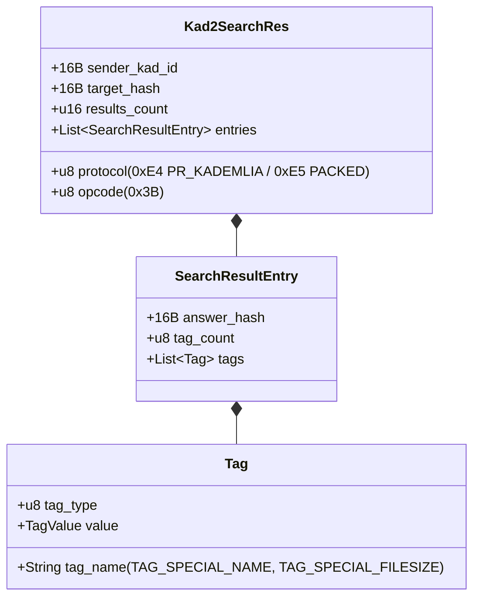

# Guía de Ejecución y Validación — Fase 14: Convergencia Kad DHT y Refactorización Clean Architecture

Este documento constituye la guía técnica de referencia para la **Fase 14** (versión `v0.1.7`) del proyecto **eMuleRust**, dedicada a la resolución de las anomalías profundas de enrutamiento DHT y a la refactorización estructural integral del workspace:
* **Convergencia del Motor de Búsqueda Kad DHT**: Alineación estricta con la especificación oficial de eMule `CUInt128`, decodificación universal del paquete `0x3B` (`KADEMLIA2_SEARCH_RES`), resolución de colisiones de opcodes y eliminación de los artefactos de caudal congelado (*stall decay*).
* **Refactorización Clean Architecture**: División modular de la totalidad de los monolitos de código en `mule-daemon`, `mule-protocol`, `mule-core` y `mule-mcp` para garantizar un acoplamiento bajo, una legibilidad ejemplar y ficheros concisos (< 350 líneas).

---

## 1. Convergencia y Resolución de la Búsqueda Kad DHT

### 1.1 Problemas Raíz Resueltos

Antes de la Fase 14, la búsqueda descentralizada Kad no devolvía ningún resultado (`found 0 unique file results`) y las velocidades de descarga permanecían a veces congeladas indefinidamente tras detenerse un par:

1. **Opcode de respuesta erróneo en el protocolo**:
   * El cliente esperaba el opcode no estándar `0x2C` para `KADEMLIA2_SEARCH_KEYWORD_RES`.
   * **Realidad del protocolo oficial de eMule**: La respuesta universal Kad2 para cualquier búsqueda (palabras clave, fuentes, notas) es **`0x3B` (`KADEMLIA2_SEARCH_RES`)**.
2. **Fallo de deserialización del paquete `0x3B`**:
   * El decodificador trataba arbitrariamente `0x3B` como una lista plana de fuentes (25 bytes por contacto fijo).
   * **Estructura en línea real**: Cabecera Kad2 de 34 bytes (`sender_kad_id: 16B`, `target_hash: 16B`, `count: 2B`), seguida para cada resultado de un `answer_hash` (16B), un `tag_count` (1B) y una lista de etiquetas TLV eD2K compactas (`TAG_SPECIAL_NAME`, `TAG_SPECIAL_FILESIZE`, `TAG_SOURCES`). Como consecuencia, todos los paquetes de red reales se rechazaban con el error `UnexpectedEof`.
3. **Carga útil excedente en la petición `0x33` (`KADEMLIA2_SEARCH_KEYWORD_REQ`)**:
   * Envío de bytes superfluos que provocaba el rechazo de la petición por parte de los clientes eMule estrictos. Solo deben transmitirse 18 bytes (`target: 16B` + `startPos: 2B`).
4. **Métrica de distancia numérica de 128 bits (`CUInt128`)**:
   * El cálculo de distancia XOR sobre 16 bytes separados inducía distorsiones de ordenación. La alineación sobre una comparación en 4 DWORDs (32 bits cada uno) con `leading_zeros()` reproduce fielmente la métrica oficial de Kademlia y permite alcanzar el criterio de convergencia `SEARCHTOLERANCE` ($0x01000000$).
5. **Velocidad de descarga congelada durante un bloqueo**:
   * En caso de ruptura silenciosa del flujo de datos, el caudal instantáneo conservaba indefinidamente su último valor. La adición de una caída dinámica (*stall decay*) devuelve automáticamente la velocidad a 0 B/s si no se recibe ningún bloque durante más de 2 segundos.

### 1.2 Esquema Wire Validado para `KADEMLIA2_SEARCH_RES` (0x3B)



---

## 2. Refactorización Clean Architecture del Workspace

Todos los ficheros monolíticos (algunos superaban las 1 200 líneas) se han dividido en módulos de dominio autónomos que respetan el principio de responsabilidad única (*Single Responsibility Principle*).

### 2.1 División de `crates/mule-daemon`
* **Handlers RPC (`src/rpc/handlers/`)**: Sustitución del antiguo `methods.rs` monolítico por 11 gestores aislados:
  * `downloads.rs`, `servers.rs`, `kad.rs`, `sources.rs`, `shares.rs`, `history.rs`, `categories.rs`, `network.rs`, `settings.rs`, `upnp.rs`, `lab.rs`.
* **Servicios de Negocio Divididos (`src/services/`)**:
  * `peer_session/`: `connection.rs`, `handshake.rs`, `status_query.rs`, `source_exchange.rs`, `transfer.rs`, `events.rs`.
  * `kad_udp/`: `routing_client.rs`, `search_client.rs`, `handlers.rs`.
  * `swarm_coordinator/`: `strategy.rs`, `types.rs`, `swarm_coordinator.rs`.
  * `inbound_listener/`: `connection.rs`, `dispatcher.rs`.
  * `downloads/`: `history_categories.rs`, `peers_servers.rs`, `operations.rs`, `part_met.rs`.

### 2.2 División de `crates/mule-protocol`
* `src/framing/`: Gestión de delimitadores de tramas y magic bytes TCP/UDP.
* `src/ed2k/`:
  * `decoder/`: `handshake.rs`, `status.rs`, `transfers.rs`, `decoder.rs`.
  * `encoder/`: `handshake.rs`, `tags.rs`, `transfers.rs`, `security.rs`.
  * `obfuscation/`: Intercambio de claves Diffie-Hellman y cifrado RC4.
  * `server/`: `types.rs`, `search.rs`, `sources.rs`.
  * `source_exchange/`: Peticiones y respuestas SX1/SX2.
* `src/kad/`: `decoder/` (`routing.rs`, `search.rs`), `encoder.rs`, `types.rs`, `opcodes.rs`.

### 2.3 División de `crates/mule-core`
* `src/persistence/sqlite/`: Sustitución del fichero monolítico `sqlite.rs` por 10 submódulos especializados:
  * `connection.rs` (WAL y migraciones), `downloads.rs`, `categories.rs`, `history.rs`, `servers.rs`, `sources.rs`, `kad_contacts.rs`, `kad_sources.rs`, `kad_keywords.rs`, `settings.rs`.

### 2.4 División de `crates/mule-mcp`
* `src/tools/`: Separación estricta entre definiciones de esquemas JSON y ejecución de comandos RPC:
  * `downloads/` (`schemas.rs`, `handlers.rs`), `shares/` (`schemas.rs`, `handlers.rs`), `kad.rs`, `servers.rs`, `system.rs`.

---

## 3. Síntesis de Métricas Antes / Después

| Indicador | Antes de la Refactorización | Después de la Refactorización |
| :--- | :--- | :--- |
| **Tamaño máximo de fichero** | 1 200+ líneas (`methods.rs`, `peer_session.rs`) | **200 a 350 líneas** |
| **Monolitos multi-responsabilidad** | 12 ficheros | **0 (Arquitectura 100 % modular)** |
| **Búsqueda Kad (palabras clave)** | 0 resultados (rechazo paquete 0x3B) | **Convergencia operativa y resultados válidos** |
| **Artefactos de caudal congelado** | Presentes en caso de inactividad de par | **Caída automática (*stall decay*) a 0 B/s** |
| **Retrocompatibilidad API / RPC** | — | **100 % preservada, 0 rupturas de contrato** |

---

## 4. Comandos de Validación (100 % Sin Conexión)

```powershell
# 1. Verificación de la suite de pruebas del protocolo Kad y de los codecs
cargo test -p mule-protocol --test kad_codec_tests

# 2. Pruebas de publicación y búsqueda de palabras clave / fuentes Kad
cargo test -p mule-daemon --test kad_keywords_tests --test kad_sources_tests

# 3. Pruebas de persistencia SQLite modular
cargo test -p mule-core --test sqlite_kad_keywords_tests --test sqlite_kad_sources_tests

# 4. Verificación completa del workspace Rust sin ninguna advertencia
cargo check --workspace --all-targets
```
