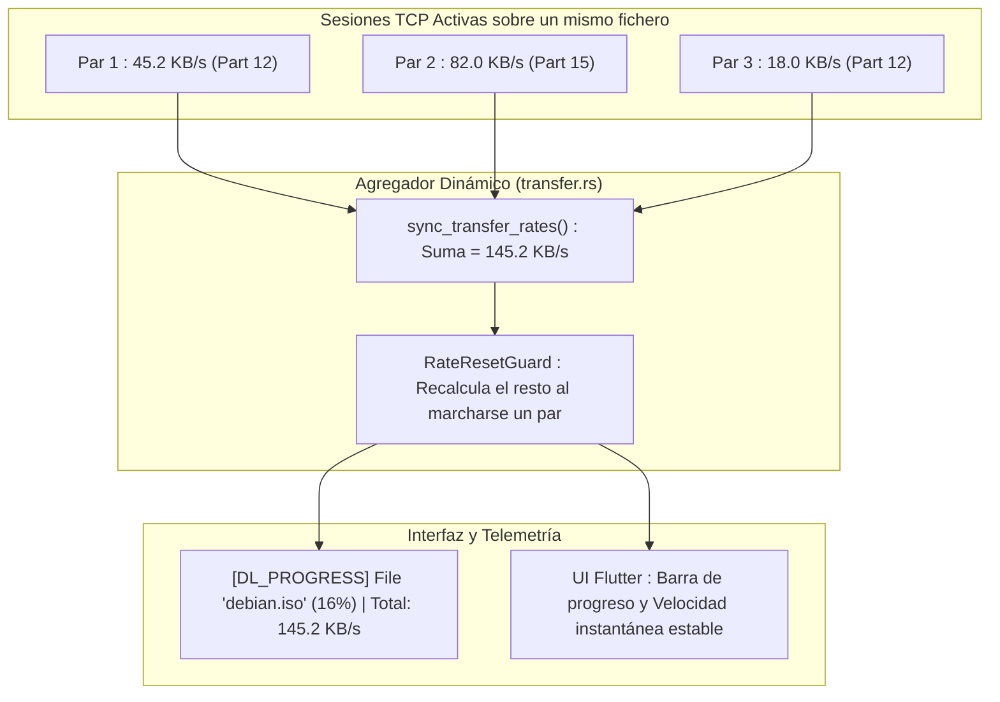

# Guía de Ejecución y Validación — Fase 15: Descarga Multipar, Queue Ranking eMule y Registros Estratégicos

Este documento constituye la guía técnica de referencia para la **Fase 15** (versión `v0.1.8`) del proyecto **eMuleRust**, dedicada a la estabilización de las transferencias en enjambre real, al respeto del protocolo de cola de espera remoto de eMule y a la observabilidad estratégica del sistema:
* **Agregación Multipar del Caudal**: Cálculo acumulado en directo de la velocidad de descarga global por fichero (`sync_transfer_rates`) y protección `RateResetGuard` frente a los artefactos de visualización a 0 B/s.
* **Gestión Conforme de las Colas de Espera Remotas (Queue Ranking)**: Detección del estado `Disconnected in queue` que preserva el rango de nuestro cliente en los pares eMule con intervalo de reconsulta conforme (10 a 15 minutos).
* **Estabilidad de las Cuotas del Enjambre**: Integración de los pares en cola de espera en el asignador Water-filling para mantener los topes de conexión.
* **Gestor de Subida (Upload Queue)**: Tratamiento de las peticiones `OP_STARTUPLOADREQ` / `OP_ACCEPTUPLOADREQ` y asignación equitativa de las ranuras según los créditos eMule.
* **Sistema de Registros Estratégicos**: Estandarización de 5 categorías de telemetría operativa no invasivas y heartbeat periódico consolidado.
* **Cartografía Completa del Repositorio**: Inventario exhaustivo estructurado en `INDEX.md`.

---

## 1. Agregación Multipar del Caudal de Descarga



### 1.1 Problema Resuelto: La Sobrescritura del Caudal Global
* **Anomalía anterior**: Cada sesión de par llamaba directamente a `set_download_rate_by_hash(rate)`. Si el Par A descargaba a 150 KB/s y el Par B transmitía un pequeño paquete de control a 1 KB/s, la velocidad mostrada para el fichero caía instantáneamente a 1 KB/s, provocando oscilaciones molestas.
* **Corrección aplicada ([transfer.rs](file:///d:/Projet/eMuleRust/crates/mule-daemon/src/services/peer_session/transfer.rs))**:
  * `sync_transfer_rates` recorre todas las sesiones activas vinculadas al hash del fichero y suma sus caudales reales instantáneos.
  * `RateResetGuard` se invoca al cerrarse una sesión (normal, timeout o error): recalcula de inmediato el caudal de las sesiones restantes en lugar de forzar bruscamente la velocidad a cero.

---

## 2. Conformidad con las Colas de Espera Remotas eMule (Queue Ranking)

En la red eDonkey2000, un par eMule oficial cuyas ranuras de subida están todas ocupadas responde con `OP_QUEUERANKING` (`0x60`) para anunciar nuestra posición en su cola de espera (ej.: Rango #42).

### 2.1 Desconexión Normal en Cola de Espera (`Disconnected in queue`)
* **Comportamiento oficial de eMule**: Para ahorrar descriptores de sockets TCP, un cliente eMule cierra habitualmente la conexión TCP una vez asignado el rango. Espera a que nuestro cliente vuelva a consultar más tarde.
* **Anomalía anterior**: Este cierre se interpretaba erróneamente como un fallo crítico de red, baneando la fuente o reconsultándola agresivamente cada 60 segundos (lo que provocaba un baneo por flood en el par remoto).
* **Resolución conforme ([peer_session.rs](file:///d:/Projet/eMuleRust/crates/mule-daemon/src/services/peer_session.rs))**:
  * El cierre de socket tras un `OP_QUEUERANKING` se clasifica como `Disconnected in queue`.
  * La fuente conserva su estado válido `Allowed`.
  * El plazo de reconexión se ajusta al rango canónico de eMule de **10 a 15 minutos**, preservando nuestra prioridad sin penalización.

### 2.2 Preservación del Techo Water-Filling ([strategy.rs](file:///d:/Projet/eMuleRust/crates/mule-daemon/src/services/swarm_coordinator/strategy.rs))
* Las fuentes en estado `Allowed` o `Tried` (en espera en una cola remota) se incluyen en el recuento de fuentes viables.
* El techo de asignación de ranuras calculado por el algoritmo Water-filling ya no se desploma, evitando sacudidas en la gestión del enjambre.

---

## 3. Gestor de Subida y Dispatcher Entrante

El servicio [`crates/mule-daemon/src/services/upload_queue.rs`](file:///d:/Projet/eMuleRust/crates/mule-daemon/src/services/upload_queue.rs) implementa la reciprocidad de compartición:
* Recepción de `OP_STARTUPLOADREQ` (`0x54`) mediante el dispatcher de escucha entrante.
* Si hay ranuras de subida disponibles: emisión inmediata de `OP_ACCEPTUPLOADREQ` (`0x55`).
* En caso contrario: colocación del par en la cola de espera ponderada por sus créditos eMule acumulados (`[UPLOAD_QUEUED]`), cálculo de su rango y emisión de `OP_QUEUERANKING`.
* Al liberarse una ranura (`[UPLOAD_RELEASED]`), el par en cabeza de la cola se promueve automáticamente (`[UPLOAD_PROMOTED]`).

---

## 4. Sistema de Registros Estratégicos en 5 Categorías

Para ofrecer visibilidad inmediata sin saturar la consola con miles de líneas de bloques unitarios, los registros se han reestructurado según 5 prefijos normalizados:

| Prefijo de Log | Disparador y Frecuencia | Ejemplo de Mensaje |
| :--- | :--- | :--- |
| **`[PART_COMPLETED]`** | Finalización de una parte de 9,28 MB | `[PART_COMPLETED] File 'archive.iso': Part 3/10 downloaded & verified. Progress: 30.0%` |
| **`[DL_PROGRESS]`** | Síntesis cada 10s por fichero activo | `[DL_PROGRESS] File 'archive.iso' (30.0% - 27.8/92.8 MB) \| Rate: 245.2 KB/s \| Active peer: 88.190.22.11:4662` |
| **`[KAD_SEARCH]`** | Fin de una búsqueda Kad | `[KAD_SEARCH] SearchSources finished: 18 candidate responses -> 6 new unique sources persisted` |
| **`[UPLOAD_...]`** | Eventos de subida y cola de espera | `[UPLOAD_SLOT_GRANTED] Client 91.121.4.3:4662 granted active upload slot for file 'doc.pdf'` |
| **`[SYSTEM_HEARTBEAT]`** | Síntesis global cada 60s | `[SYSTEM_HEARTBEAT] Server: Connected \| Kad: Running (420 contacts) \| DL: 2 active (342 KB/s) \| UL: 1 active` |

---

## 5. Cartografía Global del Repositorio (`INDEX.md`)

El fichero raíz [`INDEX.md`](file:///d:/Projet/eMuleRust/INDEX.md) se ha creado para ofrecer un directorio completo y documentado de todos los componentes del proyecto:
* Documentación de los crates Rust (`mule-core`, `mule-protocol`, `mule-daemon`, `mule-mcp`, `mule-format`, `mule-filter`, `mule-network-policy`).
* Organización de la aplicación Flutter Desktop (`apps/desktop/lib/`).
* Ubicación y rol de los scripts de automatización, pruebas de integración y especificaciones formales.

---

## 6. Comandos de Validación (100 % Sin Conexión)

```powershell
# 1. Validación de la agregación de velocidad y de las transferencias multipar
cargo test -p mule-daemon --test swarm_dual_peer_tests

# 2. Validación de la cola de subida y de las peticiones entrantes
cargo test -p mule-daemon --test upload_inbound_tests

# 3. Verificación de no regresión sobre la totalidad de las 204+ pruebas Rust del workspace
cargo test --workspace

# 4. Verificación del análisis estático Flutter Desktop
cd apps/desktop
flutter analyze
flutter test
```
