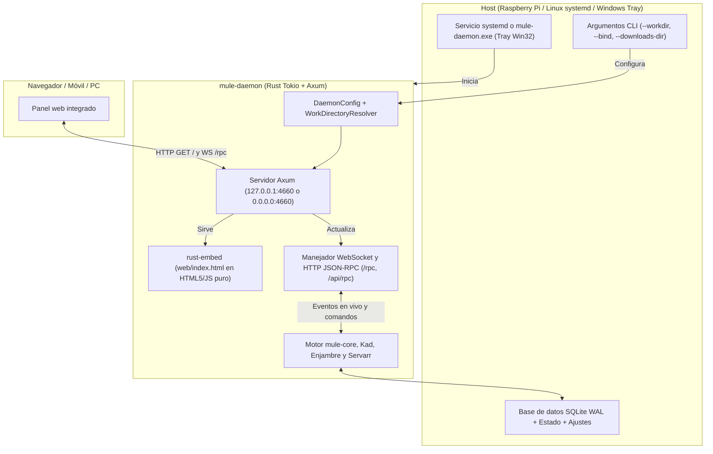

# Plan de implementación: Servidor multiplataforma (Linux / Windows) e interfaz web integrada

**ID de funcionalidad**: `001-headless-daemon-webui`  
**Estado**: Implementado  

---

## 1. Desglose de la arquitectura

---

## 2. Desglose del trabajo (Fases)

### Fase 1: Endurecimiento del servidor y sistema de configuración
- [x] Añadir resolución de directorios (`WorkDirectoryResolver`), modo portable (`portable.flag`) y ajustes en caliente en SQLite (`KNOWN_SETTINGS_KEYS`).
- [x] Soportar dirección de escucha configurable (`--bind`, permitiendo `0.0.0.0:4660` para acceso LAN o `127.0.0.1:4660` en local).
- [x] Crear plantilla de unidad de servicio systemd (`packaging/systemd/mule-daemon.service`) con límites de recursos (`LimitNOFILE=65535`).
- [x] Añadir manejo limpio de señales (`SIGINT`, `SIGTERM`, `shutdown_notify`) para guardado de `.part.met` y cierre de SQLite/UPnP.
- [x] En Windows (`release`), arrancar sin ventana de consola (`windows_subsystem = "windows"`), con icono incrustado (`build.rs`) y bandeja del sistema (`crates/mule-daemon/src/tray.rs`).

### Fase 2: Interfaz web integrada (binario único)
- [x] Crear una SPA rápida y adaptable en HTML5 + CSS + JavaScript puro (`web/index.html`) sin dependencias externas.
- [x] Integrar los recursos directamente en `mule-daemon` mediante `rust-embed`.
- [x] Implementar el enrutamiento de respaldo en Axum con detección de tipo MIME y soporte opcional de `--web-dir`.
- [x] Añadir autenticación de sesión sencilla mediante `window.MULE_SESSION` y guardia anti-SSRF/CSRF.

### Fase 3: Funcionalidades del panel web
- [x] Panel de conexión: Estado en vivo del servidor eD2k y de la DHT Kad, ID IP (HighID/LowID), latencia (ping).
- [x] Vista de transferencias: Descargas activas con velocidad en tiempo real, barras de progreso, mapa visual de bloques/partes y recuento de fuentes.
- [x] Acciones: Añadir enlaces `ed2k://` y `magnet:`, pausar, reanudar, cancelar, establecer prioridad (`Low`, `Normal`, `High`, `Auto`).
- [x] Selector dual de directorios (`Incoming`, `Temp` y bibliotecas): escritura manual o botón `📂` (`settings.pickFolder` / `settings.listDirs`).
- [x] Métricas del sistema: Uso de RAM, conexiones activas, espacio en disco.

### Fase 4: Integración y verificación
- [x] Verificar compilación y ejecución en `x86_64-unknown-linux-gnu`, `aarch64-unknown-linux-gnu` y Windows `x64`.
- [x] Comparativa de huella de memoria bajo carga (observado ~30 MB frente a 2,6 GB de aMule).
- [x] Prueba de convergencia: Validar frente a los criterios de la especificación.
