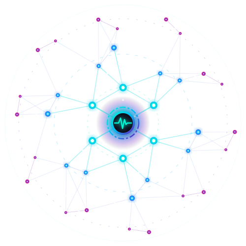

# 📚 Wiki Oficial de Pulse Core — Manual de Usuario y Referencia Técnica

  
   
  <strong>Manual Integral de Usuario, Administración de Servidores y Referencia Protocolaria</strong>

---

> 
>
> Bienvenido a la **Wiki Oficial de Pulse Core**. Esta base de conocimiento contiene la documentación exhaustiva para aprender a utilizar el programa, interpretar sus pantallas, desplegarlo en servidores domésticos (*headless* / NAS) y exprimir al máximo sus capacidades de descarga híbrida (**eD2K**, **Kad DHT** y **Torrent**) y catalogación multimedia.
>
> Toda la documentación está redactada en **español de España**.

---

## 🧭 Índice General de Manuales y Guías

Explora los contenidos organizados según tu necesidad:

### 🔰 Primeros Pasos
- **[01. Instalación y Primeros Pasos](01-Instalacion-y-Primeros-Pasos)**: Requisitos, compilación nativa rápida, primer arranque y acceso al panel web en `http://127.0.0.1:4660`.

### 🖥️ Manual de Usuario de la Interfaz Web (WebUI)
- **[02. Manual Completo de la Interfaz Web](02-Manual-de-la-Interfaz-Web)**: Guía detallada pantalla a pantalla: pestaña de Descargas, Búsqueda global, Servidores, Red Kad, Compartidos, Biblioteca Cine & Series, Registro en vivo y Preferencias.
- **[03. Gestión de Descargas, Fuentes y Enjambres](03-Gestion-de-Descargas-y-Fuentes)**: Interpretación de la barra de progreso (franjas de colores), estados de archivo, sistema de créditos y colas remotas, algoritmo *Rarest First* y recuperación de partes dañadas (ICH / AICH).

### 🎬 Automatización Multimedia y Centros de Medios
- **[04. Biblioteca Multimedia, Enlaces Duros y Subtítulos](04-Biblioteca-Multimedia-y-Subtitulos)**: Organización desatendida para **Plex** y **Jellyfin** mediante enlaces duros (*Zero-Copy Hardlinks*) sin duplicar espacio en disco, actualización automática de calidades (*Quality Upgrades*) y sincronización de subtítulos exactos con OpenSubtitles mediante hash de 64 bits.

### 🌐 Redes P2P y Conectividad
- **[05. Red eD2K: Servidores, Conexión y Solución de ID Baja](05-Red-eD2K-Servidores-e-ID-Alta)**: Cómo funciona la red eDonkey/eMule, qué significa matemáticamente tener **ID Alta (*HighID*)** frente a **ID Baja (*LowID*)**, listas seguras `server.met` y apertura de puertos en el router.
- **[06. Red Kad DHT: Búsqueda y Transferencia sin Servidores](06-Red-Kad-DHT-sin-Servidores)**: Funcionamiento del árbol Kademlia de 128 bits, cómo inicializar la red (*Bootstrap*), resolución del estado tras cortafuegos (*Firewalled*) y sistema de clientes compañeros (*Buddy*).
- **[07. Motor Torrent y Enjambres Híbridos](07-Motor-Torrent-y-Enjambres)**: Gestión de enlaces `magnet:?`, metadatos `.torrent`, orquestación de ancho de banda y ensamblado de piezas multiprotocolo.

### 💾 Migración y Servidores
- **[08. Migración desde el eMule Clásico](08-Migracion-desde-eMule-Clasico)**: Guía paso a paso para importar tus descargas a medias (`.part` y `.part.met`) desde eMule 0.50a / 0.72a a Pulse Core sin perder datos.
- **[09. Despliegue en NAS y Servidores Domésticos (*Headless*)](09-Despliegue-en-NAS-y-Servidores)**: Ejecución 24/7 sin monitor con `systemd`, persistencia de usuario con `loginctl enable-linger`, guía para Raspberry Pi, TrueNAS y Unraid.

### 🤖 Herramientas Avanzadas e Inteligencia Artificial
- **[10. Manual de la CLI (`mule-cli`)](10-Manual-de-la-CLI)**: Comandos de terminal para inspeccionar enlaces eD2K, hashes criptográficos y archivos `.part.met` en local.
- **[11. Automatización con IA y Servidor MCP](11-Automatizacion-con-IA-y-MCP)**: Control del daemon en lenguaje natural conectando asistentes (Antigravity, Claude, Gemini) a través del protocolo Model Context Protocol (~87 herramientas).

### ❓ Soporte y Diagnóstico
- **[12. Preguntas Frecuentes y Solución de Problemas](12-Preguntas-Frecuentes-y-Problemas)**: Respuestas a dudas habituales («¿Por qué no descarga?», «¿Cómo configuro el cortafuegos?», «¿Cómo recupero espacio en disco?»).
